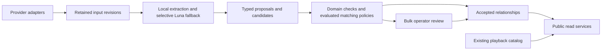

# Normalization contracts

Relisten normalization connects imported recordings to supported identities for venues, songs, compositions and people. Recording provenance in this release identifies tapers and transferrers across artists. Full capture/transfer ancestry and audio-family reconstruction are outside this release. The same services must work for Grateful Dead, Phish, mixed Archive collections and an artist with only file titles and recording notes.

This document specifies the complete implementation target. Input/work stores, provider capture adapters, canonical domain storage, reviewed identity metadata, deterministic extraction, cached Luna credit extraction, candidate retrieval, pair comparison and the read routes below are implemented locally. Reads remain disabled by default. The [implementation progress](../plans/active/2026-10-17-full-normalization/README.md#progress) records the latest local verification results. Automatic resolution, independent evaluation and backfill orchestration remain open. Read it with the [implementation plan](../plans/active/2026-10-17-full-normalization/README.md), the [provider retention audit](../research/2026-10-17-full-normalization/provider-evidence.md) and the evaluation set linked from that plan. The engineer implements these contracts; the reviewer/operator uses their invariants and failure outcomes to judge a backfill and release.

## Existing contracts to preserve

The catalog owns imported artists, shows, sources, source sets, tracks and provider references. Normalization owns additional identities and interpretations. It never rewrites imported wording to make a match appear stronger.

- [Show](../../RelistenApi/Models/Show.cs) represents one artist's engagement, with stable UUID, literal `display_date`, `performance_type` and optional label. Distinct same-day engagements have separate UUIDs. The original/default show keeps its UUID when sources move to an additional show. Unclear same-day assignment stays playable under the default/current show until evidence supports moving the source. Multiple sets within one engagement remain part of that show; each recording belongs to one performance.
- [Source](../../RelistenApi/Models/Source.cs) is a recording edition exposed for playback, not necessarily an original capture. Preserve source, set and track UUIDs, URLs, credits and collection membership when resolving identities. Moving a source to another show does not create a new recording or lose credits.
- [Venue](../../RelistenApi/Models/Venue.cs) and [SetlistSong](../../RelistenApi/Models/SetlistSong.cs) currently belong to an artist. Their IDs, UUIDs, slugs and legacy routes keep their meaning. Canonical venues and compositions require separate identities.
- [`setlist_songs_plays`](../../RelistenApi/Services/Data/SetlistShowService.cs) stores unique show/song membership. It cannot establish order, repeated occurrences, segues or timestamps. Do not manufacture those facts during migration.
- The [v3 show route](../../RelistenApi/Controllers/ShowsController.cs) returns existing playback objects. Existing artist/date links retain their selected original show. The same-day `/performances` route continues to list distinct shows.
- Metadata wins over an identifier-derived date where ingestion has established that policy. Partial and unknown dates remain partial and unknown. Normalization cannot infer an early/late split from a filename or failed audio comparison alone.

The October 17 production [schema receipt](../research/2026-10-17-full-normalization/evidence/catalog-schema.json) predates local performance migrations 16–17. Implement against the current checkout and rehearse that migration dependency before writing production normalization rows.

## Ownership and execution

PostgreSQL owns retained evidence, domain identities, decisions and checkpoints. Temporal schedules bounded work and retries activities. Redis can cache reads and candidate indexes; it cannot be the only copy of an accepted relationship or a paid extraction. The standalone ingestion worker requires its own configuration and dependencies; API host registration does not configure it.

Adapters retain input before lossy conversion. Extractors identify explicit text, order and provider IDs. Candidate retrieval finds possible identities. Domain resolvers decide which proposals a versioned policy may accept. Typed domain services apply operator decisions through `NormalizationWorkService`; `NormalizationReadService` joins accepted relationships to the current playable catalog. These responsibilities belong in cohesive classes per domain; a plugin framework is unnecessary.

New provider data, extractor revisions and match-policy revisions enter the same pipeline as the backfill. An artist-specific adapter can supply stronger evidence without owning a separate identity system.

## Implemented foundation

[`NormalizationEvidenceService`](../../RelistenApi/Services/Data/NormalizationEvidenceService.cs) retains exact inputs through migration 18. Read the resource generation before fetching upstream. Capture the completed response outside a catalog mutation transaction, and reuse its fetch UUID only for an exact retry. Every admitted fetch advances the resource generation, including unchanged bytes, to fence older responses. Equal payloads still reuse their immutable revision. Network failures remain the ingestion caller's responsibility.

[`NormalizationWorkService`](../../RelistenApi/Services/Data/NormalizationWorkService.cs) and migration 19 own durable read sets, publication fences and review receipts. `BeginWorkAsync` records the input/dependency state before extraction. Changing an existing policy or binding set requires the current configuration generation; obsolete workers cannot reinstall a prior configuration. Dependency changes reject cycles. `TryPublishAsync` rechecks the complete read set before invoking a typed domain writer in the same transaction. Callbacks must use the supplied connection/transaction, perform no network calls and preserve reviewed domain relationships/exclusions. The common store cannot infer those domain decisions.

Migrations 20–21 and `NormalizedPeopleService`, `NormalizedVenueService` and `NormalizedMusicService` own typed identities, assignments and correction history. Their writes enforce the subject scopes below. Global identities publish before relationships that consume them. Normalized readers use one read-only repeatable-read transaction on the primary, so a committed correction is visible without replica or cache lag. `Normalization:Reads:Enabled` defaults to false. Complete public evidence selection before activation: current credit reads return retained original wording and selected quotes verbatim, which may include contact details. No raw input payload is exposed. Typed identity-metadata commands now support reviewed assertion corrections and display-identity replacement; their contracts are specified below.

The [extraction tool](../../tools/RelistenNormalization/README.md) has separate local `extract` and paid `luna-credits` commands. Migration 22 retains complete-request cache entries, bounded attempts and per-job spend. A two-input [live connectivity receipt](../research/2026-10-17-full-normalization/scale/evidence/luna-connectivity.json) verifies Responses integration and cache replay without a key; it does not measure accuracy. `IdentityCandidateMatcher` supplies typed pair features and explainable rule proposals. No matching policy is active by default.

Migration 23 and `NormalizationCandidateService` add indexed candidate retrieval from accepted names, aliases and qualified provider IDs. Typed provider decoding and legacy recording seeds are implemented.

Migrations 24–25 add catalog revision clocks, mapping-registry invalidation and contributor-owned input sets. Recording/file binding covers legacy, Archive, Phish.in and joint Local inputs. V2 recording refresh and exact input-revision admission prevent older wording from acquiring newer publication fences.

Migration 26 adds immutable recording attempts and extraction checkpoints. `NormalizationRecordingProcessor.ProcessAsync` refreshes one stored recording, checks its complete evidence and catalog read set, and saves credit/title proposals under a separate extraction owner. It makes no accepted identity writes. The [recording-processing guide](../plans/active/2026-10-17-full-normalization/recording-processing.md) specifies replay, stale audit retention and failure behavior.

Migration 27 retains bounded recording page selections and classified failure receipts. `NormalizationRecordingPageService` runs stable attempts sequentially; the standalone worker exposes `--normalize-recordings=PAGE_UUID` without requiring Redis or Temporal. Exact replay preserves completed items, and only a settled page supplies a continuation. UUID paging requires later enrollment or reconciliation to establish complete catalog coverage.

Migration 28 extends provider-mapping invalidation to artist presence, UUID and MusicBrainz-ID changes. The [setlist-account binder](../plans/active/2026-10-17-full-normalization/setlist-binding.md) resolves artist, imported-setlist and existing-performance associations independently. Jerry, Setlist.fm and Phantasy Tour use global mapping qualification; Phish.net uses explicit artist scope and stored provider evidence. Missing playback context preserves retained passages. No binder accepts canonical identities.

Migration 29 adds retained imported-venue revisions, including artistless venues, and carries them through work admission, contributor ownership and publication. `NormalizationImportedCatalogService` retains complete venue and artist-dictionary facts with original producer revisions embedded in immutable inputs. Checked binding verifies the retained receipt and the full current projection before returning stored row UUIDs. See the [imported-catalog contract](../plans/active/2026-10-17-full-normalization/imported-catalog.md) for resources, limits, unknown facts, lock order and recovery. These inputs do not establish canonical venue, repertoire or composition identity.

Migration 30 adds [candidate-universe generations](../plans/active/2026-10-17-full-normalization/candidate-universes.md), including empty-result observations and per-artist repertoire. Typed writers declare their affected scopes before resources and owners are locked. Publication checks the original generations and acknowledges its own writes without rewriting the audit ticket. Current accepted rows and catalog ownership changes advance generations; immutable music history alone does not. The candidate-facts reader must still capture these generations with its selected identities and assertions in one primary snapshot.

Direct provider coordinators, negative-lookup retry registration, candidate-facts snapshots, convergent automatic writes, the multi-candidate resolver, independent evaluation and full backfill remain required.

[`NormalizationProviderInputService`](../../RelistenApi/Services/Data/NormalizationProviderInputService.cs) captures validated provider responses before legacy conversion and catalog transactions. `Normalization:Capture:Enabled` defaults to false independently of reads. All seven configured importers and Archive intake/discovery use this lifecycle; Phish.in adds a pre-request generation snapshot for stable per-show resources across changing pages. The [provider capture contract](../plans/active/2026-10-17-full-normalization/provider-capture.md) defines representation versions, keys, partial-page recovery and remaining refresh work. Capture fences admission, while later domain publication still requires the work-service read-set comparison.

[`NormalizationProviderDecoder`](../../RelistenApi/Services/Normalization/NormalizationProviderDecoder.cs) turns known retained representations into typed, cited observations without accepting identities or assigning catalog UUIDs. `RetainedRecordingCreditExtractor` preserves original coordinates through local grammar extraction.

`NormalizationLegacyInputService.SeedRecordingAsync` retains a bounded, consistent recording snapshot with zero-generation admission; it never refreshes an existing input. Its separate `RefreshRecordingAsync` method retains current v2 wording with producer catalog revisions. `BindRefreshedRecordingAsync` checks that exact receipt and those revisions before association lookup; see the [refresh contract](../plans/active/2026-10-17-full-normalization/catalog-refresh.md). The [decoding and seed contract](../plans/active/2026-10-17-full-normalization/provider-decoding.md) specifies their responsibilities.

The [catalog-binding contract](../plans/active/2026-10-17-full-normalization/catalog-binding.md) covers exact recording/file associations, artist and global identifier revisions, complete input contributions and publication lock order. The [Local binder](../plans/active/2026-10-17-full-normalization/local-binding.md) consumes root and directory inputs together and includes the mapping-registry revision. Pass each binding snapshot's complete `Inputs` as `expectedInputRevisions` at work admission, along with every catalog dependency.

Binding does not refresh retained wording or accept a normalized identity. Publication callbacks may read catalog rows but must not lock or change them; catalog mutation belongs in a separate phase.

## Shared evidence and decision contracts

### Identifiers and retained inputs

New public identity and relationship keys are UUIDs assigned once when first persisted. A name, slug, input hash or display label is not a public identity. Private integer keys are an implementation choice. Relationships between normalized entities use typed database foreign keys; do not implement domain relations as an unrestricted `(type, id, type, id)` graph. Catalog references retain typed UUID columns and validate live references when first bound. Do not add restrictive or cascading foreign keys from durable normalization history to deletable catalog rows: current source removal and artist rebuilds delete those rows. Reads join by UUID and mark absent catalog references unavailable. Reappearance under the same UUID reconnects history without creating a new identity.

`InputRevision` has `uuid`, provider/resource identity, media type, exact payload bytes or exact retained field representation, content SHA-256, capture version and first retention time. Fetch receipts separately retain fetch UUID, observed time, optional provider revision, expected/resource generations and admission outcome. Unchanged bytes reuse an immutable revision while preserving every fetch receipt. Provider/resource identity includes provider, resource type and provider key; an Archive item shared by collections is one resource. An existing observation can supply these bytes if its durable retention and locators meet this contract. Refer to it rather than copy the same payload per collection.

An initial snapshot of legacy source fields is valid evidence with origin `legacy_catalog`. It records the source UUID, field values and snapshot time. It must not claim to preserve discarded upstream arrays, order or fields. Later provider refreshes add revisions without replacing the snapshot.

Names remain nonunique. External identities are unique by entity domain, provider, provider resource type and provider key; a contradictory target is review work rather than an upsert that silently reassigns identity. Repertoire external identities also carry artist scope.

`NormalizedEvidenceReference` has `input_revision_uuid`, `json_pointer` and optional `start_code_point`, `end_code_point`, `quote`. JSON inputs use a JSON Pointer to the exact value, including array indexes. Retained HTML and plain text use an empty pointer to the whole decoded document. Text offsets count Unicode code points, with inclusive start and exclusive end, before normalization or HTML rendering. A validator must reproduce `quote` from that range. HTML entity decoding or DOM extraction must not supply offsets into the original document. Structured relationships cite the exact object/array entries rather than invent a text quote. Published evidence contains selected supporting excerpts, not entire private inputs or contact details.

[`NormalizationRetainedDocument`](../../RelistenApi/Services/Normalization/NormalizationRetainedDocument.cs) implements this read and validation contract for JSON (including `+json`), HTML and plain text. An explicit HTTP charset takes precedence; otherwise a byte-order mark selects the encoding, with UTF-8 as the default. Invalid encoded text, invalid JSON, unsupported media types and invalid locators fail validation without accepting a claim or returning provider content in the error. Decoding does not assign canonical identities or bind catalog playback objects.

### Proposals, acceptance and correction

A domain proposal has `uuid`, domain, typed proposed value/link, evidence references, input revisions, extraction version, matcher/policy version, candidate identities, reason code and state. States are `pending`, `accepted`, `rejected`, `superseded`. Ambiguity remains `pending` with reason `ambiguous_identity`, `conflicting_evidence`, `missing_evidence` or `unresolved_coverage`; it is not a processing failure.

Extraction and identity assignment are separate decisions. For example, a credit can accept the text and role “transferred by Pat” while its `person_uuid` remains null. A track can accept ordered title segments while occurrence alignment remains unresolved. A provisional song identity can be public with basis `title_derived`; it is not proof of a global composition.

The current accepted relationship has `uuid`, `revision`, basis (`provider_assertion`, `validated_match`, `reviewed`, `title_derived`), evidence and decision UUID. A domain record can have several supported assertions where values are nonexclusive. Mutually exclusive assignments, such as one credit's resolved person or one imported venue's canonical venue, have at most one current accepted value. Conflicting new evidence creates a proposal and leaves the last accepted value in use.

`ApplyDecision(operation_uuid, expected_revision, action, typed_payload, evidence, reason, operator)` is transactional. Supported actions are `accept`, `reject`, `replace`, `retract`, `merge` and `split`. The authenticated operator comes from the trusted command execution context, not a submitted display name. Reusing an operation UUID with identical content returns its original result; different content is a conflict. A stale expected revision returns a conflict without partial writes. Rejection retains a durable exclusion tied to the rejected claim and relevant input, so retries do not regenerate it as fresh review work. Changed evidence may create a distinct proposal.

`NormalizedPeopleService.ApplyMetadataDecisionAsync(PersonMetadataDecision, trustedOperator)` and `NormalizedVenueService.ApplyMetadataDecisionAsync(VenueMetadataDecision, trustedOperator)` change one identity-owned claim per command. The five assertion types are person aliases, person external identities, venue names, venue locations and venue external identities. Each assertion has a stable UUID, basis, revision, state and retained evidence. The commands also support an evidenced replacement of a person or venue display identity. They do not change recording credits or catalog venue assignments.

A metadata command supplies the operation UUID, original identity owner, expected editorial and entity revisions, action, reason and one typed claim. Existing assertions also require their expected assertion revision. `accept` can add a new assertion; `replace`, `reject` and `retract` require an existing assertion UUID. Accepted/replaced assertions become `accepted`; rejection records `rejected`, and retraction records `superseded`. These actions record reviewed authority and preserve the prior row in append-only history. Equivalent accepted copies under the same owner are superseded together, so another UUID cannot keep a retracted claim public. Later automatic publication cannot restore a reviewed exclusion or change reviewed metadata.

Acceptance or replacement must cite a retained revision whose resource is bound to the original owner's work inputs. The cited revision may be historical; review does not pretend it is the latest fetch. Evidence validation still reproduces its locator and excerpt. Assertions keep their original owner after a merge. A correction to a retired identity also locks and invalidates its current survivor, so consumers cannot publish against an unchanged survivor watermark. A concurrent redirect change produces a conflict; it does not retarget the prepared command. Exact operation replay uses its recorded owner set and changes no counters.

The decision ledger is append-only. Replacing/retracting a relationship records the prior value and reason; it does not delete evidence. A merge identifies survivor and retired identities, validates domain scope, installs a durable redirect and records each reassigned relationship. Redirects are acyclic. Repertoire merges require the same artist. Namesakes and contradictory provider identities block automatic merge. Similarity is not transitive identity proof.

A split creates new identities and explicitly lists the relationships to move. The original UUID remains with its retained meaning. It does not redirect to several targets. Reversing a mistaken merge uses its recorded moves and expected revisions, so later corrections cannot be silently undone. Recompute follows current redirects, retains reviewed decisions and exclusions, and proposes changes to reviewed relationships rather than overwriting them.

Each normalization subject (for example a recording's credits or an imported venue assignment) has a durable desired generation and current editorial revision. Every admitted input fetch atomically advances its resource generation. A subject retains the resource generations last published; a durable pending-work query finds changed resources without an eager fan-out job. Policy, input binding and editorial changes advance the subject generation. Dependencies retain their last consumed generation, editorial revision and published result; shared identity changes are pending wherever those watermarks differ. Never depend on Redis expiry or Temporal history to remember invalidation.

Typed writers also enforce the subject's ownership. The registry UUID identifies the work record; its domain, kind and entity UUID identify what that record may change:

| Domain and subject kind | Entity UUID and responsibility |
| --- | --- |
| `extractions / recording` | Source UUID; prepared evidence and local credit/title proposals. Completing extraction does not publish accepted relationships. |
| `people / recording` | Source UUID; that recording's credits. |
| `people / person` | Person UUID; the identity, aliases, external IDs and explicit corrections. |
| `venues / imported_venue` | Legacy venue UUID; its canonical assignment. |
| `venues / show` | Show UUID; its explicit venue assignment. |
| `venues / venue` | Canonical venue UUID; the identity, names, locations, external IDs and corrections. |
| `songs / artist_repertoire` | Artist UUID; repertoire, legacy song mappings and composition links. |
| `songs / setlist` | Edition UUID; that edition and its occurrences. |
| `songs / recording` | Source UUID; contents of files belonging to that recording. |
| `compositions / composition` | Composition UUID; the work and its role credits. |

A decision for one owner cannot edit another owner's relationships. Cross-owner ingestion publishes in phases: create people, venues, repertoire and works under their identity owners; retain those dependency revisions; then publish credits, assignments, editions or file contents. This keeps work bounded by recording or edition rather than repeatedly replacing a large artist's complete input set. Referencing another identity does not grant editorial authority over it. A stable file-content UUID cannot move to a different file.

Merge/split review declares all affected identity-owner registry UUIDs before taking locks. The shared review transaction locks that complete set in UUID order, applies the typed changes, records the extra owners in the audit ledger and advances every affected owner's editorial revision and desired generation once. This makes already-running consumers of a survivor stale too. Register a new split target's owner before applying the split; callbacks do not create or lock work subjects late. Typed review also compares both retired and survivor entity revisions. Reversal uses recorded moves and rejects later conflicting corrections.

An automatic run records the desired generation, editorial revision, exact current input revisions, policy version and dependency revisions it consumed. Publication compares that complete read set with the current state under a transaction. If anything changed, retain its extraction/proposals as historical results, do not make them current, and leave newer work pending. An older job cannot replace a newer result or an operator correction merely by finishing later. Checkpoints record a stale result separately from a successful current publication.

Accepted relationships and public queries use the same transactional current-state view initially; no asynchronously copied read model may lag a committed correction. Candidate indexes can lag, but revalidate returned candidates before acceptance. If a derived projection is introduced later, its publication must use the same generation comparison and durable invalidation contract. Relation details expose `evidence_status` as `current`, `changed` or `missing`: changed/missing supporting input does not silently remove the last accepted interpretation or pretend it was revalidated. Live catalog availability is checked independently.

Public correction submission is not introduced here. Operators use trusted worker commands and database-backed bulk decisions, consistent with the existing review workflow. User reports can be triaged into that workflow; public write APIs require a separate authentication and abuse-handling design.

### Extraction and acceptance

Local parsers handle explicit IDs, recognizable credit grammar and preserved ordering. Candidate retrieval uses aliases, names, locality, artist context and typed identifiers. The [evaluation strategy](../plans/active/2026-10-17-full-normalization/evaluation-strategy.md) requires training and comparing small identity matchers and credit-extraction models with rules and Luna-assisted processing. Deployment depends on measured generalization, accepted-match precision, coverage and cost; running the experiment does not require prior proof of benefit.

[`NormalizationCandidateService.FindAsync`](../../RelistenApi/Services/Data/NormalizationCandidateService.cs) retrieves candidates without accepting a match. `NormalizationCandidateQuery` selects a domain, names and provider-qualified identifiers; repertoire additionally requires one artist UUID. People, venues and compositions are global. Retrieval uses accepted aliases and provider IDs, resolves redirects and returns the current identity revision and owner subject from one primary database snapshot. Name similarity is a retrieval score, not a probability.

`NameLimit` caps returned name-derived identities. All qualified-identifier hits remain in the result even when that cap is reached. `NameCandidatesTruncated` reports incomplete name pools, including alias-heavy pools that collapse to fewer current identities. Equal-score candidates at a scan cutoff may vary between reads. A resolver must not assume that a truncated pool contains every alternative. These limits bound returned pools, not database work; catalog-scale query performance still needs measurement. A [local synthetic probe](../research/2026-10-17-full-normalization/scale/evidence/candidate-index-probe.json) checks index execution with tied names. After `BeginWorkAsync` captures the returned owners as dependencies, reload the matching facts before deciding; the earlier candidate snapshot does not authorize publication. Measure candidate recall separately from match precision.

The optional LLM extractor defaults to `gpt-6-luna`. Its request contains the necessary retained fields and available candidate IDs. Its response must satisfy a versioned schema with exact evidence references. Unknown candidate IDs, invalid excerpts and unsupported claims are rejected before a proposal can be accepted. Provider prose is untrusted data and cannot change extraction instructions or trigger tools.

A durable extraction cache key hashes the complete rendered request, including the exact relevant input, field/locator, candidate IDs and candidate context when supplied, model, prompt/schema/extractor version and generation settings. A changed candidate pool or corrected candidate description cannot reuse an answer based on the previous pool. Paid retries have a bounded attempt policy; successful cache results are committed before downstream matching and reused after downstream failures. A crash after provider success but before durable cache commit has an uncertain outcome; record that attempt, reserve its possible cost and apply bounded retries. Do not claim exactly-once billing or retry an uncertain attempt indefinitely. Persist token usage, request identifier and estimated cost per attempt. Budget exhaustion leaves work resumable with reason `budget_exhausted`; it does not lower match standards or repeatedly resend failed requests. A reviewed interpretation is durable decision data, not a cache entry.

Automatic acceptance is enabled per domain, evidence type and policy version after independent evaluation. Record candidate recall, accepted precision and review coverage separately. LLM confidence and fuzzy similarity scores are not calibrated probabilities. No numerical acceptance threshold or full-catalog acceptance rate is established by this contract; release policy must name measured targets and its evaluation receipt before enabling a rule. With no validated policy, explicit trustworthy provider assertions and reviewed decisions can publish; uncertain links remain unresolved.

Luna fallback routing is a versioned, evaluated policy. Compare it with local processing on the same inputs, including a stratified sample of apparent local successes, to detect confident local errors. Independently adjudicate sampled agreements and disagreements; Luna cannot supply its own ground truth. New artist/song identities alone do not require a call. Use task-specific evidence gaps and measured incremental gains to choose routing conditions. Missing factual evidence remains missing after a model call. Audit sampled local successes after launch to detect failures the router misses.

## Domain records and invariants

### Venues

`CanonicalVenue(uuid, display_name, kind)` is global. `kind` is `site` or `room`; a room may reference a parent site. Keep the room separate when evidence identifies a distinct performing space. A move to a different physical site creates another venue, even when the business name continues.

Venue name assertions contain wording, language when known, optional validity bounds and evidence. Location assertions contain original locality, optional structured country/region/city/address, coordinates, coordinate precision and evidence. Null date bounds mean unknown, not forever. City-center coordinates are locality evidence, not a verified building location. Equal names and coordinates alone cannot erase contradictory dates or locality.

`ImportedVenueAssignment(imported_venue_uuid, canonical_venue_uuid)` resolves each artist-scoped catalog venue without changing it. Provider-qualified external IDs and aliases belong to canonical identities with evidence. A legacy venue row with conflated rooms/sites cannot be assigned wholesale; retain a pending conflict and resolve individual show assertions first. `ShowVenueAssignment(show_uuid, canonical_venue_uuid)` supplies the effective venue only when a performance-specific correction is needed; otherwise use its accepted imported-venue assignment. Public normalized show results expose the effective result and basis.

### Repertoire, compositions and occurrences

`RepertoireSong(uuid, artist_uuid, display_title, basis)` belongs to exactly one catalog artist. `basis` is `provider_assertion`, `reviewed` or `title_derived`. New title-derived entries use the same schema and are included by default, labeled in responses. Names and aliases are nonunique. `ImportedSongAssignment(imported_song_uuid, repertoire_song_uuid)` preserves legacy song UUIDs and routes; several provider entries may resolve to one repertoire identity.

`Composition(uuid, display_title)` is global. `RepertoireComposition(repertoire_song_uuid, composition_uuid)` links a song interpretation to a work. Each simple repertoire song has at most one current accepted composition assignment. A combined title is segmented into component contents rather than creating an accidental compound work. Titles alone cannot establish a cross-artist composition. Different arrangements can share a work while retaining separate artist repertoire entries.

`WorkCredit(composition_uuid, role, original_text, person_uuid?, artist_uuid?)` has role `writer`, `composer`, `lyricist`, `arranger`, `cover_artist` or `original_performer`. Use `writer` when an input says only “written by”; do not invent a music/lyrics division. At most one resolved person/artist target is set per credit. Unresolved credit text is permitted. “Cover of Artist” supports a `cover_artist` assertion. It does not by itself establish the historically original performer or an authorship role. More specific arrangement/work relationships require separately evidenced proposals; they are not inferred from identical titles.

`SetlistEdition(uuid, artist_uuid, show_uuid?, literal_date, evidence, status)` describes one provider/source account of a performance. Retain artist, literal date and resource identity even when no supported show assignment exists. A nullable show UUID means unresolved engagement identity, not a separate performance object. Extend `ShowPerformanceService` with a recording-independent create/select operation for a supported setlist-only engagement; its current creation methods require a source. Preserve the artist mutation lock, stable performance key and existing UUID rules. Use a provider-qualified engagement identity or a reviewed performance key to create a new engagement; the date alone cannot establish an additional same-day show. Do not assign an ambiguous account to a particular early/late show merely to fill this field. A show can have several conflicting provider/source accounts. At most one assigned edition is selected for a show; unassigned editions cannot be selected. The edition artist must match its assigned show artist. Selection is explicit and does not union contradictory lists. Before agreement, readers can inspect editions without a selected one. An unordered legacy membership is an unordered edition, never an ordered canonical list.

`SongOccurrence(uuid, edition_uuid, position?, set_label?, kind, repertoire_song_uuid?, original_text, transition_after)` records each passage. `kind` is `song`, `jam`, `speech`, `nonmusic` or `unknown`. Ordered editions have unique positive positions; repeated songs have separate occurrence UUIDs. Unordered editions use null position and no invented sequence. `transition_after` is `segue`, `stop` or `unknown`. Unknown songs do not become a global “Unknown” identity. An occurrence may have nested component passages for an explicitly evidenced tease or quotation; each component references its parent and an ordered component position, without claiming a separate full song performance.

Occurrence UUIDs survive re-extraction through retained provider item identity or accepted correspondence. A changed position is not a new identity by itself. Replacing an erroneous passage records a superseding relationship; it does not silently recycle its UUID for unrelated music.

`TrackContent(uuid, source_track_uuid, position, kind, original_text, repertoire_song_uuid?, occurrence_uuid?, start_ms?, end_ms?, evidence)` describes ordered contents of a file. A segment can link to an occurrence only within its recording's current performance. A file may contain several songs or sets within that show; the release does not model one recording across different performances. Either time may be null; known bounds must be nonnegative, ordered and within a known file duration. Multiple files can cover one occurrence and one file can cover several occurrences. Contiguous coverage is not assumed. Titles permit song matching without occurrence alignment or timestamps. These partial results remain searchable. Current reads remove a stale occurrence link after a recording move or contradictory occurrence correction. Withdrawn repertoire targets become null in passage references. Stored decisions, original text and evidence remain available; these projection changes do not move or withhold audio.

### People and credits

`Person(uuid, display_name, kind)` is global, with `kind` `person` or `group`. A team can be a credited group without invented individual membership. Names and handles are aliases with evidence; usernames are provider-qualified. An unresolved mention need not create a global person. Cross-artist identity needs contextual support; matching “John,” initials or equal provider handles is insufficient.

`RecordingCredit(uuid, source_uuid, role, original_text, person_uuid?, scope_track_uuid?, evidence)` attaches a credit to the recording. A nullable track scope refines coverage; a track scope must belong to that source. Initial roles are `taper`, `transferrer`, `matrix_builder`, `mastering_engineer`, `recording_engineer`, `uploader`, `collector`, `musician` and `other`. Preserve an unfamiliar role's wording under `other`. Several people can hold one role, and one person can hold several roles. Deduplication uses accepted identity, role, recording and scope, not display text.

Source-level and explicitly track-scoped credits are included in person recording queries when their source linkage is supported. Return each source once, with all matching roles. Aadam collection membership and uploader identity do not establish a taper credit. Automatic taper/transferrer matching and cross-artist browsing are required release outcomes.

### Recording provenance scope

Retain source, description and lineage text as immutable evidence. Extract explicit taper/transferrer roles and resolve their global person identities with the same evaluated matching policies used for other credits. A collection, uploader name or equipment chain does not establish a taper. Preserve unresolved names and original wording when identity is uncertain.

The release does not create capture/transfer/matrix nodes or reconstruct audio ancestry. An explicit named conversion actor can support a transferrer credit without a complete chain. Other plainly stated recording roles may be retained with their wording; taper and transferrer search is the required outcome. Full lineage modeling can be considered separately if a listener need justifies it.

## Additive public read API

Use `/api/v3/normalization` to keep new global identities separate from legacy artist-scoped resources. Do not change existing v2/v3 JSON bodies or errors as part of this addition. New routes use snake_case JSON and UUID path IDs. The `/artists/{artist}` path accepts an existing artist UUID or slug. Query filters named `artist_uuid` accept UUIDs only; global entities use UUIDs only. The following types define new response fields; nullable fields are present and serialize as null.

Common `Entity` fields are `uuid`, `revision`, `updated_at`, `requested_uuid`, `redirect_uuid` and `aliases` (accepted strings). Venue/person responses use `display_name`; repertoire/composition responses use `display_title`. Those names follow the domain records, rather than exposing both display fields with potentially different values. Fetching a merged UUID returns HTTP 200 with the survivor's entity, `redirect_uuid` identifying the survivor and `requested_uuid` retaining the requested retired UUID. An unmerged fetch sets both redirect fields to null. A split's retained original remains directly addressable. Domain fields follow the records above; provider IDs, evidence excerpts and decision basis are returned on relation details, not injected into existing playback objects.

All list routes return `{items: [...], next_cursor: string|null}`. `limit` defaults to 50 and accepts 1–200. `q`, where supported, is a trimmed name/alias query of 2–200 Unicode code points. An omitted `q` lists identities; an empty supplied query is invalid. Search uses accepted aliases and display names, not pending candidate matches. Lists order by normalized display name then UUID unless specified below. Cursors are opaque, versioned and bound to route, parent ID, filters and order. Reject malformed/mismatched cursors with 400. Pages are live keyset reads, not snapshots; concurrent corrections can move results. Clients deduplicate by UUID when traversing changing data.

| Route below `/api/v3/normalization` | Result |
| --- | --- |
| `GET /venues?q=` and `/venues/{uuid}` | Page of canonical venue entities; detail includes kind, parent, supported names/location history and evidence references. |
| `GET /venues/{uuid}/shows?artist_uuid=` | Page of distinct show references for the effective canonical venue, including a room only when it is the queried venue; site queries do not silently include rooms. |
| `GET /artists/{artist}/songs?q=&basis=` | Page of repertoire entities with artist UUID, basis and nullable composition UUID. `basis` accepts the three repertoire values; omitted includes all. |
| `GET /songs/{uuid}` and `/songs/{uuid}/shows` | Repertoire detail with aliases, mapped legacy song UUIDs and accepted composition; distinct show references established by occurrences or accepted file contents. Show matches expose the evidence and association fields defined below, separate from the relationship decision basis. |
| `GET /compositions?q=` and `/compositions/{uuid}` | Page/detail of works; detail includes accepted role credits and repertoire links. |
| `GET /compositions/{uuid}/shows?artist_uuid=` | Distinct show references across accepted repertoire/work links, with the same evidence and association fields as song results. |
| `GET /people?q=` and `/people/{uuid}` | Page/detail of person or group identities and aliases. Names are not unique. |
| `GET /people/{uuid}/recordings?role=&artist_uuid=` | Page of distinct playable source references, with matching credit UUIDs and roles. `role` is one documented recording role; omitted includes all roles. |
| `GET /artists/{artist}/setlists` | Page of supported editions, including unassigned or setlist-only accounts, with nullable show UUID and literal date; order by literal date descending then edition UUID. |
| `GET /shows/{show_uuid}/setlists` | Page of editions with `selected` flag, `ordered` flag and evidence basis. |
| `GET /setlists/{edition_uuid}/occurrences` | Page ordered by position then UUID; unordered editions order only by UUID and advertise `ordered:false` in each occurrence's edition summary. Includes component passages. |
| `GET /tracks/{track_uuid}/contents` | Page ordered by segment position then UUID, including nullable times, repertoire/occurrence references and basis. |
| `GET /recordings/{source_uuid}/credits` | Page of resolved and unresolved accepted credits; null person UUID preserves unresolved original wording. |

A show reference is `{show_uuid, artist_uuid, display_date, performance_type, performance_label, match_evidence, association_kind, decision_basis}`. `match_evidence` is a nonempty array drawn from `ordered_setlist`, `unordered_membership`, `recording_metadata`, `file_title`, `imported_venue` and `show_venue`; union the supported values when deduplicating a show. `association_kind` is `performance_occurrence` when an accepted occurrence identifies this engagement, `recording_primary_show` when only the recording's catalog association supplies it, or `venue_assignment` for the effective canonical venue relationship.

Venue show queries use `show_venue` evidence for an explicit show override, otherwise `imported_venue` for the accepted imported-venue mapping. Song/composition queries use the four music evidence values; where both an occurrence and primary-recording association support the same show, return `performance_occurrence`. A `recording_primary_show` association preserves an uncertain recording's current assignment; it does not claim that an early/late assignment has been established. `decision_basis` is a nonempty array of the accepted relationship bases (`provider_assertion`, `validated_match`, `reviewed`, `title_derived`) supporting that result. Evidence origin and decision authority are separate fields.

Clients fetch `/api/v3/shows/{show_uuid}` for the current playback object. Show lists sort by literal catalog date descending then show UUID ascending, preserving partial dates as text. A recording reference uses the existing [CollectionRecording](../../RelistenApi/Models/Collection.cs) playback-reference fields plus `credit_uuids` and `roles`. Recording lists sort by literal date descending then source UUID ascending.

Every show/recording playback result has valid current playback joins, at least one playable file reference and no orphaned track claim. Music file-content matches stay within the recording's current show. An edition or occurrence alone does not establish playable audio. Setlist editions, occurrences and historical credits are evidence reads; they can exist without available audio and must not masquerade as playable results. This establishes catalog availability, not a successful remote audio fetch.

A missing entity/artist returns 404. An existing entity with no accepted relationships returns HTTP 200 and an empty page. Invalid filters, UUID syntax, limits or cursors return RFC Problem Details with HTTP 400 and stable extension `code=invalid_request`. Disabled normalized reads or unavailable database return 503 with `code=normalization_unavailable`; do not return false empty results. Merge redirects do not count as an HTTP redirect. New reads use `Cache-Control: no-store` initially, following the collection controller pattern; do not inherit the legacy 30-minute immutable response cache for editable relationships.

## Worker and review service contracts

The following method responsibilities are stable boundaries; exact C# names and file grouping can follow the repository conventions.

- `CaptureInputAsync(resource, payload, captureVersion, cancellation)` durably returns an input revision. Repeated equal content reuses the revision while retaining fetch history. A failed capture cannot advance the corresponding checkpoint.
- `ExtractAsync(inputRevision, domain, extractorVersion, cancellation)` returns typed proposals or a classified terminal/retryable failure. It never mutates an accepted relationship.
- `ResolveAsync(proposals, policyVersion, cancellation)` persists candidates and accepted/review decisions atomically per domain subject. Foreign keys, uniqueness, conflicting identities are checked in this transaction. It compares the consumed read set before publication, as specified above, and returns accepted, pending, rejected, stale and failed counts separately.
- `ApplyDecisionAsync(command, cancellation)` implements the revision/idempotency contract above. Trusted worker commands can bulk apply a list of commands; each returns its result. A bad item does not hide successfully committed decisions for other items.
- `ReadAsync(typedQuery, cancellation)` returns the public read contracts. It resolves redirects and accepted relationships and joins current catalog availability. It never invokes Luna or writes a speculative match during a GET.

A normalization job keys work by resource revision, domain and processing versions. Commit proposals/results and checkpoint advancement together. Retry transient provider/API/database failures with bounded attempts; record permanent unsupported input as such. Cancellation leaves committed work and the first uncommitted checkpoint resumable. Workflow completion reports partial failure and unresolved counts separately; a completed workflow does not imply a fully normalized catalog.

## Migration, release and contract verification

Add identities and relations in the `normalization` schema beside existing intake/collection tables; do not recreate that schema or attach normalization lifetime to a collection. Snapshot retained legacy fields, bridge imported venue/song UUIDs, and leave missing canonical assignments null. Rebuild normalized read indexes from accepted relationships. Never cascade deletion of a missing catalog source into retained evidence or identity history; mark its playback reference unavailable.

Separate write enablement from read enablement. Run shadow reads, compare existing playback identities/URLs, then enable new routes after measured domain evaluation. Rollback disables normalized reads and pauses workers; it keeps evidence and accepted/review history. The old API remains usable. Database restore rehearsal covers both catalog and normalization state before production migration/backfill.

Verify behavior through domain services and HTTP, including one taper across artists, different people with equal names, historical venue names/rooms, one composition across different artist titles, repeated songs, a medley in one file, unordered legacy membership, unresolved occurrence alignment, ambiguous same-day assignments, multiple sets within one show, explicit named taper/transfer roles and unparseable credit text. Exercise correction, replay, stale decisions, merge reversal, source moves, source disappearance, interrupted work, invalid Luna spans and budget exhaustion. Tests must demonstrate these relationships and recovery outcomes rather than search source files for route names or reproduce private matcher scores.

The labeled evaluation set provides observed claims and expected actions, including deliberate `unresolved` labels. It is development evidence, not independent proof that a tuned policy generalizes. Keep recording families together when separating development and holdout cases. Independently check holdout labels and report sample size, candidate recall, accepted precision and unresolved coverage by domain/provider before automatic acceptance is enabled. The release requires automatic matching for validated rules; provisional proposals alone do not satisfy it. Broader collection coverage and a numerical release target remain explicit work in the plan; this contract does not claim that the first examples establish them.
