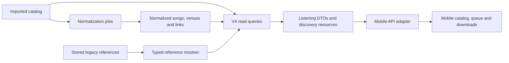

# V4 catalog API: normalized discovery and a mobile migration

Status: core approach and prefix vocabulary agreed, 2026-10-29. Full route
coverage is mapped; alias consolidation and embedded eras are approved.
Playable tracks use `track_`. Remaining endpoint details are listed in the route
tables for the planning handoff.

The [implementation plan](../../plans/active/2026-10-29-v4-api/README.md) now
resolves the remaining contract and migration choices. Its contracts take
precedence over exploratory proposals below: shared maintained catalog logic
with legacy API shims, payload-derived read revisions instead of a writer epoch,
exact normalized recording matches, simple exact-target merge favorites, and
direct resources/lists with HTTP ETags and endpoint-defined sync replacement
instead of generic response metadata. The later account decision also changes
`/v1/library` in place and uses canonical stored typed strings for account/auth
identities, with coordinated tester re-sign-in.
Start with the plan's [five review checkpoints](../../plans/active/2026-10-29-v4-api/review-guide.md):
running API responses, isolated account/auth, mobile pilot, complete API and full
mobile acceptance. The implementation plan is authoritative; this design retains
the exploration and its reasoning.

Later C1 feedback names canonical public resources `venue` and `song` and removes
`venue_display`. The 2026-10-30 decision supersedes the timeline proposals below:
show UI displays imported venue labels and links to canonical venues when present.
Venue `names` contains `{ name, kind }` aliases without dates. See the
authoritative plan contracts for the current response shape.

## Agreed approach

The v4 API preserves artist → show → source → playable track as the
listening model. Dedicated v4 responses add normalized venues and ordered song
parts on every returned track. Public IDs are typed strings; their encoding
does not decide what an entity means. An explicit resolver connects existing mobile records to v4.

We chose this approach because Switz's normalization already links
to existing shows and tracks. A new event or performance model would require
identities and relationships that normalization does not yet provide.

Confirmed readers: Alec and Switz, implementing the API and mobile migration.
Alec decides. Both know Relisten; this document must explain normalization and
migration contracts. Alec accepts data migration where it reduces complexity
across the whole change and does not see a reason for navigation redesign.
The ID choice is confirmed: retain short normalized IDs and losslessly wrap
legacy UUIDs. Unmatched venues retain imported labels. Track playback keeps
the imported title; every track also carries its available normalization
information, including ordered parts and normalized song details. Add a shared
normalized venue table alongside existing artist-specific venue rows, and
prefer normalized metadata where available. Artist venue lists group aliases
into one normalized place. Global
normalized venue favorites must ship in the first release and cover all artists.
Existing favorites are private-alpha data: a breaking favorite contract is
acceptable. Keep imported favorite scope where convenient; elaborate compatibility
or promotion machinery is unnecessary. Detailed implementation choices remain
for planning; the approach is agreed.

See [contract sketches and example journeys](contracts.md) for show/venue
ownership, grouped lists, C# ID types, playable song results, and recovery.
The [full route coverage proposal](routes.md) accounts for every current API
and account/auth registration. The [prefix table](prefixes.md) and its
[visual review](prefix-review.html) record the approved vocabulary.

The next step is the plan's first running HTTP review against the mapped route
coverage and approved prefix vocabulary. Track interpretation metadata lives entirely under
`normalization: { state, parts }`.

## Evidence and current behavior

Inspected API checkout: `3fb0e0f`, including Switz's `c293478` / PR #107.
Mobile inspection is of the current sibling checkout, not a released binary.
Production schema and coverage were not verified: the local Kubernetes config
does not contain the documented `relisten3` context. Discord's production
counts are reports from the discussion, not measurements from this investigation.

- The [Discord discussion](https://discord.com/channels/395033814008594436/466023446590259220/1565221446928830586)
  asks for conceptual mobile compatibility and allows physical remapping.
  The [v4 handoff](https://discord.com/channels/395033814008594436/466023446590259220/1565436294375673879)
  explicitly joins normalized reads and prefixed IDs.
- Switz's IDs are `venue_` or `song_` plus eight random lowercase Crockford
  characters. C# already has `VenueId`, `SongId`, Dapper handlers, and
  System.Text.Json converters. These are custom prefixed IDs, distinct from
  standard TypeID. See [NormIds.cs](../../../Relisten.Normalization/NormIds.cs).
- Normalized songs are artist-scoped; normalized venues are global physical
  sites or rooms. Shows and tracks still have legacy UUID identities. The
  authoritative show-specific venue link is `norm.show_venues`, including
  corrections to a shared legacy venue. See [schema 013](../../../Relisten.Normalization/Sql/013_norm.sql)
  and [migration 014](../../../Relisten.Normalization/Sql/014_norm_ids.sql).
- Track parts have mutable `(track_uuid, part)` keys. They can describe a song,
  unresolved content, or non-song content. They do not establish audio offsets.
  See [track writes](../../../Relisten.Normalization/NormStore.cs) and schema 013.
- Public catalog controllers currently read legacy services. Normalization's
  working-set loaders are writer/matcher machinery; v4 needs focused read queries.
- API MVC uses Newtonsoft, while the new ID converters use System.Text.Json.
  Existing converters alone do not establish v4 string serialization. See
  [Startup.cs](../../../RelistenApi/Startup.cs) and NormIds.cs.
- Venue cleanup can delete internally unreferenced machine venues. External
  bookmarks are not considered. See [RetireEmptyVenuesAsync](../../../Relisten.Normalization/NormStore.Venues.cs).
- Mobile stores catalog keys as strings, but favorite sync validates UUID
  syntax. Account favorites use `Guid` identities on the server. Download
  filenames use track UUID text. Changing ID text therefore needs coordination.
  See [mobile/server evidence](evidence.md).
- Mobile venues require artist ownership. A global venue needs a separate
  artist association or an adapter. Mobile refresh also depends on increasing
  `updated_at`, so source timestamps alone cannot represent normalization edits.

## Shared foundations

Keep ingestion and playback independent of normalization availability. Missing
normalization must leave a playable imported track visible. Public readers
must distinguish missing interpretation, unresolved parts, and resolved
non-song content. Do not expose model confidence as a promise of correctness.

The existing migration defines `features.norm_catalogue` as the per-artist
approved-read switch and `norm_venues` as the write-maintenance switch. V4 should
honor that intended read rollout unless the release explicitly changes it.
Rows present in `norm` do not by themselves establish approval for display.
Whether future domains need their own read switches can wait for rollout planning.

Keep raw imported labels available separately from normalized display values.
Resolve venue names for the show date; a venue's current name is a different
field. Follow merge survivors. Reserve different prefixes for imported venue
identities and normalized venues if both become public resources.

Keep normalized parts as track metadata. A future composition, person, event,
or timed occurrence gets its own resource and relationships. Artist-scoped
`song` must not silently become a global composition later.

Use endpoint-specific DTOs, typed C# IDs, explicit route parsing, string JSON
serialization, and OpenAPI string schemas. Keep UUID storage for existing
catalog rows unless another requirement justifies a database migration.

## Options

### A. Listening resources with normalized metadata — chosen approach

Proposed public reads:

```text
GET /api/v4/artists/{artistId}/shows
GET /api/v4/shows/{showId}
GET /api/v4/sources/{sourceId}
GET /api/v4/artists/{artistId}/songs
GET /api/v4/songs/{songId}/tracks
GET /api/v4/venues/{venueId}
GET /api/v4/venues/{venueId}/shows?artist_id=...
POST /api/v4/catalog/resolve
```

These examples are only an introduction. The complete current-route inventory
and [v4 coverage contract](routes.md) must be reviewed before planning.

Proposed response concepts:

```text
Show: id, artist_id, date, venue?, imported_venue, sources, revision
Venue: id, current_name, parent_id?, geography
ShowVenue: venue_id, name_on_show_date
ArtistVenue: artist_id, venue_id, show_count
Track: id, source_id, title, playback, normalization: { state, parts }, revision
TrackPart: ordinal, text, song?, state, qualifiers, notes, segue_after
```

Every v4 response that returns track objects includes the same normalization
contract, including nested source tracks and tracks returned by discovery or
catalog resolution. Return compact normalized song details with matched parts
so mobile does not need one lookup per part. Missing normalization is explicit;
it must not look like an omitted field that the client forgot to fetch. See
[track examples](contracts.md#track-normalization-and-song-discovery).

`TrackPart.state` distinguishes matched, unresolved, and non-song content.
Track-level normalization distinguishes no interpretation from a completed or
partial interpretation. State names and the stale-result policy need design;
the API must not promise freshness that current writer metadata cannot prove.



The API owns joins and public semantics. Normalization owns interpretations and
corrections. Mobile owns its local migration and presentation adapter. Reads
do not invoke model calls or start workflows.

Tradeoff: this keeps today's show grouping and source selection. It cannot
promise distinct same-day events or setlist-only events without additional
modeling. Its benefit is a direct mapping to current listening data.

### B. Normalized events and performances as the primary API

Public resources would center on events, artist performances, recordings,
occurrences, and media tracks. Mobile would navigate event → performance →
recording and translate existing show/source references into that hierarchy.

This can represent multiple performances on one date and events without
recordings. It requires durable event/performance identities, explicit source
assignment, merge/split rules, and an ambiguous-migration policy. Track parts
cannot supply occurrence identity or timestamps. The current normalized tables
do not implement this model.

Choose this if distinguishing those events is a first-release requirement and
a larger mobile schema/navigation migration is acceptable. Otherwise it delays
normalized reads to solve a different, larger identity problem.

### C. Discovery-only v4 beside existing listening APIs

Expose normalized song/venue lists and track/show associations; leave mobile
listening responses on v3. Results carry legacy track/show references so mobile
can open existing playback screens. Canonical discovery resources still need
public merge and retirement behavior.

This is the smallest first delivery, but clients combine API generations and
the account identity migration remains unfinished. Choose it if the immediate
goal is to explore normalized data before committing to v4 listening contracts.

## ID format is a separate choice

The [TypeID specification](https://github.com/jetify-com/typeid/blob/main/spec/README.md)
uses a prefix and 26-character, 128-bit suffix. It requires new IDs to encode
UUIDv7 and recommends allowing supplied UUID variants. Switz's eight-character
IDs intentionally use a different encoding.

Confirmed direction: retain existing normalized IDs and losslessly encode
legacy 128-bit catalog values with entity prefixes. Describe this as a typed
ID family, unless standard TypeID compatibility is chosen explicitly. Do not
truncate, hash again, or mint replacements for existing playback identities.
If standard TypeID everywhere is required, migrate normalized IDs with durable
old-to-new aliases before public release. The retained normalized `retired_uuid`
is an old normalized identity, not a mapping from imported song/venue UUIDs.

The [C# encoding probe](experiments/README.md) passed all nine published valid
TypeID vectors and 10,000 arbitrary 128-bit round trips. It also demonstrates
the default Guid byte-order difference. This proves a compatible suffix encoding
is feasible without changing legacy bits; it does not qualify a library,
serializer, or complete public ID contract. Package choice can wait for planning.

## Mobile and account migration contract

For existing artists, shows, sources, sets, and tracks, encoding can be one to
one and reversible. Imported songs map through `norm.song_evidence`. Imported
venues map through evidence, but show-specific venue corrections mean a global
old-venue-to-new-venue rewrite can be wrong. Unmapped references remain explicit.

Proposed resolver input is a typed reference with its identifier scheme and
optional context. Its per-item result distinguishes resolved, redirected,
unmapped, ambiguous, and unavailable. It returns canonical identities and
enough legacy reference data to preserve local relationships. Malformed IDs
are request errors; missing catalog data must not erase favorite membership.
Keep the existing bounded batch approach rather than issuing one request per
favorite. See [current resolver contract](../../../RelistenApi/Models/Api/CatalogResolveRequest.cs).

Mobile may initially keep legacy keys for playable entities and map v4 IDs at
the API adapter. If it rewrites Realm primary keys, migrate every relationship,
queue entry, history record, favorite/outbox reference, and download lookup.
Preserve offline files with an alias lookup or explicit file migration.

Account favorites currently use Guid. Evolve the private-alpha library contract
and persistence to typed string catalog targets in this release. Update favorites,
mutation receipts, change records, uniqueness constraints, and mobile validators
and outbox together. Favorite and mutation IDs remain independent UUIDv7 values.
Alec permits breaking alpha favorite compatibility: a v1 read projection,
dual transports for old pending outboxes, and cross-version receipt replay are
not release requirements. See [account contract](contracts.md#favorites-and-legacy-reference-resolution).
Public v2/v3 catalog listening APIs remain available; breaking private favorite
sync does not require breaking released catalog readers.

Global venues should have one canonical resource and separate artist-specific
counts/associations. Two local storage choices remain under consideration:

- Replace mobile's artist-owned venue model with shared `Venue` and
  `ArtistVenue {artistId, venueId, showCount}`.
- Keep imported artist-owned `Venue` rows and add `NormalizedVenue`, with
  show-specific normalized links. Display prefers normalized metadata and
  falls back to imported metadata. Existing references can keep their meaning.

The second choice reflects Alec's proposed direction. It differs from copying
normalized names into every imported venue row: shared metadata stays in one
table. It is the agreed direction for this migration. The overlay supports first-release global favorites directly through
`NormalizedVenue`. Full replacement becomes more attractive if canonical-only
storage is required and imported rows no longer need to remain locally.

Grouped canonical browsing needs a server-computed artist list/count projection:

```text
ArtistVenueBrowseEntry {
    reference: canonical venue | imported venue fallback,
    showCount,
    displayMetadata
}
group by: normalizedVenueId when present, otherwise importedVenueId
count: distinct shows for the requested artist
```

The normalized link belongs to each show. Do not assume one imported venue
always maps to one canonical venue, or add imported venue counts together.
Mobile caches only part of the catalog, so local show counts are incomplete.
Preserving offline grouped lists needs a cached browse-entry model, keyed locally
by artist, reference kind, and reference ID. That key identifies a query result,
not a new public venue. A persistent domain `ArtistVenue` is optional; the cached
list state is not optional if grouped browsing must work offline.

Existing screens can consume an artist-venue view; navigation need not change.
Artist-scoped canonical venue detail queries must filter both artist and
canonical venue, since the current local query filters only venue. Global
venue detail and global favorites span artists.

Existing venue favorites may continue to target imported venue rows. A grouped
canonical browse row must not silently select one imported row as its favorite
target. New global-venue favorites are required in this release and use canonical
identity across all artists. Existing artist-specific favorites can retain
their scope, but they are internal testing data and do not justify a complex
migration. The normalized overlay does not remove the required account contract
work.

**Superseded on 2026-10-30:** the following historical-name proposal is retained
for exploration context. Show UI now uses the imported label and canonical link.

Shows also need their own venue display name, resolved for the show date.
Current cards read `show.venue.name`; a shared canonical current name cannot
supply different historical names for different shows. Canonical identity
controls grouping/navigation; show-specific labels control historical display.

## Failure, change, and recovery

- Unnormalized records remain visible with imported labels. A matcher outage
  does not make the catalog or playback unavailable.
- Merges resolve old IDs to the survivor. Splits need contextual resolution or
  an ambiguous result; never pick an arbitrary survivor.
- Published IDs need retention, tombstones, or redirects. Current venue
  retirement must change before external references depend on those IDs.
- API revisions and cache invalidation must cover normalization edits, merges,
  removals, and changed counts. Taking a maximum source timestamp alone misses
  deletions. Mobile must receive a revision it actually uses to refresh rows.
- Read a response from a consistent database snapshot. Do not join partial
  statements from different normalization revisions without defining the result.

### Read revision and collection completeness

The proposed minimum is one durable normalization epoch advanced transactionally
with API-visible normalization changes, once near commit. Derived track/show
link changes are deliberately absent from `norm.changes`, so the change-log
maximum cannot serve as this epoch. Surviving-row timestamp maxima also miss
deletions. Cover human edits and reverts as well as matcher writes.

Read the epoch and DTOs from the same database snapshot. Combine normalization
revision with raw-catalog freshness for cache identity and ETags. Add an explicit
mobile refresh contract; preserve `updated_at` as data metadata rather than
inventing timestamps from response time. Opaque ETags support equality, not
ordering. Planning must choose ordered snapshot generations or request-generation
guards with server revalidation to prevent older responses overwriting newer
state, including responses from lagging replicas.

A global epoch costs extra cache churn and briefly serializes updates. Scope it
further only if measurements justify that complexity. It describes committed
read state, not completion of an entire multi-transaction normalization workflow.
Renames and rematching can still become visible in separate transactions.

Mobile's existing collection upsert tombstones rows omitted from a response.
V4 must distinguish a complete artist collection from a page or entity patch.
Only a complete, successfully fetched collection may hide missing associations.
Completeness is scoped to the exact artist/filter and one declared revision.
For pagination, use a stable revision/cursor or restart when revision changes;
fetching every page across changing revisions is insufficient for replacement.
No delta-feed system is required to establish this contract.

## Decision and planning handoff

Adopt the normalized overlay: dedicated v4 DTOs/read queries; short canonical
IDs plus losslessly wrapped legacy IDs; imported mobile venue rows plus shared
normalized rows and show-specific links; grouped artist venue browsing;
unchanged imported track titles with normalization information on every returned
track; first-release global venue favorites through
a breaking typed-target alpha account contract. Keep listening navigation and
playable file identity. Alec agreed to this direction with the explicit addition
that normalization information belongs on each track.

The competing replacement model removes more legacy local state but requires
more relationship migration. It does not eliminate the need for server counts,
fallback handling, favorite target kinds, or API freshness. The overlay better
fits the requirement to retain imports and prefer shared normalized metadata.

Planning still needs to resolve:

- C# codec/converters, OpenAPI, and final field details within the approved
  route and prefix contract. The coverage inventory and prefix approval are complete.
- Read revisions, replica behavior, cache keys, pagination and complete collections.
- Historical venue display policy and handling of unmatched song-list entries.
- Canonical venue merge/remove behavior in favorites and public ID retention.
- The private-alpha account schema migration/reset policy and mobile outbox bootstrap.
- Whether mobile keeps legacy playable keys behind an adapter or rewrites them;
  preserve downloads, queue and history whichever representation it uses.
- Query indexes, representative query costs, migration checkpoints and rollout order.

Required implementation checks include a normal listening journey, partial
normalization, canonical merge resolution, interrupted mobile migration,
offline playback, grouped list replacement and global favorite mutation/sync
replay. These are planning requirements, not claims of existing verification.
The codec probe and document review are complete; runtime API/mobile behavior
has not been implemented or release-tested.
