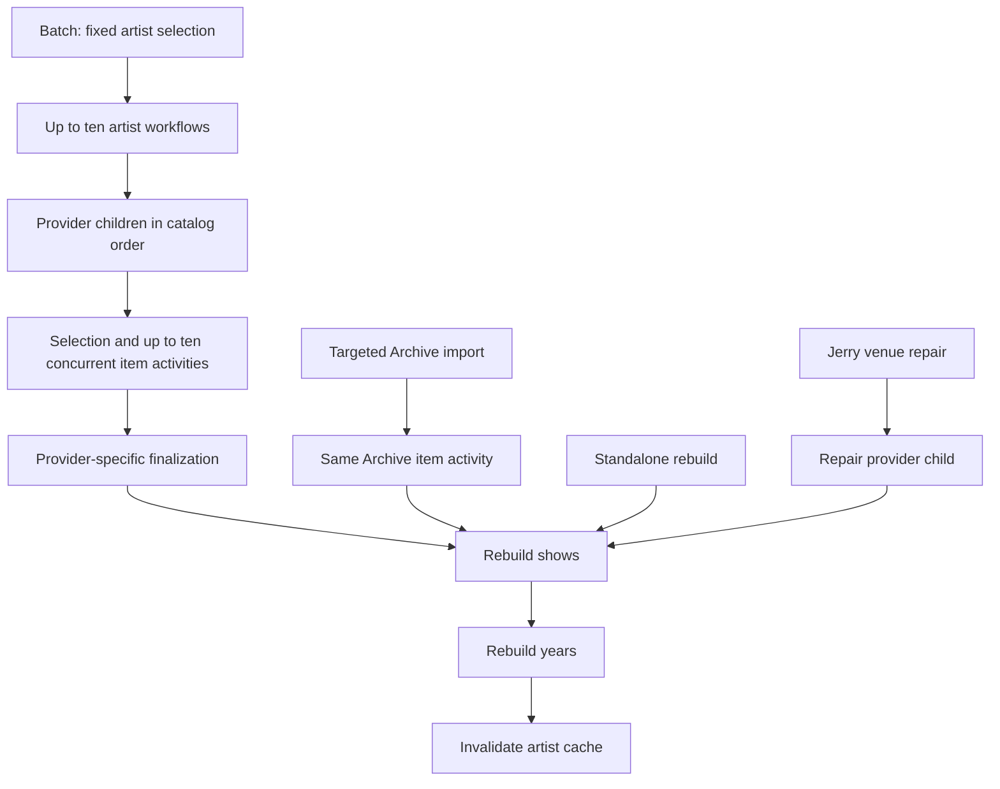

# Catalog ingestion

Relisten imports recordings and setlists from upstream providers into PostgreSQL.
`RelistenIngestionWorker` runs those imports separately from the listener API.
Temporal records execution progress so unfinished work can resume after a worker
restart. Hangfire continues to run cache and popularity jobs.

This guide explains the architecture and contracts for engineers who know the
Relisten app but may be new to its ingestion stack. Use [operations](operations.md)
for commands, deployment, diagnostics, and recovery; use [provider behavior](providers.md)
for selection, finalization, and deletion rules. [Local development](../../local-dev/README.md)
covers the checked-in sample catalog and isolated tests.

## How an import runs

A **workflow** records orchestration decisions and completed steps. An **activity**
does network or database work that Temporal can retry. Workflow code must remain
deterministic; HTTP, SQL, and external reporting belong outside workflow code.

The diagram shows successful execution. Item failures can produce partial results;
provider failure and cancellation have different rebuild rules, described below.

An artist workflow runs enabled provider mappings in catalog order. Phish.in must
precede Phish.net because Phish.net enriches its recordings. Providers select or
page through their own items, process them, and perform their own finalization.
Only the artist coordinator schedules the final show/year/cache rebuild.

The catalog is a rebuildable upstream cache. A changing upstream page or an
occasional missed item can be repaired by a later sync. Stable identities, atomic
compound writes, and conservative deletion checks matter more than an exact
snapshot or exact first-attempt mutation counts. Frequent refreshes are preferable
to a separate progress journal or commit-receipt system.

## Responsibilities and code map

| Component | Responsibility and entry points |
| --- | --- |
| API and CLI | Preserve authentication and response shapes; resolve artist IDs/slugs; construct [named commands](../../RelistenApi/Services/Ingestion/ImportCommands.cs). |
| Temporal client | Admission, schedules, and [execution-bound handles](../../RelistenApi/Services/Ingestion/ImportHandle.cs), implemented by [TemporalIngestionClient](../../RelistenApi/Services/Ingestion/TemporalIngestionClient.cs). |
| Artist and batch workflows | Provider order, artist exclusivity, bounded children, summaries, and final rebuilds: [ArtistRefreshWorkflow](../../RelistenApi/Services/Ingestion/Workflows/ArtistRefreshWorkflow.cs) and [RefreshBatchWorkflow](../../RelistenApi/Services/Ingestion/Workflows/RefreshBatchWorkflow.cs). |
| Provider workflows and activities | Provider selection, typed checkpoints, parsing, item processing, and finalization. See [providers](providers.md). [ProviderActivityRunner](../../RelistenApi/Services/Ingestion/ProviderActivityRunner.cs) supplies a fresh importer, diagnostics, and heartbeat lifetime per attempt. |
| Catalog data services | Current-state reads, identity formulas, conflict resolution, dependent rows, and deletions. [CatalogImportTransaction](../../RelistenApi/Services/Data/CatalogImportTransaction.cs) owns item transactions; [CatalogRebuildService](../../RelistenApi/Services/Data/CatalogRebuildService.cs) owns derived catalog rebuilds. |
| Temporal and payload Redis | Temporal owns execution history. [RedisPayloadCodec](../../RelistenApi/Services/Ingestion/Transport/RedisPayloadCodec.cs) retains exact oversized payload bytes; neither store owns catalog rows. |

## Requests, admission, and results

Commands use the catalog artist UUID. API and CLI adapters resolve numeric IDs or
slugs through `ArtistService`. Callers request a named operation; they do not
supply checkpoints, execution deadlines, or payload references. Targeted Archive
imports, standalone rebuilds, and Jerry venue repairs have distinct commands.

Every artist operation uses workflow ID `ingest/artist/{canonical-uuid}`. Temporal
rejects an overlapping start with `ImportAlreadyRunning`, including the active
workflow ID. The caller cannot treat a running refresh as satisfying a newly
requested targeted import or rebuild. A finished workflow ID can be reused.
Batch callers count conflicts separately and continue. An ambiguous start error
remains an error; a retry may find that the first start succeeded and report a
conflict.

`ImportHandle<TResult>` retains the admitted execution chain. Its result follows
continuations; cancellation cannot affect a later independent operation that
reused the workflow ID. Description follows recorded continuation links rather
than selecting the latest execution by ID. Missing or expired history is reported
explicitly. The CLI's ID-only cancellation command intentionally targets the
current execution instead.

An item result contains its typed upstream key and catalog source or setlist
identity. A derived show identity is available after rebuilding. `Applied` means
processing succeeded; it does not count inserted or changed rows. `Unchanged`
means an existing identity met the provider's timestamp/content rule. Supported
skips have provider-specific reasons. Transport errors and malformed required
listings are failures, not skips.

[Result contracts](../../RelistenApi/Services/Ingestion/IngestionContracts.cs)
count completed items (`Applied` plus `Unchanged`), skipped items, and failed
items. Provider summaries retain at most 20 structured failure details alongside
the full failure count. A completed artist is `Partial` if an item failed. Batches
count completed, partial, failed, and conflicting artists separately. Temporal
execution status alone therefore does not establish a successful import.

### Serialization

Temporal uses System.Text.Json; existing upstream parsers use Newtonsoft.Json.
Their attributes are independent. Inputs must round-trip through the actual
Temporal converter without running computed getters or losing optional fields.
Provider wire values such as `archive.org` and `phish.in` remain stable strings;
numeric upstream keys remain numbers, and Local's date key remains a string
without timezone conversion. Key wrappers use a `Value` property.

Request variants use closed `kind` discriminators registered in the contract
types. Unknown variants fail deserialization; arbitrary CLR type names are not
accepted. Page `Next == null` ends enumeration. An empty page with a non-null
cursor does not. Keep distinct provider cursors and item results rather than
adding a generic string-key protocol. Source definitions are in
[ImportCommands](../../RelistenApi/Services/Ingestion/ImportCommands.cs),
[IngestionContracts](../../RelistenApi/Services/Ingestion/IngestionContracts.cs),
and each provider's contracts linked in [providers](providers.md).

## Writes, retries, and failure recovery

Item activities fetch HTTP inputs before entering a ReadCommitted catalog
transaction, then reload mutable state and call data services sequentially.
Different items can write concurrently. Existing unique constraints and conflict
handling preserve identities; there is no artist-wide item lock. Do not use
`Task.WhenAll` or concurrent SQL connections inside one ambient transaction:
sequential connection wrappers reuse the enlisted Npgsql connection.

Source UUIDs retain the existing artist/upstream-identifier formula; track UUIDs
retain artist/MP3-URL identity. Source-set UUIDs retain their source UUID, V1/V2
namespace, and set index. Setlist writes resolve the existing artist/key
identity before writing performances. Venue and tour creation resolve both UUID
and natural-key conflicts by reading the winning row. Data services own these
rules, not workflows or ad hoc activity SQL.

Deadlocks and serialization failures retry the whole activity with fresh HTTP
inputs, importer state, and a new transaction. Retrying only SQL against stale
importer dictionaries is unsafe. Phish.net locks only the source being enriched.
Archive collection indexing has a separate global lock for artist/slug allocation;
it is not a show-write lock. Archive discovery records a validated collection
page before applying it in a separate transaction. Applying that fixed page
creates each artist and upstream mapping together; a retry finds the mapping
and avoids another artist. A non-advancing cursor or a listing ending before its
declared total fails discovery. See [provider rules](providers.md) for item writes.

An exhausted item failure increments the failure count and allows other items to
continue. Empty and partial imports still rebuild. Ordinary provider failure
triggers a rebuild of committed data before propagating the failure. Failed
artist preparation, cancellation, and expiry do not start a recovery rebuild.
Provider cleanup still requires its own evidence; a final artist rebuild does
not authorize deletion. A failed rebuild fails the operation.

Show rebuild, year rebuild, and cache invalidation run in that order as three
activities, not one transaction. Rebuild SQL owns its transactions and can commit
some derived work before a later step fails. Repeating it must converge. A fresh
import or standalone rebuild repairs derived data left by an interrupted run.

Stored normalized artist/venue counts follow the same eventual-refresh model.
Source-table triggers mark affected artists; activities attempt a best-effort
refresh after catalog or normalization work. A minute schedule retries pending
artists, and daily reconciliation repairs missed marks. Count refresh failures do
not fail an otherwise completed import, and counts can briefly differ from the
current show list. Queue acknowledgment and refreshed counts commit together.
See the [artist venue foundation plan](../plans/active/2026-10-30-artist-venues/README.md)
for identity, merge, and recovery contracts. Existing import workflow command
order and provider deletion rules are unchanged.

Activities heartbeat through HTTP and database waits. Transactions check the
token and inherited deadline before writes and before commit. Dapper calls have
bounded SQL timeouts but do not all support immediate cancellation. Cancellation
does not undo committed items; stop old writers before handing ownership to a
different ingestion engine.

## Durable progress and payloads

An operation receives one logical execution ID and a seven-day deadline from its
initial server admission, including queue time. Child workflows and continuation
runs inherit the remaining deadline. The logical ID is diagnostic context, not a
catalog key. Continuing does not give work another seven days.

Fixed selections advance only after all admitted items in a segment finish.
Paged providers finish a page before advancing its cursor or finalizing. A worker
restart replays the recorded page; a continuation carries the next cursor,
counters, and required cleanup evidence. Consider continuation after 100 completed
activity calls or when Temporal recommends it; a paged run can exceed that bound
by one page. Batches drain active children before a 250-artist segment boundary or
recommended continuation. No continuation abandons live children or activities.

Keep immutable selections and prerequisite catalogs separate from changing
progress arguments so the codec can reuse their serialized bytes. A batch selects
artist UUIDs once and fixes a thin import's filter year in UTC once, preserving
both across continuation. Do not reselect from a changing catalog during rollover.

Clients, workers, and replay tools must use the same converter, namespace, and
payload store. Complete protobuf payloads of at most 32 KiB stay inline; larger
values up to 64 MiB go to Redis with metadata intact. Oversized values are
rejected, not truncated or split silently.

The Redis protocol uses encoding `binary/relisten-redis-v1`, a JSON reference with
`version`, `key`, `length`, and `sha256`, and keys under
`relisten:temporal:<escaped-namespace>:payload:v1:<sha256>`. Hashes cover complete
protobuf bytes. Encoding stores the bytes and refreshes the 15-day expiry before
returning a reference. Identical bytes share a key; changing counters must not
force another copy of an unchanged selection.

Decoding validates the version, namespace, bounded length, and digest before
reconstructing the payload. Unrelated encodings pass through; nested references,
missing bytes, and corrupt or unsupported references fail explicitly. Decoding
does not refresh expiry or fetch replacement upstream data: new inputs would
change replay decisions. Offloading reduces event size, not event count, so
continuation is still necessary. Small summaries remain readable in Temporal UI;
offloaded values appear as references. Follow [storage recovery](operations.md#storage-backups-and-recovery)
when bytes cannot be recovered.

## Changing ingestion safely

Put provider behavior in its concrete workflow and activities. Add a named command
when an operation has distinct semantics. Keep routine item processing as shared
activity composition; introduce another durable workflow only when it needs an
independent durable sequence. Preserve readable domain phases, direct data flow,
and comments explaining ownership and retry constraints.

Run `./test-local.sh` with an appropriate filter, then broaden verification when
the change affects shared behavior. [Ingestion tests](../../RelistenApiTests/Ingestion)
exercise public workflow results and catalog boundaries: identities and playback,
concurrent writes, rollback, partial failure, cancellation, provider order,
targeted imports, continuation/replay, worker replacement, and handle isolation.
Tests use synthetic upstream responses, disposable catalog databases, and
SDK-managed Temporal servers. They do not require production credentials.

Workflow inputs and command names are stored in history. Before changing them or
orchestration order, drain incompatible executions or use Temporal versioning.
Update provider contracts and relevant tests together. Use the
[deployment procedure](operations.md#deploy-or-update) to coordinate API clients,
workers, payload storage, and ingestion ownership.
