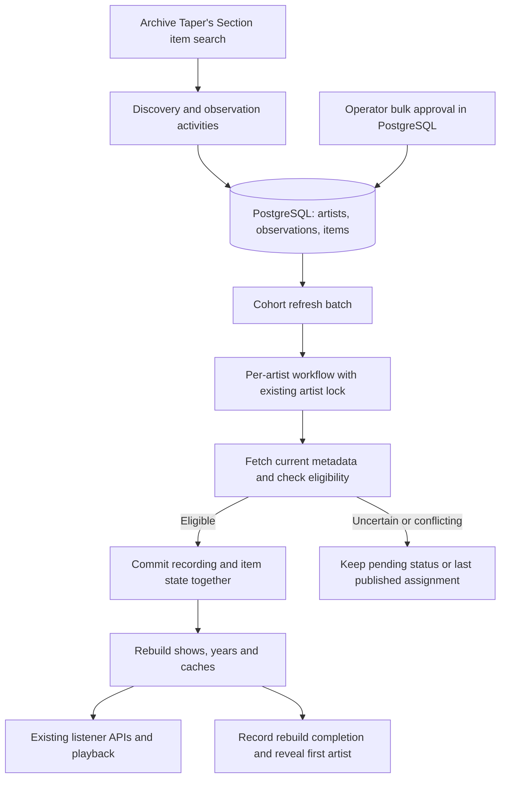

# Bring new Taper’s Section artists into Relisten

Build item discovery and automatic recording imports for artists that do not yet have a Relisten entry. An operator reviews artist candidates in PostgreSQL and sets an approval flag, usually in bulk. Once approved, recordings that pass the checks in this plan appear through existing artist, show and playback APIs. Further recordings for the same artist remain eligible after its catalog entry exists.

This plan is for a Relisten engineer, reviewer and operator. It assumes familiarity with C# and the listener API, but explains the ingestion responsibilities needed to implement and operate the change. Read this file for scope and sequence, [contracts](contracts.md) when building the components, and [verification and operations](verification-and-operations.md) for acceptance and deployment.

## Release outcome

A successful pilot creates one reviewed artist once, publishes at least two eligible recordings, and picks up a later recording without another artist approval. The artist appears in the default artist list. Its shows contain ordered playable tracks. Repeating discovery, imports and rebuilds preserves the artist, source and track UUIDs.

Taper’s Section is Archive.org’s mixed collection at `archive.org/details/taperssection`. Its recordings do not each have a dedicated artist collection. Today Relisten discovers artist collections and uses each collection as an artist’s import boundary. That leaves these recordings outside normal discovery. A **source** in Relisten is a recording and its tracks; a **show** is the existing aggregate for an artist and display date.

The first served artists must be new to Relisten. Record matches to pre-existing artists and defer their Taper’s Section recordings. Uncertain identity also stays pending. Once this release creates an artist, its durable intake membership distinguishes it from a pre-existing artist. There is no minimum number of recordings required for approval.

The first release includes:

- bounded discovery of Taper’s Section audio items and retained metadata observations;
- artist candidates, bulk database approval and safe artist creation;
- explicit eligibility rules followed by automatic publication for approved artists;
- periodic discovery of new items and refresh of already assigned items;
- current failure/review status, retry recovery and existing catalog rebuilds.

Song search, physical venue identity, canonical setlists, recording-family matching and upstream correction submission follow later. Their foundation here is retained provider evidence, stable item identity and durable artist membership. Later song search should include clearly labeled title-derived matches with durable provisional artist-scoped song IDs. Alec’s bespoke provider agreements are the permission basis for the planned evidence retention and eventual correction forwarding.

## Product decisions

Artist review happens once through a database flag. Every subsequent item must still pass deterministic performer, date, item-kind and playback checks. The system does not treat an approved artist name as approval of compilations or a tribute mislabeled with that name. Operators can pause an artist’s further imports by clearing its flag.

An upstream artist or date conflict on a published recording holds the update and keeps the last published assignment. The record remains playable. Record the conflict for review; do not add a broad hiding or reassignment system for this uncommon case. An operator can pause intake while arranging a specific catalog correction. Automatic processing never changes the artist or performance date of an already published item.

Source venue text and recording credits can be displayed through existing fields. Missing venue identity does not block playback. Files remain files: an introduction, split track or medley does not require a normalized song identity. Multi-performer items, compilations, ambiguous dates and ambiguous early/late attribution wait for review.

## What the current code changes about the design

The code and local schema were checked at `9cc744a18bbb4bdc135a2d41e7a45d77d0e9c821` on October 16, 2026. Normal Archive imports require a collection mapping, so this release needs an item-assignment route. There is no existing artist alias registry. Artist creation uses a shared lock only in collection discovery; the other artist writers must join it. The importer loses array values and rejects missing dates early, so it needs a retained observation and explicit resolved input. Finally, the default artist list hides `AutoCreated` rows until publication clears that flag.

These findings define the changes below. The [contracts](contracts.md) explain ownership and compatibility. The implementation fixtures cover tribute, compilation, collaboration and conflicting date examples. Those cases establish regression behavior; they do not measure automatic assignment accuracy across the live collection. The production pilot still requires review of actual candidate items.

## Components and data flow

A Temporal **workflow** records execution progress. An **activity** performs HTTP or database work and can be retried. PostgreSQL owns evidence, approval and catalog state; losing Temporal history or payload Redis must not erase those records.

Discovery and cohort refresh are separate scheduled operations. Discovery finds arrivals and fills review candidates. Refresh revisits retained item identifiers even if they leave the mixed collection. Both have bounded pages and concurrency. New artist approval is picked up by refresh; an operator can also start refresh immediately.

Keep the existing artist refresh coordinator and ordinary targeted Archive command intact. Add a dedicated cohort artist operation that competes for the same `ingest/artist/{uuid}` workflow ID. Reuse the recording writer and ordered rebuild steps, with explicit reviewed-assignment inputs instead of a fabricated collection mapping.

## Implementation sequence

Each step has an observable outcome and depends on the previous step unless stated otherwise. Implement the contracts in [contracts.md](contracts.md); use the acceptance cases in [verification](verification-and-operations.md#acceptance-cases) as the proof for each step.

### 1. Store observations and discover candidates

Add the three intake relations, typed DTOs, bounded search reader and metadata projection. Build the candidate query, eligibility evaluator and database review view. Retain the relevant original fields before parsing them.

**Outcome:** fixture discovery produces inspectable new, existing and unresolved candidates. Repeating a page adds no duplicates. No public artist or source exists before approval. Test pagination, capture and the attribution/date rules here.

### 2. Materialize approved artists safely

Add the shared artist-registry transaction to collection discovery, authenticated artist create/update and intake materialization. Recheck matches under the lock. Create the approved artist, features and cohort membership together, preserving its creation slug and initially setting `AutoCreated`. Add no Archive collection mapping.

**Outcome:** concurrent creation and lost-acknowledgement retries reuse or defer the identity without creating a duplicate. Clearing approval pauses later writes while retaining membership.

### 3. Publish through the existing catalog

Extract the shared Archive recording writer from collection selection. Add the cohort activity and artist workflow. Recheck approval and input state before committing the recording and its intake references together. Settle item work, rebuild shows/years/caches, then reveal the first artist.

**Outcome:** one approved fixture artist appears in existing APIs with two playable recordings. Retry preserves UUIDs; an ineligible item creates no source. Partial success and rebuild failure remain recoverable.

### 4. Add discovery, refresh and recovery

Add the cohort batch, named operator commands and paused schedule registration. Reobserve assigned items regardless of performance date or current collection. Reevaluate unpublished items after approval or rule changes. Keep ordinary Archive writes and deletion accounting from changing intake-owned sources. Preserve the last assignment on conflicting updates.

**Outcome:** a third recording imports without another approval. Restarting from PostgreSQL after losing execution state converges without duplicate rows. Status identifies pending observations, held updates and incomplete rebuilds.

### 5. Run the pilot and roll out

Complete the [verification matrix and deployment sequence](verification-and-operations.md). Deploy matching API/worker images with schedules paused. Discover a bounded set, approve one artist and check browsing, playback, retries and a subsequent item. Enable schedules after the pilot passes.

**Outcome:** a small approved cohort works for listeners. Unapproved artists remain pending, existing artists remain deferred, and operators can pause intake without removing catalog data.

## Implementation status and decisions

This is the execution source of truth for this release. Update the checklist as implementation proceeds. Record a discovery here only when it changes scope, a contract or the next step; keep diagnostic logs outside the plan.

- [x] Step 1: schema, observations, candidates and review view.
- [x] Step 2: approval materialization and registry transaction.
- [x] Step 3: recording publication and listener visibility.
- [x] Step 4: schedules, refresh and recovery.
- [ ] Production pilot and rollout: requires deployment, reviewed live artists and verified terminal pagination. Local implementation does not enable schedules.

The current decision record is: new artists first; bulk artist approval in PostgreSQL; automatic publication of eligible items; retain last published assignment on conflict; existing listener identities and payloads; three concrete intake tables; separate cohort workflows using existing artist exclusivity. The readers are the implementer and reviewer/operator. No product decision remains open in those areas.

If new evidence makes an eligibility rule unsafe or a legacy contract incompatible, stop the affected publication path, explain the evidence, and revisit that decision with Alec. Continue independent implementation work. Routine method names, page sizes and internal factoring can be chosen during implementation within the stated contracts.

## Implementation decisions

The service retains the selected observation before parsing the legacy recording DTO. Unavailable and uncertain items therefore keep their evidence without requiring a playable recording parse. The publication transaction names its approval/freshness checks, catalog identity validation and recording commit separately. Artist lookup releases its first database connection before loading provider mappings, so these operations use one enlisted PostgreSQL connection.

An unchanged assignment observation still refreshes the recording writer. Reviews are outside the decision projection, so skipping the writer would suppress review-only updates once ordinary Archive imports defer to intake. `Unchanged` means the assignment evidence was reused; it is not a claim that every ancillary field stayed the same. Each committed writer invocation advances the rebuild revision. Catalog update timestamps use the current metadata check time because this operation has no search freshness document.

`Observed` counts successful activity results with retained evidence. A failed activity can also leave evidence in PostgreSQL; inspect status for that case. Counts describe returned processing outcomes rather than exact insertions or individual retry attempts.

## Existing contracts

Use [ingestion architecture](../../../ingestion/README.md), [provider rules](../../../ingestion/providers.md) and [operations](../../../ingestion/operations.md) for the shared contracts. Migration 13 creates the three concrete intake tables and the bulk review view. Venue/song/event registries, editorial history and upstream correction submission remain future work. The three files in this plan contain the release behavior, execution decisions and operational checks needed to work without the earlier research report.
