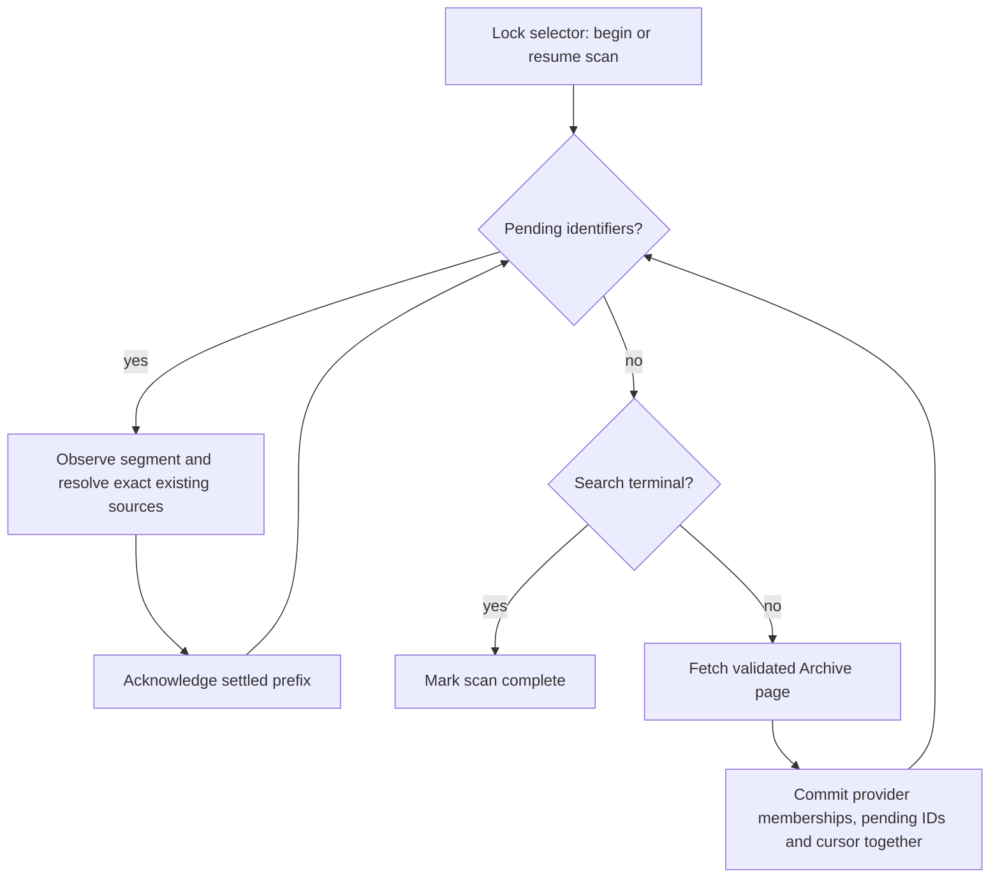

# Collection implementation contracts

Collections add browsing membership around canonical recordings. This increment implements collection identity, two independent inclusion rules, exact reuse of existing Archive sources, read-only v3 endpoints, and configured discovery. Discovery retains unresolved items; it does not publish recordings for existing artists or resolve Jerry Garcia’s performing projects.

Use this contract with the [design](../../../design/2026-10-17-relisten-collections.md), [work sequence](README.md), and [ingestion operations](../../../ingestion/operations.md). It describes the implementation in this checkout. The [verification record](#verification-rollout-and-remaining-work) separates service/workflow tests from actual HTTP checks. The separate [Gov’t Mule milestone](govt-mule-smoke.md) verifies the recording-publication path.

## Ownership and stored records

[Migration 14](../../../../RelistenApi/Migrations/14_AddRelistenCollections.cs) adds the following records. PostgreSQL owns their identities, membership, accepted references and discovery progress. Temporal owns execution history. Redis stores caches and oversized Temporal payloads, not membership decisions.

| Relation | Key and responsibility |
| --- | --- |
| `collections` | Stable UUID and unique slug; mutable name, description and `published` flag. New collections default to unpublished. |
| `normalization.collection_selectors` | Stable selector UUID and fixed collection/provider/upstream-identifier tuple. Stores `enabled`, scan ID/state, cursor, seen cursors, pending identifiers, discovered count, terminal flag, completion time and last error. The tuple is unique within a Relisten collection. |
| `normalization.collection_artist_memberships` | One collection/artist UUID pair, active flag, retained review basis, current reason and retirement timestamp. Includes that artist’s present and later playable recordings. |
| `normalization.collection_recording_memberships` | Independent editorial or provider inclusion. Editorial rows name a source UUID; provider rows name a selector and Archive item. Unique per collection/source for editorial rows and selector/item for provider rows. Active state, reason, review basis and last-seen scan remain attached to that basis. |
| `normalization.archive_item_resolutions` | One shared row per exact Archive item identifier, across selectors. Retains latest and first accepted observation IDs, selected artist UUID, accepted source UUID, decision basis, status, reason and observation error. |
| `collection_playable_sources` | Live SQL view of the deduplicated inclusion union joined to current canonical playback rows. It is not a copied or separately rebuilt catalog. |

Membership and resolution UUID references deliberately have no cascading foreign keys to catalog artists or sources. Catalog deletion retains the decisions for inspection. Foreign keys between the new collection records and retained observations protect their internal references.

The view includes a source only when its artist and matching artist-owned show exist and it has a non-orphaned track with a nonempty MP3 URL. This means playable catalog data; it does not probe upstream media availability. Provider membership also rechecks the accepted source’s exact item, performer and Archive attribution. An unrevealed intake artist remains hidden while `AutoCreated` is set, even if its candidate’s diagnostic status changes. Native auto-created artists can be explicitly selected without changing their default artist-list visibility.

## Membership writes and exact source reuse

[CollectionService](../../../../RelistenApi/Services/Data/CollectionService.Writes.cs) owns collection and inclusion writes. Its public operations are:

```csharp
SaveCollectionAsync(CollectionDefinition definition)
SaveSelectorAsync(CollectionSelectorDefinition definition)
SetArtistMembershipAsync(Guid collectionUuid, Guid artistUuid, bool active, string reason)
SetEditorialRecordingMembershipAsync(Guid collectionUuid, Guid sourceUuid, bool active, string reason)
SetProviderMembershipAsync(Guid selectorUuid, string itemIdentifier, bool active,
    string reason, Guid? scanId = null)
```

`CollectionDefinition` supplies UUID, slug, name, description and publication state. UUID and slug cannot change after creation; UUID-shaped slugs are rejected. Slug lookup is exact and case-sensitive. `CollectionSelectorDefinition` supplies UUID, collection UUID, provider ID, upstream identifier and enabled state. Only enabled state can change for an existing selector identity. Archive discovery identifiers use letters, digits, underscore, period and hyphen; the reader rejects unsupported values.

Membership changes require a nonempty reason and run in a catalog transaction. New artist/source selections must name a current catalog identity; retained memberships remain inspectable and can be retired after their catalog reference disappears. Provider inclusion currently supports Archive.org selectors only and can be retained before an item has a source. These operations do not alter artists, recordings, playback URLs or importer ownership.

The inclusion rules form a union. An explicit source selection does not include its artist’s other recordings. Artist-wide inclusion does include later recordings. Overlapping editorial, provider and artist-wide bases return a source once. Retiring one basis leaves the others active. There is no exclusion rule that overrides other inclusions.

Positive discovery updates `last_seen_scan_id` on existing provider rows but preserves an operator’s inactive state and reason. Reactivation requires an explicit operator membership write. Disabling a selector pauses discovery; it does not retire its memberships. Unpublishing a collection hides public reads while retaining all records.

[ArchiveItemResolutionService](../../../../RelistenApi/Services/Data/ArchiveItemResolutionService.cs) owns shared exact-item resolution:

```csharp
FindAsync(string itemIdentifier)
ResolveExistingAsync(ArchiveItemResolutionRequest request,
    CancellationToken token = default, DateTimeOffset? deadline = null)
RecordFailureAsync(string itemIdentifier, string error)
```

The request names an exact item, optional retained observation ID, optional expected artist UUID, a decision basis and optional current conflict reason. An observation must belong to that item; an expected artist must exist. Callers supply an expected performer or conflict reason only from supported evidence. Collection membership itself supplies neither.

Resolution locks its shared row and looks for at most two matching canonical sources. A match requires both `sources.upstream_identifier` equality and an Archive.org `links` row with `for_source=true`; sources have no provider column. The first unambiguous native-catalog match can establish the performer; collection discovery trusts that existing assignment rather than independently proving its billing. No match stays `pending`; duplicate matches or contradictory performer evidence become `conflict`. A previously accepted source or artist cannot be replaced by ordinary resolution. A missing accepted source becomes `missing`. These states retain accepted UUIDs and their original observation/basis for repair.

After an observation is accepted, later nonempty `creator`, `date`, `year` or `title` values are compared with that accepted evidence after identity normalization. A changed value holds resolution for review, including a harmless title edit. An identifier-only retry uses the latest retained observation, so omitting fresh metadata cannot clear the hold. Empty current fields do not introduce a changed-value hold. This conservative comparison does not infer performing projects.

A conflict does not withdraw a still-valid accepted source: public reads keep it only while the current source still matches the accepted item, performer and provider. A deleted or identity-mismatched reference disappears from playable results. Resolution never substitutes a same-date recording. Reusing a native source does not refresh it, claim intake ownership or change its deletion policy. Missing recordings for existing artists remain unresolved until a separate publication contract is implemented.

Operators inspect retained state through `GetSelectorAsync`, the three membership getters, and `ArchiveItemResolutionService.FindAsync`, or equivalent database reads. There is no collection editing HTTP API, CRUD CLI or browser review screen in this increment.

## Public read API

[CollectionsController](../../../../RelistenApi/Controllers/CollectionsController.cs) exposes anonymous, read-only JSON endpoints. Missing and unpublished collections both return 404. Published collections can be empty.

| Route | Response and order |
| --- | --- |
| `GET /api/v3/collections` | `{items, next_cursor}` containing collection DTOs, ordered by slug with `C` collation, then UUID. |
| `GET /api/v3/collections/{uuidOrSlug}` | One collection DTO. |
| `GET /api/v3/collections/{uuidOrSlug}/artists` | Artist facets ordered by sort name with `C` collation, then UUID. |
| `GET /api/v3/collections/{uuidOrSlug}/recordings` | Canonical recording references ordered by show date descending, then source UUID ascending. Optional `artist_uuid` stays within collection membership. |

Paged endpoints accept `limit` (default 50, allowed 1–200) and an opaque `cursor`. The response’s `next_cursor=null` ends enumeration. Malformed limits, cursors or UUID filters return 400 with problem details. A cursor binds its seek key to the resource, collection UUID and artist filter; changing the filter or using another resource’s cursor is invalid. Page size can change within the allowed range. A cursor grants no access: every request rechecks publication and current playable rows.

These are live seek pages, not a frozen snapshot. Concurrent catalog or membership edits can change results between requests. Counts are distinct canonical entities after inclusion deduplication, not page totals or sums of membership bases. Collection reads use normal database read routing, so configured replica lag can delay visibility of a write. Successful collection reads carry `no-store`; controller-handled errors do too. ASP.NET model-binding errors can return before that filter and have no cache header. There is no Redis collection cache or collection-only rebuild step.

The [DTO definitions](../../../../RelistenApi/Models/Collection.cs) use these snake-case fields:

- Collection: `uuid`, `slug`, `name`, `description`, `published`, `source_count`, `show_count`, `artist_count`.
- Artist facet: `uuid`, `name`, `slug`, `sort_name`, `includes_all_recordings`, `source_count`, `show_count`. The inclusion flag identifies an active artist-wide rule; appearing as a facet alone does not create that rule. Artists with no playable collection content do not appear.
- Recording: `source_uuid`, `artist_uuid`, `artist_name`, `artist_slug`, `show_uuid`, `date`, `display_date`, `track_count`, `duration`. Duration sums included playable tracks in seconds. `date` is the catalog show-date value used for sorting; `display_date` preserves the catalog’s stated precision, including `XX` components.

Recording results link to existing v3 show playback. They do not copy track payloads or introduce replacement source, show or artist identities. Unresolved provider items, operator reasons and performer decisions are not exposed through these public reads.

## Configured discovery and operator procedure

Create an unpublished collection and an Archive selector through the service or reviewed database maintenance. Review their identities before publishing the collection. A selector maps a discovery boundary to a collection; it does not create an artist-to-provider mapping.

```sh
dotnet run --project RelistenIngestionWorker -- \
  --collection-discover=SELECTOR_UUID --max-pages=1
```

`--max-pages` is optional and must be positive. It counts complete fetched pages for this invocation, including across workflow continuations. It does not truncate a page or count items. Omitting it resumes or traverses the selector to its terminal response. This start returns an execution-bound workflow ID and run IDs; it does not report completion.

`TemporalIngestionClient.DiscoverArchiveCollectionAsync(DiscoverArchiveCollection)` uses exclusive ID `ingest/collection/{selectorUuid}`. Overlap returns `ImportAlreadyRunning`. Different selectors can run concurrently and share item resolutions. They do not acquire artist import IDs because discovery writes no canonical recordings. No collection schedules are registered.

The durable sequence is:



The concrete [workflow](../../../../RelistenApi/Services/Ingestion/Providers/ArchiveCollections/ArchiveCollectionDiscoveryWorkflow.cs) and [discovery service](../../../../RelistenApi/Services/Data/CollectionDiscoveryService.cs) enforce these details:

1. `BeginOrResumeAsync` resumes a running scan. A completed scan starts a new scan ID, cursor and count. A disabled selector returns paused without fetching.
2. `ArchiveCollectionSearchClient` queries `collection:{identifier} AND mediatype:audio`, requests identifier/membership fields, and validates every row’s audio type and configured collection. The first request uses `count=100`; cursor requests omit `count`. Responses are capped at 64 MiB and 5,000 items. Repeated cursors, nonempty pages with no new identifiers, malformed rows and terminal responses claiming unreturned items fail discovery. An empty advancing page continues. Totals are diagnostic, not a frozen traversal count.
3. `ApplyPageAsync` locks the selector and atomically retains every received item’s provider membership, the shared resolution row, pending work and next cursor. Lost acknowledgements or stale scan/cursor inputs return current progress. Advancing cannot discard unpersisted identifiers.
4. Metadata activities retain the shared selected observation, then attempt exact existing-source resolution. They neither materialize artists nor call the recording writer. Overlapping selectors reuse the same Archive item and observation identities.
5. Pending IDs settle in segments of at most 100, with the existing limit of ten concurrent Archive activities. Only a settled expected prefix is acknowledged. Continuations carry settled summary state; PostgreSQL retains pending work. Cancellation before acknowledgement can repeat a segment safely.
6. A terminal response plus no pending IDs completes the scan. A page-limited nonterminal run returns `Limited=true` and retains a running scan. Disabling during a segment stops after admitted work settles and its prefix is acknowledged; remaining work resumes after re-enabling.

Discovery uses the existing workflow, Archive and database queues, five-attempt activity retry policy, heartbeats and inherited execution deadline. Exhausted item failures are counted and acknowledged; their resolution error remains visible. A later complete scan reobserves received identifiers, including those failures. A completed traversal can therefore return `Completed=true` with `Failed>0`; inspect the full summary. Fetch/page failures retain the scan cursor and pending state for retry. No missing-listing inference retires membership, even after a complete scan.

`ArchiveCollectionDiscoverySummary` reports `Discovered`, `Observed`, `Linked`, `Unresolved`, `Failed`, `Limited`, `Completed`, `Paused` and at most 20 structured failures. `Discovered` counts fresh identifiers committed during this invocation; a resumed pending prefix may be observed without increasing it. `Observed` counts successful item activity results, not all evidence that might remain after a failed activity. Linked and unresolved counts describe processing outcomes, not insertion counts.

## Verification, rollout and remaining work

Use [collection persistence tests](../../../../RelistenApiTests/Collections/TestCollectionPersistence.cs) for inclusion union, facet/filter counts, current playback links, exact provider reuse, conflict/missing-reference retention, retirement and cursor contracts. Use [discovery workflow tests](../../../../RelistenApiTests/Ingestion/TestArchiveCollectionDiscoveryWorkflow.cs) for page persistence, continuation/replay, limits, cancellation and partial failure. The October 17 shared regression suite passed all 402 cases across Taper’s Section, collections, ingestion, Archive.org, catalog rebuild and artist registry behavior. That includes two [registered-worker end-to-end cases](../../../../RelistenApiTests/Collections/TestArchiveCollectionFlow.cs) using the actual Temporal registrations, PostgreSQL and loopback HTTP. They verify discovery through canonical source reuse and retained unresolved work. The suite also covers changed-metadata holds and identifier-only retry recovery. After the final native receipt/status cleanup, its targeted regression passed separately (1/1). The final solution build had zero errors and 18 existing NuGet warnings; `dotnet csharpier check .` passed.

The [actual HTTP evidence](evidence/collection-http-smoke.json) records 55 requests against the isolated Gov’t Mule catalog on port 13824: 27 returned 200, 16 returned 400 and 12 returned 404. Artist-wide, editorial and two provider inclusion bases deduplicated to the same 359 Mule sources. A selected-recording collection returned four sources across two artists; the Mule filter returned three. List, facet and recording pagination exhausted without duplicates, resource/filter cursor mismatches failed, and successful collection responses carried `no-store`. Four existing v3 show responses preserved their playback references.

The before/after comparison preserved all 413 sources, 429 sets and 7,561 tracks in that isolated catalog, including identities and media references. These counts include the preloaded catalog as well as Mule. They do not describe a full Aadam or Jerry import. No production collection writes or schedules were involved. The [bounded live Aadam selector check](aadam-first-page-smoke.md) passed through the actual configured workflow: one fetched page, 100 observed/unresolved items, zero failures, `Limited=true` and `Completed=false`. Its cursor remained durable, pending work settled, and canonical catalog and ownership snapshots stayed unchanged. The unpublished fixture returned 404 and was absent from the collection list. Live continuation and terminal pagination remain unverified.

Apply additive migrations 14 and 15 before running this checkout’s API or worker. Collection and intake resolution now read the performer-review fields added by migration 15. Both migration entry points must agree. Drain incompatible open discovery histories before replacing workers or use Temporal versioning. Code rollback keeps the new tables and canonical catalog; the destructive migration down path is unsupported. Pause new starts and disable selectors as needed. Retiring membership or rolling back collection code does not delete recordings or transfer importer ownership.

This increment provides the collection and exact-reuse parts needed for Aadam. It does not yet provide missing-recording publication for existing artists or justify a full Aadam import. The separate [reviewed performer contract](performer-contract.md) adds the bounded Jerry assignment implementation; its [bounded local proof](jerry-projects-smoke.md) passed, while the product collection membership list remains undecided. Production backup/restore, deployment, collection-wide pagination and pilot checks remain release work.
