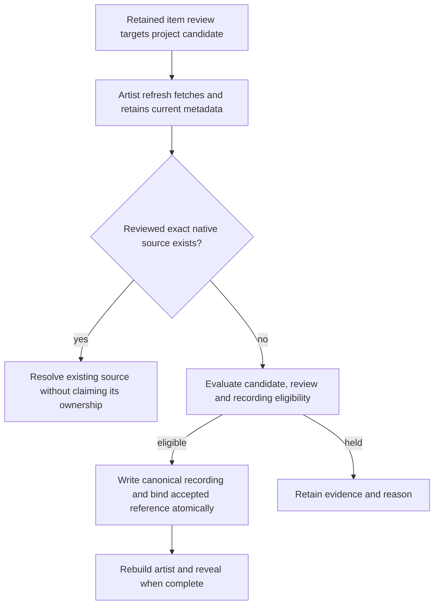

# Reviewed Archive performers

An item-level performer review lets a recording under a broad provider creator name target one performing project. This supports a bounded Jerry Garcia import without making `Jerry Garcia` a shared alias for every project. The review names a candidate and retained evidence; it does not publish a recording, approve the artist, or add collection membership.

This contract is for the engineer and reviewer/operator. Use it with the [collection contract](contracts.md), [intake publication contract](../2026-10-16-taperssection-intake/contracts.md) and [execution sequence](README.md). The implementation uses interpretation rules version 8. The [bounded local Jerry proof](jerry-projects-smoke.md) verifies publication and retry through real workflows and APIs. The separate [retained sample](evidence/jerry-performer-sample.json) records the wider research inventory; it is not a full import or assignment benchmark.

## Project identity and review

The existing production `JGB` artist (`a3ffe2d0-a626-cd1d-56bf-13c617eb94be`) represents the Melvin Seals continuation. Keep its 480 sources, including earlier-dated recordings. Historical `Jerry Garcia Band` is a distinct proposed project. No ordinary review repairs or moves the existing sources. Other projects, such as Legion of Mary or Garcia/Saunders, retain separate identities.

[ArchiveIntakeService.ProposeProjectAsync](../../../../RelistenApi/Services/Data/ArchiveIntakeService.Performers.cs) takes a project name, slug, finite reviewed labels, approval, cancellation token and optional deadline. It returns a candidate UUID. The labels must identify that project. The project name is also normalized into its matching keys. Approval invokes ordinary materialization, including the locked live-registry recheck; an existing artist match remains deferred. An approved or materialized candidate cannot silently change its name, slug or label set. No artist-to-provider mapping is created.

For a historical Jerry Garcia Band candidate, use reviewed full-name project labels. Do not add the broad `Jerry Garcia` creator or the existing `JGB` name to force matching. Broad provider billing remains attached to each item’s immutable observation.

[ArchivePerformerReviewService](../../../../RelistenApi/Services/Data/ArchivePerformerReviewService.cs) exposes:

```csharp
ReviewAsync(ArchivePerformerReview review,
    CancellationToken token = default, DateTimeOffset? deadline = null)
FindPerformerDecisionAsync(string itemIdentifier)
SetApprovalAsync(string itemIdentifier, bool approved, string reviewBasis,
    CancellationToken token = default, DateTimeOffset? deadline = null)
```

`ArchivePerformerReview` supplies an exact item identifier, candidate UUID, supporting observation UUID, evidence array, nonempty review basis, approval (default false) and optional alternatives. `Alternatives` lists unresolved possible performers. A nonempty list holds publication even if the review is approved; it is not a list of rejected hypotheses. The supporting observation must belong to that exact item.

Each evidence entry uses `TapersSectionEvidence`: field locator, raw value, rule name and optional start/length. Locators name a string in `metadata.creator`, `metadata.title` or `metadata.description`, including an indexed array value. Without a span, the evidence value must equal the whole retained field. With a span, the exact raw substring must equal the value; offsets and lengths use .NET string (UTF-16 code-unit) indexing. At least one value must normalize to a reviewed project label or proposed project name. A project name embedded in a longer title or description therefore needs its exact substring span. These checks prove what was reviewed; the operator remains responsible for interpreting the billing correctly.

The returned `ArchivePerformerDecision` includes the retained review, revision, supporting projection and content hash, project labels, and selected artist UUID when the candidate has a mapped artist or one existing catalog match. The hash identifies the supporting evidence. It is not a requirement that every later projection remain identical.

## Durable state and approval

[Migration 15](../../../../RelistenApi/Migrations/15_AddArchivePerformerReviews.cs) adds performer fields to the shared `normalization.archive_item_resolutions` row: candidate and observation references, approval, evidence, review basis, unresolved alternatives and nonnegative revision. Completeness constraints keep approval from existing without its target and supporting evidence. Performer approval is independent of the row’s source-resolution status and the candidate’s artist approval.

A meaningful review or approval change increments the revision. Repeating the same inputs is idempotent. `SetApprovalAsync` captures the review revision and rejects approval if a concurrent edit changed the target or revision; the operator must reload the changed review. It never approves an unseen replacement review.

Review writes and publication follow candidate → intake item → shared resolution lock order. Publication reads the review under those locks before writing. A review cannot retarget an already published intake item to another candidate. Such a change requires reviewed catalog repair because artist identity affects source and track identity. Revoking approval preserves the review, evidence and existing playback; it pauses later writes. It does not delete a recording or retire collection membership.

## Applicability to current metadata

Before applying a review, the evaluator checks that both projections name the same exact item, the raw creator value is unchanged, and every complete supporting field is unchanged. Even when evidence uses a short span, applicability compares its whole field. Editing the surrounding description therefore cannot preserve permission merely by leaving the project name in place. An unrelated file or date update can retain performer approval when the creator and supporting fields stay identical.

A changed creator or supporting field requires another review. A stale, revoked or unsupported decision produces `performer_review_required`; the item does not fall back to broad creator matching. Missing creators remain held. Several distinct normalized creator identities or unresolved alternatives remain `ambiguous_creator`. New-recording publication still requires the selected candidate’s artist approval and registry checks. Ordinary context, date, availability and playable-file checks continue to apply. An item-level review cannot waive an existing compilation, tribute, multi-act or ambiguous-performance hold. These context checks and explicit unresolved alternatives do not detect every mixed-project recording; the operator must review the actual billing and contents.

When applicable, the broad original creator may explain that item’s title billing. This permission is local to that reviewed item. Other items with the same provider creator do not inherit its candidate assignment.

## Publication and exact native reuse

The existing artist refresh selects approved candidate items plus approved performer reviews that target that candidate, including reviews created before intake classification. It uses the existing `ingest/artist/{artistUuid}` admission ID, activities, recording writer and rebuild sequence. There is no candidate-null publication or second import-admission mechanism.



Before ordinary new-project publication, `ResolveReviewedNativeAsync` attempts shared exact-source resolution for a reviewed item. A usable native match keeps its existing source, artist, tracks and importer ownership. If an unpublished intake discovery row already exists, native reuse clears its candidate assignment and settles its observation/check receipt without claiming recording ownership. A successful link records `deferred_existing_artist` with `native_source_linked`; a resolution hold records `needs_review` with `resolution_conflict`. This does not create an intake row solely for linking or change original published references. A conflict or invalid review stays held. When no source or accepted reference exists, normal candidate publication can proceed. Existing-artist missing-recording publication remains deferred.

`ArchiveItemResolutionService.ResolveExistingAsync` also honors a stored performer review during collection discovery. Revocation, an unmapped target, unresolved alternatives or stale evidence blocks a new accepted binding. Prior valid accepted references remain playable during that hold. Ordinary native reuse retains the conservative changed-creator/date/year/title policy in the [collection contract](contracts.md#membership-writes-and-exact-source-reuse).

After the intake writer writes a reviewed new-project source, `BindPublishedAsync(item, observation, artist, source, token, deadline)` accepts its shared reference in the same transaction. It requires matching intake ownership, one exact Archive canonical source and an approved applicable performer review. Source and artist UUIDs remain pinned. This operation can advance the accepted observation during a legitimate owned date correction; it does not use the native-reuse changed-date hold to block the writer’s permitted correction. The outer catalog transaction commits only after binding succeeds; a failed bind rolls back the source write.

Collection reads include a reviewed recording only after normal artist publication/rebuild and an active inclusion rule. Performer review alone never creates that rule. Keep the Jerry collection unpublished until its project membership is decided, including whether Grateful Dead belongs.

## Operator sequence and verification

1. Retain current metadata for a bounded, identified set of items. Preserve their original creator values and observation UUIDs.
2. Propose each distinct project using finite project labels. Review registry matches before approving a new artist; preserve native identities.
3. Review each supported item against its immutable observation. Record exact billing evidence and alternatives. Approve only resolved performer decisions.
4. Run the ordinary named artist refresh. Inspect its typed result and retained item state, including held and failed items. A completed workflow can report partial publication.
5. Verify artist, show and playback references through current v3 responses. Check native reuse, retries, revoked/stale reviews and an owned date correction without identity changes. Add collection membership separately after its editorial decision.

Focused tests must cover publication under distinct projects from one broad creator, exact native reuse without ownership transfer, changed or revoked evidence, unresolved alternatives, published-target protection and the existing writer/rebuild recovery. The shared 402-case regression run passed across performer/intake, collections, ingestion, Archive.org, rebuild and registry behavior. The final native receipt/status regression passed separately (1/1) after cleanup; the solution built with zero errors and 18 existing NuGet warnings, and the CSharpier check passed. The [local proof](jerry-projects-smoke.md) published three recordings under three projects, held the mixed item on both passes and preserved all three source/set identities, 31 tracks and complete media URLs across six normal artist executions. Forty actual HTTP checks and one successful 206 audio range request complement the contract tests. The proof does not measure creator-wide assignment accuracy. Production rollout, a full creator-wide import and repairs to existing `JGB` assignments are separate work.

Apply migrations 14 and 15 before running the new code. Keep the new review records on code rollback; migration 15 does not support destructive reversal. Before rolling back to workers that do not read performer approval, stop the affected intake workers or clear their candidates’ artist approval too. A per-item pause alone cannot constrain an older worker when the creator already matches an approved project label. Retain the ownership guards, review records and canonical references so playback and later recovery remain intact.
