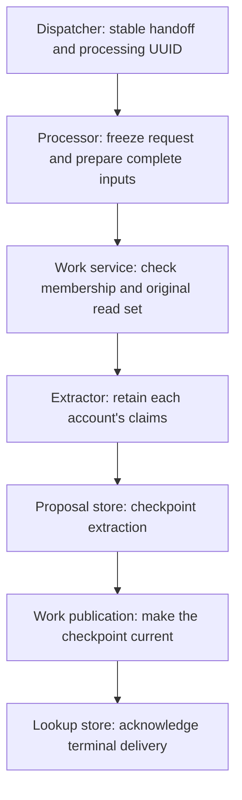

# Process every retained account for a recording

A recording can have legacy catalog fields and richer Archive, Phish or Local evidence.
Process those accounts together without choosing one as the truth. The extraction
batch retains each input's claims and citations separately. Identity resolution
follows extraction; this processor accepts no person, song or composition match
and changes no playback relationship.

The shared recording processor serves both legacy page runs and retained-provider
handoffs. This matters after the first provider input joins an extraction owner:
later legacy runs must consume that input too. They cannot publish a legacy-only
batch while acknowledging the provider's watermark.

## Service entry points

`NormalizationRecordingProcessor.ProcessAsync(attemptUuid, sourceUuid, ct)`
keeps the existing legacy/page entry point. New delivery methods are
`ProcessRetainedAsync(attemptUuid, handoffUuid, ct)` and
`ProcessLegacyHandoffAsync(attemptUuid, handoffUuid, ct)`. Both require a committed
handoff naming that processing attempt. The dispatcher selects the method from
the handoff mode; callers do not substitute one input type for another.

`NormalizationWorkService.GetInputContributionsAsync(subject, limits?, ct)`
returns `NormalizationInputContributionsSnapshot`: the owner, complete contribution
states and any unmanaged baseline. Defaults allow 100 contributors and 10,000
bindings. `BeginContributedBatchAsync` takes prepared contributions plus the
original complete membership receipt, rather than changing the existing
single-contributor API. These are .NET service interfaces; no HTTP route or
scheduled worker is added by this change.

The successful handoff path is:

Direct legacy/page runs enter the same processor with a source UUID. They do not
create a lookup handoff. Failure and stale paths retain the original requests
and leave prior accepted data intact, as specified below.

## Ownership and preparation

Keep the existing `(extractions, recording, sourceUuid)` owner. The legacy
contributor remains `relisten / recording / sourceUuid`; a retained provider
contributor uses its exact recording resource. Each owns its complete input and
dependency keys. A change to one account cannot remove another account's keys.

Read owner configuration and all contributions from one primary repeatable-read
snapshot. The bounded read must reject an oversized set rather than return a
truncated success. Existing unmanaged owner bindings remain explicit; they cannot
silently disappear when the first named contributor joins.

Prepare the initiating input and every supported peer before admission. Keep
original input revisions, checked bindings and contributor revisions. Legacy
inputs also require their actual admitted capture receipts and original producer
clocks. Raw provider inputs have no legacy receipt; do not invent one. Reuse a
legacy receipt only when its original facts and clocks still validate. Otherwise,
refresh the complete legacy snapshot.

The first input in `NormalizationRecordingPreparation` identifies what initiated
the run. `AdditionalInputs` retains peers. This ordering gives no input greater
authority over a conflicting title or credit. The saved complete preparation is
immutable, and recovery uses it without selecting replacement inputs.

Admit all prepared contributions atomically. Compare original revisions for the
entire prepared union. Equal dependency keys must have equal observed generations;
neither the largest generation nor a fresh read can reconcile conflicting facts.
Also compare the original complete contributor membership and revisions under
the configuration lock, including empty contributors. A peer can arrive with
identical input keys; comparing the input union alone cannot detect that change.
Preserve unknown contributors. If the returned owner ticket contains unsupported
or unconsumed evidence, leave it unpublished and report the explicit attention
outcome. Never clear that evidence's watermark with a partial extraction.

Membership is compared when admitting the preparation. After admission, the
ticket's complete input and dependency union controls publication freshness.
Changing ownership of already-consumed facts can leave that union current;
adding an input or dependency invalidates the earlier ticket.

## Claims and file-specific credits

Extract each retained input separately. The batch's initiating `Extraction` and
`AdditionalExtractions` preserve the input revision responsible for each group.
Two accounts may cite the same track UUID with different titles. Retain both
claims; duplicate-track checks apply within each account, not across accounts.

Archive can attach taper, transferrer, source and lineage text to individual
files. Extract those credits from the original decoded files as well as the
recording's text. Credit proposals and unresolved credit passages retain an
optional `FileOrigin` naming that file assertion in the input. A file-scoped
credit does not become a recording-wide claim. Missing or unplayable catalog file
associations do not discard supported credit text.

Later credit resolution must map a file origin through that account's checked
binding before setting `RecordingCredit.ScopeTrackUuid`. An unresolved file scope
stays unresolved; a null track UUID cannot silently turn it into a recording-wide
credit.

The extractor validates exact cited text and file origin. Catalog bindings supply
playback associations; a caller-supplied file text value in a binding cannot
replace the original decoded assertion. Title proposals still require positively
bound catalog files. Text offsets describe the retained title, not audio times,
set boundaries or another performance.

## Handoff and recovery

The [lookup dispatcher](lookup-enrollment.md) uses each handoff's stable processing
attempt UUID. The processing header freezes the initiating handoff before saving
the complete preparation. Retrying a different handoff with that UUID conflicts.
The consumer version is fixed by that durable header; a retained handoff does not
need a fabricated version from before its consumer existed.

A legacy handoff preserves its original input, binding, producer clocks and
admission compare-and-swap values. Preparing peers cannot refresh those values to
make a delayed handoff current. A stale initiating request needs a new lookup
attempt. Direct legacy runs prepare against the current complete owner snapshot.

After admission, revalidate every saved input and binding, extract each group,
and checkpoint the completed batch. Publication then checks the original complete
ticket and makes the batch current in one transaction. An interrupted delivery
replays the same processing attempt. Acknowledgement verifies its durable terminal
result and the original initiating handoff evidence, while allowing the complete
preparation to contain legitimate peer accounts.

Cancellation and unexpected failures retain unfinished attempts. Stale or
unsupported attempts preserve the prior published batch and accepted data.
Historical terminal attempts keep exact replay; unfinished attempts from an
incompatible processing version require a new attempt UUID. No input fetch,
extraction or network call belongs inside publication's database transaction.

## Verification and release

Migration 35 adds immutable `initiating_handoff_uuid` to processing attempts and
allows a preparation without a legacy fetch receipt. The existing attempt,
checkpoint and publication tables remain authoritative. Apply migrations through
35 before running the current processor, page command or dispatcher. Lookup
registration itself still requires migrations through 34.

Drain incompatible unfinished processing and legacy deliveries before changing
binaries. Processing version 4 uses complete owner preparations and membership
receipts, including joint Local input pairs. Older terminal results remain readable and replayable; an older pending
request cannot acquire the new contract by replacing its saved preparation.
Use a new lookup or processing attempt after resolving that incompatibility.
Rollback stops processing and dispatch while retaining attempts, handoffs,
evidence and clocks; it does not drop the new schema or change existing playback.

Verify retained Archive and Phish inputs through lookup, dispatch and the current
proposal reader. Cover mixed legacy/provider owners, conflicting titles for the
same track, file-scoped credits, incomplete playback context, changed peer inputs,
concurrent contributor changes, cancellation, callback rollback, stale delivery,
and acknowledgement recovery after downstream publication. Verify subsequent
legacy runs against the expanded owner, rather than testing only initial provider
delivery.

Keep matching and public reads subject to the [main plan's](README.md) independent
evaluation and rollout requirements. These extraction checks cannot establish
identity-matching accuracy. [Local processing](local-processing.md) adds selected
root-account context. [Setlist processing](setlist-processing.md) retains complete
provider accounts under separate extraction owners.
