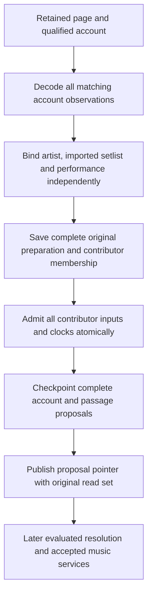

# Retain complete setlist proposals before resolving music identities

A setlist is one provider's account of a performance. Preserve its passages, set
boundaries and annotations even when Relisten cannot yet associate it with an
artist, imported setlist or playable show. This processor publishes evidenced
proposals. A later resolver accepts repertoire identities, composition links and
occurrences, then selects supported editions for public reads.

## Service contracts and identity

`NormalizationSetlistProcessor.ProcessAsync(attemptUuid, inputReference,
accountIdentity, expectedArtistUuid?, ct)` processes an account from an actual
retained input. `RetryAsync(newAttemptUuid, registrationUuid, ct)` selects the
current head of the latest attempt's incoming resource for a new attempt.
Both return a `NormalizationSetlistProcessingAttempt` with its terminal result.
`GetAsync(registrationUuid, ct)` returns the last published proposal batch, if any.
Reusing an attempt UUID resumes its immutable request or returns its terminal
receipt; it cannot change the request or select newer evidence.

The registration identifies a provider-qualified account and optional expected
artist. Phish.net requires explicit artist scope. The registration UUID is not an
accepted music-edition UUID. The extraction owner is
`(extractions, setlist, registrationUuid)`; accepted music editions remain under
`(songs, setlist, editionUuid)`.

Use the actual retained page resource as each contributor and input key. An
account's `Origin.Item` identifies the member being processed. A date, title,
page position or imported-setlist UUID cannot replace a qualified account
identity. Keep every matching observation within a page, including conflicting
duplicates.

## Data flow and responsibilities

The [setlist binder](setlist-binding.md) supplies independent `Artist`,
`ImportedSetlist` and `Performance` outcomes, plus the catalog and mapping clocks
it actually read. A missing imported setlist or show does not discard passages.
`Published` means that a proposal batch became current; its bindings may still be
unresolved. `Unresolved` reports processing that needs attention, while `Stale`
reports a preparation whose original evidence or dependencies no longer permit
publication.

Read complete owner membership before preparing the incoming input and supported
peers. Save all original input references, account observations, bindings,
contributor revisions and membership in the immutable preparation. Admit that
complete union through `BeginContributedBatchAsync`. Conflicting generations for
the same dependency require new preparation, rather than selecting a newer clock.

Admission checks the original contributor membership even when a new contributor
owns an already-consumed input. After admission, publication freshness follows
the actual input and dependency union. An ownership-only change with the same
union can leave those facts current; a newly contributed page makes the earlier
ticket stale. This keeps ownership checks precise without reprocessing unchanged
evidence.

Checkpoint per-input extraction groups and publish their pointer and terminal
receipt through the Work service's transaction callback. The store validates that
the saved proposals reproduce the retained accounts and consume the complete
ticket. No extraction, provider fetch or paid request belongs in that transaction.

## Preserve what the provider says

`NormalizationSetlistProposalBatch` retains the preparation, publication ticket
and `NormalizationSetlistInputExtraction` groups. Each group retains complete
typed accounts, passage proposals and decoder issues. Keep repeated songs,
repeated or empty sets, supplied ordinals, transitions, tape flags, notes,
footnotes, annotations and exact citations. An unordered account stays unordered.
Malformed or omitted passages remain visible through decoder issues; do not
renumber gaps away.

Reads use the bounded evidence API: by default, 100 unique revisions, 32 MiB per
input and 128 MiB in total. Extraction permits at most 1,000 decoded accounts and
10,000 passages across an input, including accounts other than the requested one.
Preparation and extraction checkpoints each permit 16 MiB of serialized JSON.
An enclosing page can therefore exceed a limit even when the requested account
is small. Reject the complete operation and retain recoverable state; do not
truncate the page or publish a partial account. Inspect the oversized input before
changing limits or obtaining a supported smaller provider response.

Passage proposal UUIDs identify claims within their retained input and extractor
version. They are not canonical occurrence UUIDs. A provider song identifier
identifies a song, not each performance of it. Later acceptance must preserve
supported occurrence correspondence across corrected account revisions.

Legacy `setlist_songs_plays` memberships cannot recover order or repeats. They
cannot replace the retained account. Cover and guest annotations also cannot
establish composers; composition and authorship require their own evidence.

## Changed pages and recovery

A current page head does not establish the latest edition of every account that
appears on several pages. Preserve those observations together. Edition selection
still needs targeted refresh or an explicit reconciliation policy.

An incoming page without the requested account produces `Unresolved` with
`account_not_in_input`. If an enrolled peer's changed page no longer contains the
account, report `peer_account_not_in_input` and preserve the prior publication.
A disappearance from one page cannot establish that the performance was deleted
or silently remove that contributor. Unsupported owner inputs likewise require
attention rather than a partial successful publication.

Cancellation and unexpected failures preserve unfinished attempts. Recovery uses
the same saved request, preparation and extraction checkpoint. Stale work cannot
replace a later proposal batch or reviewed decision. Terminal receipts retain
exact replay across processing versions; incompatible unfinished attempts require
inspection and a new attempt UUID.

## Migration and verification

Migration 36, `AddNormalizationSetlistProcessing`, adds registration, attempt and
publication storage and permits the `extractions / setlist` owner kind. It does not
change accepted music, catalog show identities or playback relationships. Apply
the migration before using the processor. Rollback stops processing while keeping
retained evidence, proposal history and schema available for recovery.

Verify through processing and proposal-reader contracts: repeated songs, empty
sets, unordered accounts, independent unresolved bindings, conflicting page
observations, contributor races, stale original clocks, missing members,
cancellation, checkpoint recovery and transaction rollback. Verify that accepted
music and playback remain unchanged. Synthetic contract fixtures and the
independently labeled real-data evaluation serve different purposes.

Service registration starts no schedules or imports and enables no public reads.
Automatic resolution, accepted edition representation and selection, independent
accuracy evaluation and full backfill remain required by the [main plan](README.md).
