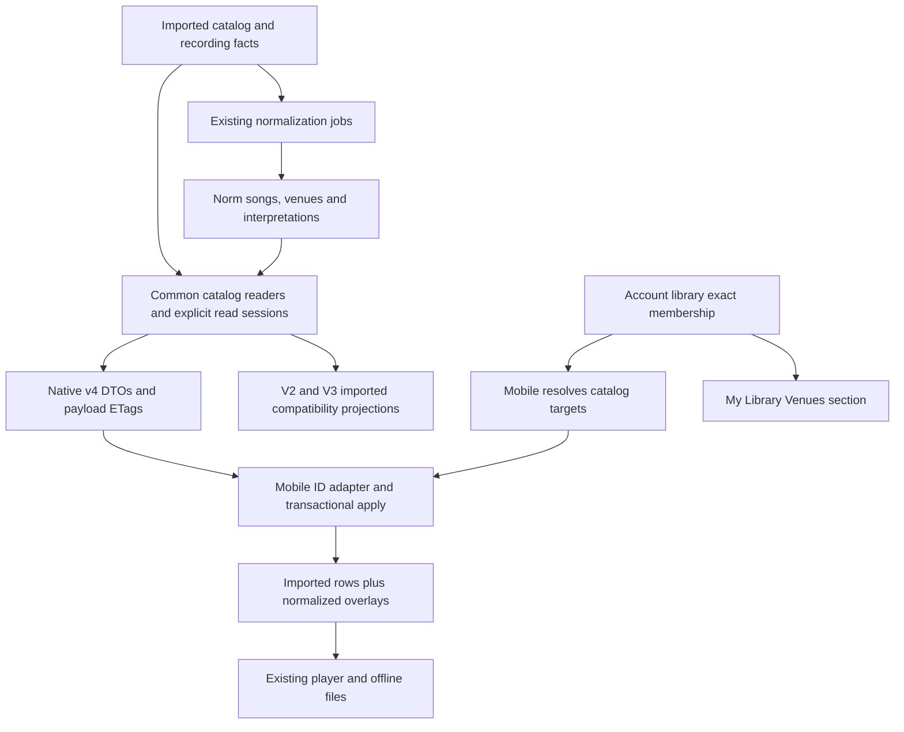
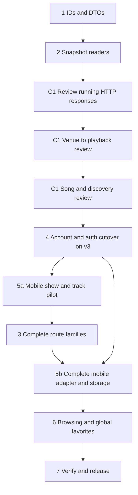

# Deliver the complete v4 catalog and mobile adapter

Status: C1 includes venue and song-to-playback navigation, 2026-10-30.
Implementation and real-response verification are in progress.
The local API reads the restored production catalog; no production deployment or
account migration occurred. This is a living ExecPlan: update Progress,
Discoveries, Decision Log, and Outcomes as work proceeds.

Build and review this in stages. First deliver a running browse and playback API that
Alec can inspect directly. Review artist/year, venue-to-playback, and song-to-playback responses before
account/auth work. The later breaking
account/auth cutover runs against the existing v3 catalog; prove a small normalized
mobile journey before completing the remaining API/UI.
The [review guide](review-guide.md) defines five checkpoints and what Alec sees.

## Outcome and readers

Deliver v4 coverage for every existing catalog, discovery, playback, and operator
API capability. Return typed catalog IDs, normalized venue overlays, and one
`normalization` object on every returned track. Mobile keeps its listening
navigation, imported playback titles, downloads, queue, and history. Global venue
favorites work across artists in a separate My Library Venues section. V4 is
the maintained catalog API. V2/v3 become compatibility adapters over the same
catalog application logic, not a second long-lived implementation.

Alec decides product behavior. Alec and Switz implement/review the work; both
know Relisten. This plan supplies the new contracts and cross-component rules
without requiring this conversation. Other readers need no normalization internals
beyond the definitions below. Work spans this repository and the sibling
`/Users/alecgorge/code/relisten/relisten-mobile` checkout.

Start with the [review guide](review-guide.md) for the build/review sequence.
Read this overview for component work, [contracts](contracts.md) for exact behavior,
[verification and rollout](verification.md) for release evidence, and
[endpoints.json](endpoints.json) for the executable route baseline. The linked
[assumptions and fresh review](assumptions-and-review.md) explain changes from
the exploration and constraints rechecked in current code. The linked
[design](../../../design/2026-10-29-v4-api/README.md),
[coverage tables](../../../design/2026-10-29-v4-api/routes.md), and
[approved prefixes](../../../design/2026-10-29-v4-api/prefixes.md) retain the
reasoning and source references. This plan takes precedence where it resolves
an earlier design proposal.

## Scope and decisions

- Keep artist → show → source → set → playable track. A source is a selectable
  recording; a normalized song part is metadata about a file, not a new file.
- Keep imported UUIDs and database join keys. Public UUID-backed IDs encode the
  same 128 bits in lowercase Crockford base32. Prefixes are `artist_`, `show_`,
  `source_`, `source_set_`, `track_`, `year_`, `tour_`, `imported_venue_`,
  `imported_song_`, `setlist_show_`, `source_review_`; normalized `venue_` and
  `song_` keep their existing eight-character suffixes. Stored artist–venue
  relationships use native short `artist_venue_` IDs. Eras stay embedded.
- Preserve every existing capability; duplicate aliases may consolidate. Admin
  HTML, health, OAuth, profile, and session protocols retain their own paths.
- Honor `features.norm_catalogue`. Missing/disabled normalization preserves
  imported browsing and playback. The separate `norm_venues` switch controls
  maintenance, not permission to read an artist's normalization.
- Normalized song matches identify exact show, source, track, and matching parts.
  Imported setlist evidence cannot establish a recording/track match. Preserve
  imported song/show behavior for artists without normalization and unresolved
  imported entries for partial coverage.
- Show UI renders the imported venue name/locality and links to the normalized
  venue through `show.artist_venue.venue` when present. Canonical name/locality
  is fallback only when imported data is absent. Venue `names` contains deduplicated `{ name, kind }` aliases, not date
  periods. Track playback title remains imported.
- Show summaries and full shows share nullable `artist_venue` resources with
  stored `artist_show_count` and a nested global venue. That venue's
  `global_show_count` sums stored counts for approved-read artists and stays the
  same across artist/year filters. Imported fallback remains separate.
- Canonical artist venue list entries contain `artist_venue`; canonical detail
  returns its metadata plus complete `shows`. Every imported venue includes its full
  `show_count`, including embedded show/source venues and imported detail.
  Include an imported entry when needed to reach unmatched shows; its full
  collection can overlap canonical entries during partial normalization. Clients always browse `/venues` and
  follow each entry's `kind`; they do not select a list from artist feature flags.
  Canonical counts come from stored artist relationships. Imported counts use
  the full show-level assignments to each imported venue.
- Canonical song counts come from `norm.song_counts`; imported setlist counts
  come from `public.setlist_song_counts`. GETs never recount. Live file/show
  discovery shares the recount's membership function, while saved counts may
  briefly lag post-commit imports. Admin song edits refresh atomically. Ordinary
  repairs commit each artist separately under the existing artist-scoped lock.
- Venue and song details return flat metadata and complete `shows` in one
  snapshot and ETag. Direct lookup routes accept their own ID
  kind, including imported and artist-venue IDs, without `detail_url`. Bare
  venue/song `/shows` routes are removed. The large song file-match collection
  remains separate, with song metadata and `tracks` but no `shows`. Compact browse
  and embedded resources cannot clear detail membership.
- “Recently updated” retains its imported recording-update meaning. A normalized
  correction still refreshes metadata; it does not move the show into that list.
- Global venue favorites do not implicitly favorite their shows or add all those
  shows to existing artist/year library groups. Keep exact stored targets after
  merges; no special favorite consolidation or migration is required.
- Change `/v1/library` in place. Account/auth user, session, favorite, mutation,
  library-change and command IDs are canonical prefixed strings in application
  storage and APIs. Preserve logical identities by encoding their UUID bits.
- Coordinate the private-alpha account/auth migration and require tester sign-in
  again. Preserve users, provider links and memberships; revoke old sessions/token
  families. No dual old-ID credential support or parallel library route version.

## Current code and constraints

The pre-implementation review checked API `3fb0e0fc1` and mobile `676ecd6`. The
[source observations and review](assumptions-and-review.md) explain the evidence.
Legacy readers open separate connections; normalization changes can leave imported
timestamps unchanged; mobile's cache can suppress those changes. V4 therefore
needs explicit snapshot reads and authoritative apply. Imported UUIDs also identify
mobile downloads/queues/history, so they remain stored behind the API adapter.

The [artist-venue foundation](../2026-10-30-artist-venues/README.md) is stacked
between shared normalization enums and v4. Local `relisten_db` is at migration 15.
Its full refresh was verified against real assignments: 5,397 pairs for 12 artists,
covering 13,418 show memberships, with zero count mismatches. Production was not
changed. Current v4 reads use this materialized relationship and retain imported
fallback when an approved assignment has no stored pair yet.

Production schema, primary capacity, replica topology and deployed migration mode
remain unverified. They are rollout checks, not assumptions this plan treats as facts.

## Data flow and ownership

Ingestion owns imported facts. Normalization owns interpretations, corrections,
and canonical merge relationships. API readers own public projections and query
counts. Accounts own exact favorite membership and replay. Mobile owns cached
query results and presentation. Reads never invoke model calls or workflows.
PostgreSQL consistency applies to one read request, not an entire asynchronous
normalization workflow. Redis popularity rankings remain separately maintained
inputs; read each required map once and do not claim transactional ranking updates.

## Maintainability and readability acceptance

V4 owns the future public contract. Shared catalog application code owns queries,
identity relationships, normalization policy and command behavior. Legacy adapters
own only old input parsing, output shape, and version-specific cache/transport
policy. Core code must not depend on legacy controllers, DTOs or `Identifier`.
Imported data is a domain requirement for v4 fallback, not a legacy-only feature.

Use explicit result models and a small number of cohesive readers/handlers.
Reuse resource projections across route families; do not build a reader/DTO stack
for each route or mirror every model through redundant intermediate types.
Do not introduce a generic endpoint pipeline, universal repository, field-bag
model, or API-version switch spread across services. Keep controller entrypoints
at one level: validate/resolve inputs, execute the query/command, project, respond.
Keep SQL batching, ordered track-part construction and fallback decisions in
named methods with clear ownership. Comments explain snapshot lifetime, retries,
publication and compatibility policy rather than narrating assignments.

Each implementation slice needs a fresh correctness/readability pass tracing a
normalized success, raw/partial result and failure/recovery path from its public
entrypoint. Passing a formatter or tests does not establish source readability.
Reviewers must be able to locate the relevant rule once without mentally merging
old and new service implementations. Routine helper names/layout remain local
implementation choices; these dependency and ownership rules do not.

Mobile keeps one Realm model and repository set. Transport selection belongs in
the API adapter; screens, playback and favorite kinds do not branch on API version.
V4 has one authoritative apply coordinator with explicit resource, owner and query
updates. Keep legacy cache/timestamp behavior in the legacy transport/update entrypoint.
Implement mobile's actual queries, not a generic interpreter of all server routes.

## Progress

- [x] Revalidate code, audience, prefixes, and complete route coverage.
- [x] Resolve song-match precision, fallback, venue names, update semantics,
  rollout flag, favorite scope, and My Library behavior with Alec.
- [x] Finish contract/migration/verification documents and fresh plan review;
  resolve feasibility, bootstrap, compatibility and rollback findings.
- [x] Start C1 on `codex/v4-api-c1`; shared ID codec passes 15 focused tests.
- [x] Implement the expanded C1 browsing journey and validate the live real-data host.
- [x] Implement seven venue reads and direct source detail for the C1
  [venue-to-playback journey](review/venue-source-journey.md).
- [x] Wire stored artist–venue resources and global counts into every C1 show/venue read.
- [x] Verify count identity, approval scope, ETags, and the real end-to-end responses.
- [x] Refresh the saved request/capture evidence for the new graph.
- [ ] Alec reviews the [expanded C1 browsing and playback responses](review/README.md)
  before account/auth work.
- [x] Add song browsing/discovery reads for the
  [song-to-playback review](review/song-source-journey.md).
- [x] Stack [stored song counts #111](https://github.com/RelistenNet/RelistenApi/pull/111)
  below v4, update admin refreshes, backfill locally, and verify the 19 ms warm
  artist-browse median with unchanged payloads.
- [ ] Alec reviews song counts, exact recording matches, and imported setlist
  fallback before account/auth work.
- [x] Unify venue/song detail snapshots, add direct imported and artist-venue
  lookups, and verify focused HTTP tests and real local responses. Keep compact
  browse resources and separate file-match detail; omit `detail_url`.
- [ ] C2–C5 remain unstarted pending the C1 response review.

## Discoveries and changes from the exploration

The proposed global normalization epoch is replaced by snapshot-derived HTTP
ETags for the first release. The change log omits derived links and cannot
act as a revision. A writer counter adds broad mutation obligations and possible
contention to intentionally concurrent imports. Use primary read-only snapshots
and no v4 Redis response cache initially. This is simpler but costs database
reads even for a 304; representative load results are a release gate.

The mobile ETag/apply issue requires a dedicated v4 transport and authoritative
apply entrypoint, not only DTO renaming. The in-place account change retains
`/v1/library` browser protections; verify those protections without adding routes.

## Implementation sequence

The numbers below identify components, not a single deployment. Follow the
[five review checkpoints](review-guide.md): packages 1/2 and the accepted catalog
families from package 3 produce browsing and playback HTTP responses first
(expanded C1). Venue browsing, direct sources, and song/discovery reads are
implemented; their response review remains the next gate before auth. Package 4
plus mobile account work proves typed auth/library against v3 (C2); the minimum of package 5 proves raw/normalized show playback
(C3); package 3 completes route families and their legacy adapters (C4); remaining
mobile/UI work and release checks finish the change (C5).

Use small PRs with one reviewable outcome. Account/auth and catalog work can be
developed independently after C1, but deploy the breaking account cutover and
activate normalized catalog reads separately. C2 does not require normalized
Realm tables or the full v4 resolver. Keep all 62 routes and global venue favorites
as first-release requirements; an early developer checkpoint is not that release.

### 1. Shared IDs and the first response models

Add dependency-free `Relisten.Identifiers/` with the approved codec/registries,
UUID-backed catalog types and string-backed account types. Keep normalization's
existing `VenueId`/`SongId` and Temporal strings. Hosts own serializer/binding
adapters; C# and TypeScript share known vectors.

Add `Models/Api/V4/` and `Controllers/V4/`, independently of the legacy base
controller's formatting/cache policy. Start with full show and direct track reads.
Core results are independent of legacy DTOs; reuse resource projections across
routes. Publish OpenAPI from actual DTOs. No legacy extraction or broad mobile
storage work belongs in this first response change.

### 2. Snapshot readers and C1 HTTP acceptance

Add `Services/Catalog/CatalogReadSession` and the first cohesive reader. Use one
primary read-only REPEATABLE READ transaction, explicit connection/transaction,
batched SQL, cancellation and a 30-second command timeout. Materialize before
serialization. Preserve legacy cache/routing and Npgsql auto-prepare.

Implement approved-read gating, partial track parts, raw fallback, canonical venue
links and aliases, canonical redirects and the ID reservation migration in
[contracts](contracts.md#canonical-redirects-and-retirement). Generate payload
ETags without writer counters. Deliver C1's running local Swagger/request setup:
normalization-only edits must change JSON/ETag despite unchanged imported times.
Alec reviews complete responses before their design spreads through the code.

### 3. Complete API families and legacy adapters for C4

The venue/source and song/discovery families are part of expanded C1 for API
review before accounts. After C3, implement the remaining
`endpoints.json` families and legacy adapters. Each family
gets native v4 routes, common query/results, legacy projections, response fixtures
and measured compatibility in one coherent change. Complete the pilot family's
legacy conversion here too. Imported/approved read views and primary/prefer-replica
targets remain explicit internal choices. Check legacy caches before expensive
materialization. Remove duplicated SQL after auditing non-HTTP callers.

Share operator handlers over existing ingestion clients/stores. Preserve current
admission, engine selection and job handles; v4 artist PUT uses route identity
and atomically updates artist/features/upstream assignments. Commands do not
become anonymous. Isolate v4 Swagger while preserving mixed legacy operation sets.

C4 requires all 62 operations, every returned track's common normalization DTO,
accepted browse/discovery/resolver examples, legacy compatibility and a fresh
source-readability review. All existing capabilities remain first-release scope.

### 4. Isolated account/auth migration for C2

Change `/v1/library` and `/v1/me` in place. Convert owned user/session/favorite/
mutation/change/command PKs/FKs and catalog favorite targets to canonical typed
strings, preserving identity bits and stored data. Convert first-party `sub`/`sid`,
codecs/cursors and mobile credential/profile/scope comparisons together. Keep
OpenIddict-private keys, external provider values and reviewed browser protections.

Follow the [coordinated migration contract](contracts.md#coordinated-alpha-migration-and-re-sign-in):
stop old writes, preserve users/provider links/favorites, revoke old first-party
credentials and require tester sign-in. No dual credential or parallel route version.

Prove the mobile account-only upgrade on v3 catalog. The catalog adapter maps typed
imported targets to the existing v3 resolver; account storage/sync stay typed.
Short normalized memberships survive unavailable metadata. This checkpoint needs
no normalized Realm tables or full v4 resolver. Review preservation, fresh login,
mutation replay, restartable upgrade and whole-account rollback before live cutover.

### 5. One mobile store and authoritative v4 apply

After C1/C2, add only the show/track adapter and storage needed for C3. Prove
raw/normalized playback, correction refresh, failed-apply retry and offline recovery
before route expansion. Complete the remaining mobile reads after C4.

Add `relisten/api/v4/` and additive Realm normalized venue/song rows, embedded
track interpretation, show display/browse fields and applied-query state. Keep
one repository/model set and existing imported UUID/file keys. Account IDs/targets
remain typed; the projection adapter bridges catalog records to account targets.

Apply resources, owned associations, query results and ETag in one Realm transaction,
using each endpoint's replacement rule. Bypass legacy timestamp guards for v4;
preserve richer detail when shallow related objects arrive. Discard superseded
query/account/transport generations. Failed apply commits no validator or cursor.
Test direct schema-15 upgrades and staged account-only then catalog upgrades.

### 6. Complete browsing and global favorites for C5

Use server-counted canonical-or-imported venue/song entries with existing artist
navigation. Song matches identify exact show/source/track; imported fallback
retains its setlist meaning. Render imported venue labels and link to canonical
venues where available. Preserve imported titles, playback URLs, source/set order
and offline identity.

Add global venue detail and a separate My Library Venues section using existing
styles. Venue favorites span artists without implicit show favorites. Keep simple
exact-target merge behavior. Normalized song favorites contribute their owning
artist, without adding all matching shows to the library.

### 7. Qualify and release separately

Follow [verification](verification.md): HTTP/coverage and compatibility evidence,
migration invariants, mobile/device/offline journeys, measured primary/legacy
performance and pinned rollback builds. Deploy server contracts before catalog
activation. The account/auth cutover is a separate event from catalog activation.

Use v3 catalog fallback only in a schema-compatible mobile build. A shared-core
regression needs server rollback; a converted account schema needs compatible
code/forward repair. Measure and agree capacity budgets before traffic expansion.
No migration, deployment, session revocation or public release is authorized merely
by accepting this plan.

## Decision Log

- 2026-10-29, Alec: approved 13 prefixes with `track_`, embedded eras, and
  functional coverage with duplicate-alias consolidation.
- 2026-10-29, Alec: normalized information belongs on every track, entirely
  under `normalization`; keep imported playback titles and raw artist support.
- 2026-10-29, Alec: exact show/source/track information from normalization;
  venue-name fallback (superseded by the imported-display decision below);
  recording-only recent updates; honor read flag.
- 2026-10-29, Alec: separate global Venues library section; simplest merge
  favorite behavior is acceptable, including re-favoriting; alpha sync may break.
- 2026-10-29, Alec: ordinary responses are direct resources/lists; use HTTP
  ETags and endpoint-specific sync rules, without generic response metadata.
- 2026-10-29, Alec: v4 is the future; prioritize maintainability/readability and
  make old APIs legacy compatibility shims over common catalog logic.
- 2026-10-29, Alec: approved six account prefixes, in-place `/v1/library`, native
  stored typed account/auth IDs and coordinated tester re-sign-in. OpenIddict
  private keys stay opaque; user/provider-link/favorite data is preserved.
- 2026-10-29, plan recommendation: keep imported Realm UUID keys; use primary
  snapshots/payload ETags rather than writer epochs; prove capacity before expansion.
- 2026-10-29, simplification review: inspect real HTTP responses before broad work;
  prove account/auth on v3 separately; keep one mobile repository set; expand v4
  and legacy adapters by family. Five review checkpoints govern dependent work.
- 2026-10-29, HTTP correction: use weak payload ETags for conditional GET so
  compression does not require another validator-generation mechanism.

- 2026-10-29, Alec: expand C1 to artist/year/show-list navigation before auth.
  Keep the full plan, but review these public contracts together first.

- 2026-10-29, Alec: canonical public resources are `venue`/`song`; include venue
  name periods and remove `venue_display` (periods superseded below).

- 2026-10-30, Alec: discard the additional venue-history fix and its branch. Show
  UI displays imported venue name/locality and links to the normalized venue
  when present. Return deduplicated `{ name, kind }` aliases without dates.
  No timeline resolution, history backfill, or date-evidence work is required.
  The active branch stack is normalization enums → artist-venue foundation → v4 API.

- 2026-10-30, Alec: expand the API review with artist venue groups, canonical and
  imported venue details/show lists, and direct source detail. Inspect the
  venue-to-playback journey before the next song/discovery slice and account/auth.

- 2026-10-30, Alec: expose `show.artist_venue.artist_show_count` and nested
  `venue.global_show_count`; update venue routes for end-to-end review. Reuse the
  same relationship resource and keep imported labels/fallback. Read stored counts
  with public approval filtering; do not refresh counts during API reads.

- 2026-10-30, Alec: put the full `show_count` on imported venues and remove the
  separate fallback subset count. Imported browse entries open the same full
  collection as imported detail, even when it overlaps canonical entries during
  partial normalization. Keep count meaning consistent for mobile persistence.

- 2026-10-30, Alec: extend the local catalog review through song browsing,
  exact show/source/track matches, and imported setlist fallback before accounts.
  Keep recording-derived counts separate from imported setlist counts.

- 2026-10-30, Alec: store canonical song/file/show counts and imported setlist
  counts below v4. Reuse the existing artist-scoped lock, keep counts separate
  from audited song decisions, and avoid schedules, queues, or per-row triggers.
  Wire v4 to stored reads and remeasure after local backfill.

- 2026-10-30, Alec: make every venue/song detail a resource-with-shows snapshot,
  using the separately loaded artist catalog. Add direct imported
  and artist-venue ID lookup; omit `detail_url`. Keep browse compact and song file
  matches separate. Review real responses before account/auth work.

## Outcomes and retrospective

Planning is complete. Independent feasibility and mobile/account reviewers
confirmed the corrected plan has no remaining blockers in their reviewed areas.
The handoff includes 60 catalog/operator endpoints, three in-place library
endpoints, two profile actions, contracts, five personal review checkpoints,
migration/rollback steps and verification. The full thread was reread during the
simplification pass; later decisions supersede the exploration's old epoch,
generic metadata, library versioning and UUID-backed account-storage proposals.

Earlier C1 runtime and local HTTP/snapshot checks are recorded in the
[response review](review/README.md). The stored artist–venue graph is the current
review update; its final response verification is pending. Migration 15 and the
full derived-count refresh have been applied to local `relisten_db`. Canonical
identity/deletion behavior still needs production release qualification. Mobile schema
upgrades, production load measurements and deployment remain unperformed. Primary capacity and deployment
configuration are execution gates, not assumed facts. Record implementation
results here as milestones are completed.
