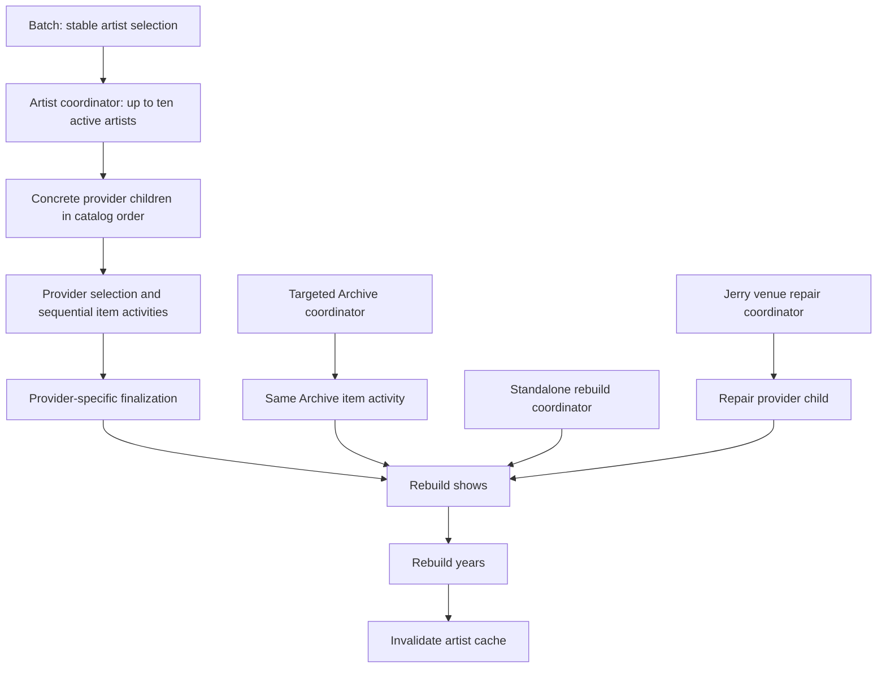

# How an import executes

An artist workflow owns one artist operation. It starts the artist's provider workflows in catalog order, including Phish.in before Phish.net, then rebuilds shows, years, and the artist cache. A provider workflow describes its own selection, pagination, item processing, and finalization. An activity performs the HTTP or database work for a named step.

Item activities fetch their required upstream inputs before starting a catalog transaction. One item result reports its typed key, catalog source or setlist identity, and `Applied`, `Unchanged`, or a supported `Skipped` reason. Derived show identities become available after rebuilding. Provider and artist summaries retain counts, not every successful identity.

## Code map

| Responsibility | Entry point |
|---|---|
| Named commands and provider keys | [ImportCommands](../../RelistenApi/Services/Ingestion/ImportCommands.cs) |
| Admission, schedules, provider client groups | [TemporalIngestionClient](../../RelistenApi/Services/Ingestion/TemporalIngestionClient.cs) |
| Result, cancellation, and description of the admitted execution | [ImportHandle](../../RelistenApi/Services/Ingestion/ImportHandle.cs) |
| Provider dispatch and final rebuild | [ArtistRefreshWorkflow](../../RelistenApi/Services/Ingestion/Workflows/ArtistRefreshWorkflow.cs) |
| One requested Archive recording | [ArchiveItemImportWorkflow](../../RelistenApi/Services/Ingestion/Workflows/ArchiveItemImportWorkflow.cs) |
| Recovery rebuild and Jerry venue repair | [RebuildArtistCatalogWorkflow](../../RelistenApi/Services/Ingestion/Workflows/RebuildArtistCatalogWorkflow.cs), [JerryVenueRepairWorkflow](../../RelistenApi/Services/Ingestion/Workflows/JerryVenueRepairWorkflow.cs) |
| Stable selection, child replacement, and continuation | [RefreshBatchWorkflow](../../RelistenApi/Services/Ingestion/Workflows/RefreshBatchWorkflow.cs) |
| Concrete provider steps and domain methods | [Provider guide](provider-behavior.md) |
| Shared item failure handling | [ImportItemOperation](../../RelistenApi/Services/Ingestion/Workflows/ImportItemOperation.cs) |
| Activity lifetime, diagnostics, and importer scope | [ProviderActivityRunner](../../RelistenApi/Services/Ingestion/ProviderActivityRunner.cs) |
| Current-state reads and atomic catalog writes | [CatalogImportTransaction](../../RelistenApi/Services/Data/CatalogImportTransaction.cs), [ProviderContext](../../RelistenApi/Services/Ingestion/ProviderIngestion.cs) |
| Rebuild scheduling and database operations | [CatalogSteps](../../RelistenApi/Services/Ingestion/Workflows/CatalogSteps.cs), [CatalogActivities](../../RelistenApi/Services/Ingestion/Activities/CatalogActivities.cs), [CatalogRebuildService](../../RelistenApi/Services/Data/CatalogRebuildService.cs) |
| Oversized serialized workflow values | [RedisPayloadCodec](../../RelistenApi/Services/Ingestion/Transport/RedisPayloadCodec.cs) |

## Ownership and retry behavior

All artist operations use `ingest/artist/{uuid}`. Temporal rejects an active conflict; the client reports `ImportAlreadyRunning` with that workflow ID. A completed ID can be reused for a new operation. The returned handle retains the admitted run and follows only its continuation chain. It cannot silently attach to a later import that reused the same artist ID.

`CatalogImportTransaction` serializes item and prerequisite writes with a transaction-scoped PostgreSQL advisory lock derived from the numeric artist ID. It acquires the lock before loading mutable sources, setlists, eras, or tours. The callback makes sequential data-service calls in one ambient ReadCommitted transaction. It does not fetch HTTP or open concurrent SQL connections. Data services continue to own UUID formulas, upserts, dependent rows, and deletions.

An activity retry may refetch HTTP inputs and repeat SQL. It reloads current catalog state and returns the current catalog identity. There is no saved commit receipt. `Applied` means processing succeeded; it does not establish how many rows changed in the first attempt.

Archive artist collection discovery uses a separate global lock because creating an artist also allocates a slug across artists. [ArchiveArtistDiscoveryWorkflow](../../RelistenApi/Services/Ingestion/Workflows/ArchiveArtistDiscoveryWorkflow.cs) first records a fetched, validated page in history. A second activity applies that fixed page, creating an artist and its upstream mapping together. Application retries use that recorded page. A cursor that fails to advance, or a listing that ends before its declared total, fails discovery.

Show and year rebuild SQL retains its own transaction ownership. `CatalogSteps` schedules shows, then years, then cache invalidation. These three activities do not form one transaction. Repeating a failed rebuild must converge after partial aggregate work.

## Failure and cancellation

An exhausted item failure increments `FailedItems`; the provider continues with its next item. A provider retains at most 20 structured failure details plus the total failure count. A completed artist result has status `Partial` when any item failed. A zero-selection or partial import still rebuilds once after all providers finish.

Preparation and discovery failures stop the operation before its remaining finalization. Expiration and cancellation propagate; they are not partial success. Archive deletion and Jerry orphan cleanup retain their separate domain rules, described in the [provider guide](provider-behavior.md). A failed rebuild fails the artist operation even if item writes already committed.

Activities heartbeat during HTTP and database waits. HTTP accepts cancellation. The transaction runner checks cancellation and the inherited deadline after locking and before commit. Existing Dapper calls use bounded SQL timeouts; not every query stops immediately when cancellation arrives. Rebuild SQL can finish committed work before it observes cancellation. Cancellation never undoes an earlier committed item.

## Continuation and retained inputs

An operation gets one logical execution ID and a seven-day deadline. Children inherit that deadline and receive only its remaining time. The logical ID is diagnostic context, not a catalog key. Continuation does not extend the deadline.

Provider checkpoints contain a typed stage, current page or selection position, counters, and required reconciliation evidence. They distinguish unstarted discovery from a completed final page. Providers continue after 100 completed activity calls or when Temporal recommends it, between item operations. Immutable selections or prepared catalogs travel separately from changing progress, so the payload codec can reuse their serialized bytes.

A batch selects artist UUIDs once and retains that array across runs. It fixes the thin-import year in UTC once, replaces completed children until ten are active, and drains children before a 250-artist segment or recommended continuation. Its result separately counts completed, partial, failed, and conflicting artists.

## Payload storage

Temporal stores event history in its own PostgreSQL databases. The shared data converter keeps complete serialized protobuf payloads of at most 256 KiB inline. Larger payloads, up to 64 MiB, go to Redis under a namespace-specific content hash. The history contains a versioned reference. Both original metadata and data are preserved.

Successful encoding or reuse refreshes the content key's 15-day expiry. Decoding checks the reference, length, and digest. It never substitutes a new provider fetch for missing bytes. Redis loss can prevent workflow activation or history replay, even though the catalog and Temporal databases remain available. See [storage and recovery](operations.md#storage-backups-and-recovery) before rollout.

The codec removes large values from history events; it does not limit history event count. Provider continuation remains necessary. Small result summaries remain readable in Temporal UI. Offloaded values appear as references because this implementation has no web codec endpoint.

## Verification boundaries

The [plan](provider-workflow-plan.md) tracks verification results. Meaningful checks exercise typed payload conversion, provider catalog output, repeated and overlapping writes, rollback, cancellation before commit, partial results, provider ordering, targeted imports, continuation/replay, worker replacement, batch concurrency, and handle isolation after workflow-ID reuse. Local tests use isolated services and fixture HTTP responses. Production behavior has not been verified by deployment.
