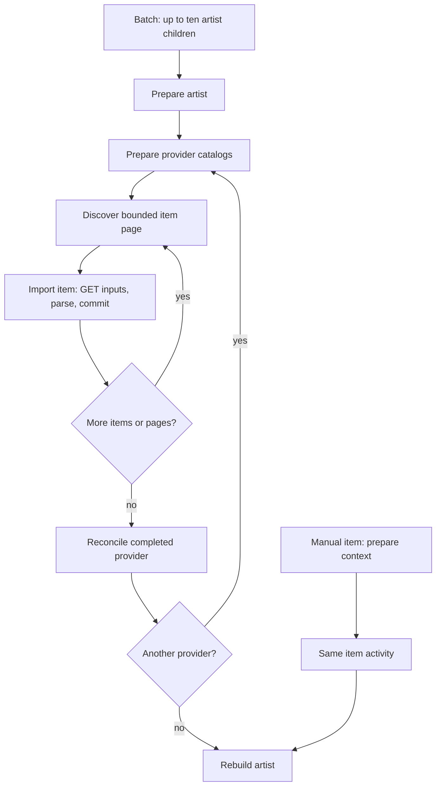

# How an import executes

Read `ArtistRefreshWorkflow.RunAsync` for the artist sequence. `ImportProvider`, `ImportPages`, and `ImportPage` each own one level of iteration. `ReimportItemWorkflow` calls the same item activity directly. No generic workflow engine or numbered fetch protocol sits between these entrypoints and the provider operations.

The diagram groups item iteration; the code imports all items in the current page before discovering the next page. Rebuild-only requests go directly from artist preparation to the final rebuild.

## Code map

| Responsibility | Entry point |
|---|---|
| Artist, page, and checkpoint sequencing | [ArtistRefreshWorkflow](../../RelistenApi/Services/Ingestion/Workflows/ArtistRefreshWorkflow.cs) |
| Targeted item import | [ReimportItemWorkflow](../../RelistenApi/Services/Ingestion/Workflows/ReimportItemWorkflow.cs) |
| Shared exhausted-item failure policy | [ImportItemOperation](../../RelistenApi/Services/Ingestion/Workflows/ImportItemOperation.cs) |
| Provider dispatch and activity boundaries | [IngestionActivities](../../RelistenApi/Services/Ingestion/Activities/IngestionActivities.cs) |
| Artist batches and collection discovery | [IngestionBatchActivities](../../RelistenApi/Services/Ingestion/Activities/IngestionBatchActivities.cs) |
| Provider contract and transactional context | [IProviderIngestion](../../RelistenApi/Services/Ingestion/ProviderIngestion.cs) |
| Expiring snapshots and atomic receipts | [IngestionStore](../../RelistenApi/Services/Ingestion/IngestionStore.cs) |

## Provider operations

Each `*Importer.Ingestion.cs` file reuses the existing parser and catalog code. Its item method fetches any required GET responses before entering `context.CommitAsync`. Item/catalog-preparation writes and their result commit together. An overlapping or repeated attempt returns the winning receipt; an exception rolls back both. This preserves result counts as well as database effects after a lost activity acknowledgement.

| Provider | Prerequisite or discovery data retained | Item operation | Finalization |
|---|---|---|---|
| Archive | Verified `rows=*` listing, selected listing fields, observed identifiers | Fetch metadata and apply one recording source | Verify absent candidates directly; delete only confirmed cases within the existing guard |
| Phish.in | Era/tour/song/venue catalogs and selected show pages | Restore the catalog ID mappings and apply the listed show | None |
| Phish.net | Selected source IDs and matching API show information | Follow ratings redirects, fetch reviews when needed, apply enrichment | None |
| Setlist.fm | Selected setlists from each page | Apply the setlist and preserve accumulated tour bounds | None |
| Phantasy Tour | New item IDs and every listed local date | Fetch and apply a new show's detail | Repair existing dates and derive tour bounds only after complete enumeration |
| Jerry mirror | Selected file metadata | Fetch HTML and import the show or venue correction | Remove orphan venues only after a successful venue backfill |
| Local | Root catalog for venues and selected date groups | Fetch the date's directory metadata and apply the combined recording | None |

Several GETs may repeat when an item activity retries. Their responses are not stored separately. Explicit catalog preparation avoids fetching Phish.in's prerequisite catalogs for every show. Stable discovery snapshots avoid repeatedly enumerating Archive's largest artists and keep selected work consistent through history rollover. Each discovery activity returns at most 100 item references to the workflow.

## Failure and cancellation

A prerequisite or discovery failure stops the workflow before provider reconciliation. An item that exhausts retries is logged and counted; other items continue. `FailedItems > 0` means a partial result. Provider reconciliation retains its own policy: Archive needs direct deletion evidence, and Jerry orphan cleanup requires a successful backfill. Cancellation propagates instead of becoming an item failure.

Activities heartbeat during I/O so Temporal can deliver cancellation. HTTP uses the activity cancellation token; item/catalog-preparation transactions check cancellation before commit. Already committed work remains committed. Rebuild SQL owns its existing transactions and is safe to repeat, so the rebuild activity does not use a receipt or an outer transaction. A subsequent artist import always rebuilds aggregates, including when it finds no new item changes. This also repairs aggregates left unfinished by a cancelled import without an application progress journal.

The artist workflow rolls over after roughly 100 activity calls, or when Temporal recommends it. The checkpoint contains the provider, page and item position, counts, and at most six Archive ineligible identifiers (enough to trigger the existing five-deletion guard). It does not contain item response bodies. Batch rollover waits for its active children to finish.

## Storage and lifetime

`ingestion_snapshots` contains immutable discovery selections and reused catalog inputs. `ingestion_receipts` contains compact committed results, including Archive reconciliation evidence. Both use the logical request ID. There are no stored fetch parts, request copies, item-failure rows, finalization markers, or PostgreSQL-based resume commands.

A run has seven days to finish. Its deadline survives ContinueAsNew, and every store operation rejects expired work. Rows expire one day after that deadline; the worker deletes expired rows at startup and hourly. The extra day keeps in-flight attempts from racing cleanup. Receipt deletion can never authorize an expired run to repeat a catalog write. If the worker is stopped, cleanup resumes at its next startup.

The execution deadline is deliberately finite because retained inputs have finite retention. Start a fresh import after expiry. Operators may change the lifetime in `IngestionRun.MaximumDuration` after observing backfill durations, but must keep admission timeouts and cleanup semantics aligned. Temporal's execution timeout includes ContinueAsNew; activity heartbeats are required for cancellation. See [workflow timeouts](https://docs.temporal.io/encyclopedia/detecting-workflow-failures) and [.NET cancellation](https://docs.temporal.io/develop/dotnet/workflows/cancellation).

## Verification boundaries

Tests compare all seven providers' catalog output with the legacy path, including stable source/track/show identity. Other tests cover lost acknowledgements, transaction rollback and overlap, expiry/cleanup, bounded discovery, retry and cancellation, worker replacement, workflow replay/rollover, and batch concurrency. Phantasy Tour tests cover correcting existing dates without detail requests and withholding repair after incomplete discovery. Archive tests retain Present/Deleted/Unknown and thin/targeted reconciliation coverage.
