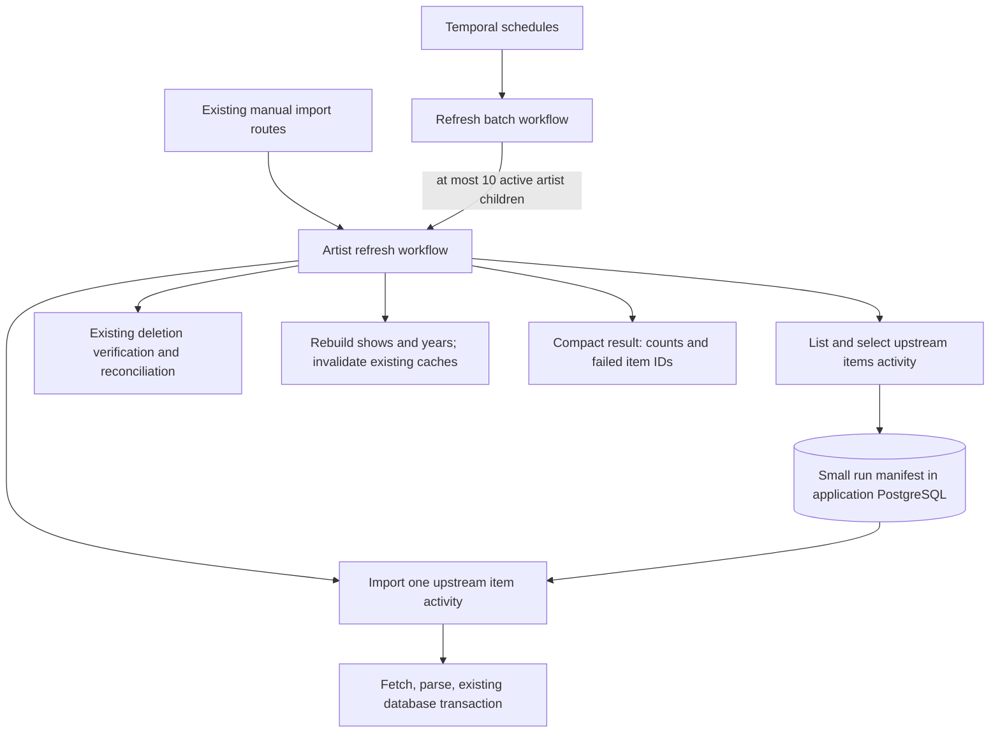

# Decision memo

Status: provisional. Scope is existing ingestion on self-hosted Temporal and PostgreSQL. See [overview](README.md) and [evidence](capacity-and-evidence.md). The [implementation plan](implementation-plan.md) and [queue throttling](upstream-throttling.md) refine this initial memo: separate manual item entry point, one HTTP request per fetch activity, and an operator-controlled ingestion stop/start during cutover.

## Existing behavior to preserve

The API targets .NET 10. Hangfire stores jobs in Redis; the artist queue has ten workers per enabled server. The checked-in deployment declares one ingestion worker, although live replica count was not inspected. Most importer item loops are sequential, but Phish.net’s Hangfire-progress path fans out up to ten source operations. Consequently, ten artist jobs already permit concurrent upstream requests from different artists. [C1–C3](capacity-and-evidence.md#code-evidence)

Scheduled work comprises:

| Operation | Current schedule or entry point |
|---|---|
| Discover Archive artists | 06:30 UTC daily |
| Refresh every artist, including auto-created artists | 07:00 UTC daily |
| Thin scrape artists with a show in the past seven days | 00, 02, 04, 12, 14, 16, 18, 20, 22 UTC; current-year scope |
| Refresh one artist or upstream item | Authenticated import routes and admin actions |
| Refresh Phish.in only | Existing API-key route |
| Rebuild shows/years; Jerry Garcia venue backfill | Existing admin/import operations |

Archive lists the collection, validates its response, then imports new, targeted, date-changed, review-changed, or recently added items. “Recently added” defaults to seven days. It writes a source, sets, tracks, reviews, and links, then rebuilds shows and years when something changed. A source failure is logged and the item loop continues. Most ingestion jobs disable Hangfire automatic retries. [C1, C3, C4](capacity-and-evidence.md#code-evidence)

The migration must retain PR89's independent deletion policy: the count guard, direct metadata checks, `Present` / `Deleted` / `Unknown`, and the separate no-VBR-MP3 eligibility rule. A search response can agree with its own count and still omit items. Temporal completion cannot establish that an upstream listing is complete. `Unknown` must keep the existing source. Thin scrapes must not perform whole-artist absence reconciliation. [C4, C5](capacity-and-evidence.md#code-evidence)

## Options

Shared foundations are the existing importer services, current SQL identities and upserts, the same scheduling/admin entry points, small Temporal payloads, and explicit per-item failure results. The differences are where Temporal records progress.

| Option | Workflow/activity interface | Failure and ownership | Assessment |
|---|---|---|---|
| **A. Artist workflow, source activities** | `RefreshArtist(request)` lists/selects items, calls `ImportItem(itemRef)`, then current reconciliation and aggregate activities | Artist owns ordering and finalization. Failed item retries locally; exhausted failures are recorded and do not hide successful items. A separate `ReimportItemWorkflow` composes the same operations and shares the artist Workflow ID. | **Recommended now.** Granular recovery with few orchestration concepts. |
| B. Artist workflow, source child workflows | Replace each `ImportItem` activity call with `IngestSource(itemRef)`; initially the child would call that same activity | Each recording gets a Workflow ID and separate history. Parent still owns whole-artist reconciliation. More workflow starts, events, and parent/child lifecycle handling. | Choose if independent recording workflow control is required now, or when a recording gains multiple durable steps. No need to introduce it just for possible future code. |
| C. Artist workflow, show child workflows | Parent groups recording items into `IngestShow(showKey, sourceRefs)` | Show child coordinates all recordings associated with a date and finalizes that show | Poor initial fit. Shows are derived from source metadata; a date can be unknown or corrected during import. GD has 18,200 recordings but only 2,081 shows. This introduces grouping/ordering changes before the migration needs them. |
| D. One entire importer activity per artist/provider | `RefreshArtist` calls existing `ImportDataForArtist` as one activity | Retry re-enters a whole provider import; progress inside it is not represented in history | Useful temporary bridge for small adapters. Does not meet the intended per-recording granularity for Archive. |

PanicStream is disabled and excluded: no workflow, activity, queue or importer migration for it. No workflow or activity per track is needed. Tracks are part of the source transaction. Provider-specific setlist items can be the import unit even when that provider creates no audio source. Preserve Phish.in's prerequisite eras, tours, songs, and venues before its show loop. [C3, C6](capacity-and-evidence.md#code-evidence)

Temporal itself recommends activities until child workflows have a concrete reason; children add history and lifecycle overhead. [Official child-workflow guidance](https://docs.temporal.io/child-workflows)

## Recommended control flow



Run providers in their existing order. Initially execute one source activity at a time within each artist, with ten artists in flight. Use ten-concurrent provider workers as the starting point; Phish.net’s internal fanout becomes explicit activity composition. A later measured increase is a configuration change, not a prerequisite for migration.

### Small internal contracts

Names below are proposed internal interfaces, not new public product APIs:

```text
RefreshBatch(BatchId, Selection, Cursor)
RefreshArtist(ArtistUuid, RequestId, ProviderFilter, Scope, Checkpoint?)
PrepareImport(ArtistUuid, RequestId, Provider, Scope) -> ManifestRef + counts
ReadManifestPage(ManifestRef, Cursor, Limit) -> item refs + next cursor
ImportItem(ManifestRef, ItemKey) -> Created/Updated/Unchanged/Skipped + counts
ReconcileImport(ManifestRef) -> existing-policy outcomes
FinalizeArtist(ArtistUuid, RequestId) -> aggregate result
```

`Scope` keeps current full refresh, specific upstream identifier, and thin-year behavior. An explicit backfill can select a fixed set of upstream identifiers and force refresh using the same item activity. Distinguish that from changing the meaning of the ordinary daily refresh.

Keep a small import-run manifest in the **application database**, outside Temporal's own tables. It records the artist/provider/scope, selected upstream identifiers and required search fields, completed/failed items, and compact counters. One run row and item rows are enough; a general job platform is unnecessary. The manifest makes a stable list and cursor available across history rollover and manual resumption. A successful source transaction should record its item completion in that transaction. Retrying after an uncertain acknowledgment can then return that receipt instead of redoing committed work.

An item failure record must distinguish an intentional skip from an exhausted transient failure. Temporal must not record an activity as successful merely because the current importer caught and logged an exception. Keep the current continue-through-items behavior by handling the activity failure in the workflow and reporting a partial result. Keep unexpected workflow programming errors visible for repair.

### Identity and duplicate requests

Use a stable active workflow ID such as `ingest/artist/{artistUuid}`. An already-running refresh must not be replaced or terminated by a duplicate start. Treat the conflict as “already running,” identify its request, and let the caller retry later, matching the current skip-overlap behavior. The daily parent records the conflict rather than declaring that artist refreshed. Permit a new execution after the previous refresh closes. Keep logical `RequestId` separate from Temporal `RunId`, which changes on Continue-As-New.

For batches, use `ingest/daily/{UTC-date}` or `ingest/backfill/{requestId}`. A resumed backfill reuses its stored manifest and unfinished item set. A deliberate fresh scrape gets a new request ID. Use the manifest to recognize a completed logical request even after Temporal history retention expires.

If a newer refresh has already updated an item, resuming an older manifest must revalidate that item's input and timestamps before writing. A cursor is permission to revisit unfinished work, not permission to overwrite newer catalog data.

Use existing provider/item identifiers for work identity. Preserve existing database UUIDs and numeric IDs. Source UUIDs derive from artist ID and upstream identifier; track UUIDs derive from artist ID and MP3 URL; show UUIDs derive from artist ID and display date. Source SQL uniqueness currently does not include provider ID. Do not silently namespace or regenerate those identities during this migration. [C7–C9](capacity-and-evidence.md#code-evidence)

Use the same active artist Workflow ID for full, exact-item and rebuild entry points. Stop Hangfire ingestion before enabling Temporal, and stop Temporal before handing work back. Alec controls deployments, so a database write-fencing/ownership protocol is unnecessary for this migration. Keep cancellation cooperative, transactions short and completion receipts atomic with their writes.

### History and payloads

Start the daily parent with no more than ten active artist children. After 250 completed artist children, drain outstanding children and Continue-As-New with its manifest cursor. An artist workflow similarly rolls over after roughly 500 total activity calls at completed item boundaries, or earlier if history size/count or `Workflow.ContinueAsNewSuggested` requires it. These are proposed conservative thresholds to test, not Temporal limits. Do not carry a large item list into the next run.

Parent rollover must wait for child results: children do not automatically become children of the new parent run. Set parent-close behavior explicitly; `RequestCancel` is appropriate for cancelling a batch, and the application must finish cancellation before authorizing replacement writes. Avoid detached children for this migration. A child artist's own Continue-As-New chain remains one logical child to its parent. [Child lifecycle](https://docs.temporal.io/child-workflows), [.NET Continue-As-New](https://docs.temporal.io/develop/dotnet/workflows/continue-as-new)

Fetch and parse full upstream metadata inside `ImportItem`; return only IDs, outcome, and counts. Do not put Archive file lists, reviews, HTML, or full catalog DTOs into Temporal history. Store the small discovery manifest outside history. This migration does not require an object store for every raw response. If an oversized diagnostic response must be retained, store it externally and record a reference with a checksum and expiry; raw archival can remain a later decision.

### Retry, cancellation, and backpressure

Activities can execute again after a successful external side effect if the completion acknowledgment is lost. Existing upserts help, but transaction/receipt handling must cover reviews, links, set replacement, track orphaning, and aggregates as well. Do not enable retries blindly around the existing whole-artist method.

Use explicit activity timeouts and a finite retry budget. A starting policy to test is five attempts for transient HTTP/network failures, exponential backoff, and a bounded total retry window. Respect `Retry-After` when supplied. Malformed or incompatible payloads should end as a recorded item failure; absence checks that cannot establish state remain `Unknown`, never deletion. Keep short HTTP-level retries from multiplying Temporal retries.

Long activities heartbeat and observe `ActivityExecutionContext.Current.CancellationToken`. Cancellation stops new item dispatch and asks active work to stop; it does not undo committed source transactions. Resume means process unfinished manifest items, not undo and start everything again. Avoid whole-workflow retry policies initially. [Retries](https://docs.temporal.io/encyclopedia/retry-policies), [.NET activity timeouts](https://docs.temporal.io/develop/dotnet/activities/timeouts)

Use `ingest-workflows`, `ingest-db`, and one HTTP task queue per provider. Each HTTP activity attempt makes at most one request; split multi-request operations into shared workflow composition. Configure a consistent `MaxTaskQueueActivitiesPerSecond` across pollers and bounded per-worker concurrency; disable eager execution and inner retries. Use ten-concurrent provider workers, with the optional queue rate unset unless a provider needs it. At rollout stop Hangfire ingestion and start Temporal ingestion. This is sufficient for the requested ingestion throttling and avoids a distributed limiter. See [queue settings and tests](upstream-throttling.md).

Backfill shares the same upstream/database budget. Alec can pause a backfill if normal imports need the slots; an automatic priority policy is not required. There is no need for a custom priority scheduler.

### Schedules and manual operations

Use three Temporal Schedules matching the current discovery/full/thin cadences. Preserve UTC. Set overlap explicitly, initially `Skip` to avoid piling up refresh batches. Record skipped/partial work. Do not silently add a dependency between the 06:30 discovery and 07:00 refresh; they are separate schedules today. Temporal supports schedule pause, trigger, and backfill in .NET. [Schedules](https://docs.temporal.io/develop/dotnet/workflows/schedules)

A Temporal Schedule backfill recreates scheduled triggers. A Relisten catalog backfill selects artists/items and resumes their manifest; use `RefreshBatch` for the latter. Pausing a schedule does not itself cancel an already-running import. Stop dispatch, cancel active work if requested, and report what already committed.

Keep current authentication and import route semantics while replacing their enqueue implementation. Some routes return a Hangfire job ID or a string containing it; keep response status/body shapes or update every known admin caller together. The synchronous debug routes and `deleteOldContent=true` are existing exceptional behaviors. Run those through the legacy route while normal ingestion is stopped; do not translate a destructive delete-and-reimport into a normal retryable activity. No new AI/search endpoints are part of this work.

## Self-hosting with PostgreSQL

Use a single Temporal server deployment running its frontend, history, matching, and internal worker roles; a Web UI deployment; and Relisten's .NET ingestion worker. The server and application worker are different processes. Keep server/API/UI access private. Ingestion downtime during restart is acceptable; workers resume from durable state when the service returns.

Create separate `temporal` and `temporal_visibility` databases and a dedicated service role. Reuse the current PostgreSQL installation; do not put Temporal tables in Relisten's application schema. PostgreSQL supports both persistence and modern Visibility, so Elasticsearch is unnecessary for this starting design. The documented Visibility baseline is PostgreSQL 12+ with Temporal Server 1.20+; the measured Relisten replica runs PostgreSQL 17.10. Verify the selected maintained server release, SQL plugin/schema, and PostgreSQL combination in the pilot. A historical minimum version is not a recommended version to install. [PostgreSQL setup](https://docs.temporal.io/self-hosted-guide/visibility/postgresql)

Use pinned production server/admin-tool images and explicit schema setup; do not use the development server as production. If Helm is chosen, server 1.30+ requires a compatible chart (the current guide says 0.73.1+). There is no requirement to introduce Helm if the existing manifest workflow is simpler. [Deployment guide](https://docs.temporal.io/self-hosted-guide/deployment)

The recurring chores are small but real:

- Include **both new databases** in off-host backup coverage. Existing Relisten database-only dumps may not include them. Test restoring to an isolated database and restarting a paused workflow. Database backup is recovery; Temporal history archival is not a replacement for it.
- Monitor disk/WAL growth, database latency/connections, activity failures, queue delay, and last completed artist/batch. Keep Sentry and existing alerts, adding workflow/run/item IDs. Temporal UI provides item retry detail; no custom review application is needed.
- Start with a short history retention such as seven days, subject to Alec's preference. Keep manifests long enough for a named backfill/recovery, then clean them up. PostgreSQL Visibility indexes need ordinary vacuum/bloat monitoring; retention does not guarantee the disk shrinks.
- Upgrade server minors sequentially, following release notes and applying required schemas before the server. Test the upgrade and restore once outside production. Worker code changes separately need replay-safe workflow changes or draining old runs before replacing the worker. [.NET versioning](https://docs.temporal.io/develop/dotnet/workflows/versioning), [server upgrades](https://docs.temporal.io/self-hosted-guide/upgrade-server).

Do not add extra server replicas, a separate PostgreSQL cluster, or elaborate recovery targets until operation shows a reason. The [capacity model](capacity-and-evidence.md#capacity-model) identifies what the small pilot must measure.
