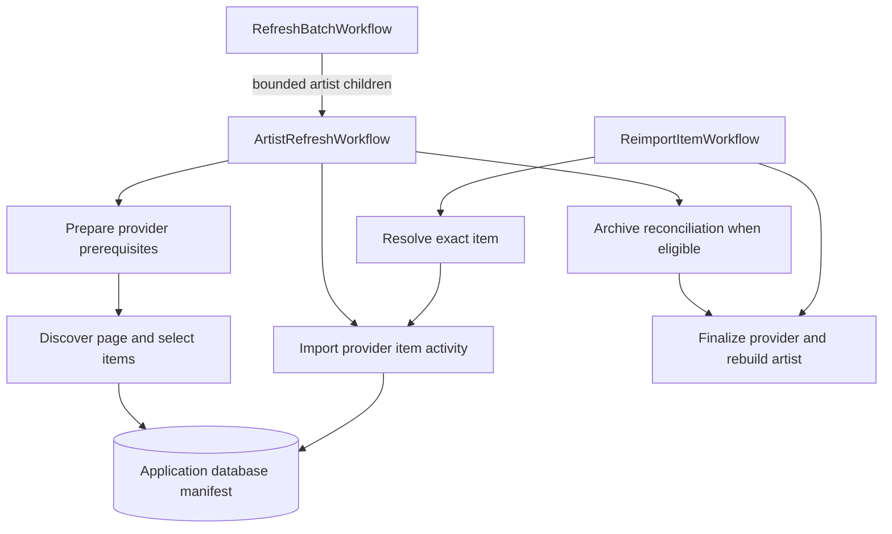

# Workflow and importer contracts

> Historical planning record. The implemented design is documented in [architecture.md](architecture.md) and [operations.md](operations.md); these supersede activity, persistence, and recovery proposals below.

Proposed implementation, 6 October 2026. Read the [implementation plan](implementation-plan.md) first. Observations refer to API commit `8414bad39d854a5f06bac5c3975d1e144fa9efa2`; proposed names below do not exist yet.

## Compose activities through two entry points

Use `ArtistRefreshWorkflow` for normal discovery and refresh, and `ReimportItemWorkflow` for an explicit item request. Both call the same provider operations. Starting a manual item workflow gives that request its own history without creating a child workflow for every item during a daily scrape. If independent item workflows later prove useful, the same activities can move into children.

Do not use “show” for every item. Archive items are recording sources; a Relisten show groups sources by artist/date. Other providers import setlists or enrich an existing recording. Tracks remain inside the item transaction.

### Shared input and output

| Contract | Fields and meaning |
|---|---|
| `IngestionRequest` | Logical `RequestId`, `ArtistUuid`, optional provider mapping ID, `Scope`, requested-by/reason, `ContractVersion`. Store immutable arguments in the application database. No credentials. |
| `Scope` | `FullRefresh`, `LegacyThin(year)`, `ExactItem(providerItemKey)`, or `Resume(manifestId)`. A fixed year backfill is separately declared below; do not equate it with today's inconsistent thin behavior. |
| `RunRef` | Manifest ID and provider mapping ID. Temporal Run ID is diagnostic, not the durable request identity. |
| `ItemRef` | Manifest ID + provider item key. Reference staged discovery data instead of passing HTML, metadata, or track arrays through Temporal. |
| `PageResult` | Next cursor, selected count, completion/validation status, staged page reference. Page retry replaces the same staged page atomically; it cannot append duplicate items. |
| `ItemResult` | `Created`, `Updated`, `Unchanged`, `Skipped`, counts, receipt ID. Exhausted errors are recorded as `Failed`; they cannot masquerade as `Unchanged`. |
| `RunResult` | `Complete`, `Partial`, `Cancelled`, or `AlreadyRunning`, counts and manifest reference. Fetch detailed failures from the manifest rather than returning an unbounded list. |

Each HTTP activity attempt makes at most one request and uses its provider task queue. Names below describe logical operations; multi-request operations are workflow helpers that compose separate fetch activities and a database apply activity, as specified in [queue throttling](upstream-throttling.md). Activities use scoped services with immutable inputs. Remove shared `CurrentImportOptions`, slug counters, and importer dictionaries from cross-call state; reconstruct small lookups from primary data or a run snapshot. A deterministic workflow helper can compose several activities when needed. HTTP, SQL, parsing and wall-clock reads stay in activities.

Use the same active Workflow ID, `ingest/artist/{uuid}`, for artist refresh, exact-item and rebuild workflows. An overlapping start returns the active run; different entry-point workflow types can share that ID. Keep logical RequestId separate from Temporal RunId. The first activity creates or loads the manifest; no custom admission/outbox service is needed.

Each item transaction applies existing SQL and saves a completion receipt. A retry after a lost acknowledgment returns the receipt. Stop Hangfire ingestion before starting Temporal ingestion, and stop the Temporal worker before handing writes back; Alec controls that rollout. No database ownership generations or cross-scheduler write guard is needed. Resume unfinished inputs against current primary data instead of blindly applying an old snapshot.

`FinalizeArtist` runs once after the selected providers, and once after a manual item run. It preserves source/show/year relationships, freshness and existing cache invalidations. Preserve provider-specific tour updates. A partial run can rebuild from successful commits while reporting failures; a failed discovery is never permission for absence reconciliation. If finalization fails, retry/resume it independently. Cancellation records `NeedsFinalize` when catalog writes have occurred, so resume/rebuild cannot silently leave aggregates stale.

## Provider inventory and extraction

All implementation source paths below are relative to `RelistenApi/Services/Importers/`, unless stated otherwise. Provider order follows the artist's existing mapping order and current prerequisites; do not reorder providers by the registry array.

### Archive.org — [ArchiveOrgImporter.cs](https://github.com/RelistenNet/RelistenApi/blob/8414bad39d854a5f06bac5c3975d1e144fa9efa2/RelistenApi/Services/Importers/ArchiveOrgImporter.cs)

**Observed:** `ArchiveOrgSearchClient` requests `/advancedsearch.php` with collection, optional year, selected fields and `rows=*`. It validates status, start, reported count and duplicate identifiers. Metadata comes from `/metadata/{identifier}`. Selection includes new items, date/review changes, targeted IDs and recently added items. Import writes source, sets, tracks, reviews and links. Thin mode suppresses absence reconciliation. Metadata verification uses `extended_err=1`, a 20-second timeout, and `Present/Deleted/Unknown`; a plain HTTP 404 is Unknown. Search consistency does not prove completeness.

**Activities:** `DiscoverArchiveItems(RunRef, scope) -> PageResult` stages the validated listing and selection; this endpoint is one listing, with database manifest paging afterward. `ImportArchiveItem(ItemRef) -> ItemResult` fetches metadata, parses, then applies existing item SQL and receipt atomically. `VerifyArchiveDeletionCandidate(ItemRef) -> VerificationResult` records evidence; `ApplyArchiveReconciliation(RunRef) -> counts` rechecks eligibility, current guard and direct evidence within the item transaction. Preserve the separate no-VBR-MP3 rule. Evaluate the existing greater-than-five guard before extra verification requests. Never translate exhausted errors into Deleted.

**Manual:** `ResolveArchiveItem` can fetch the exact metadata identifier and validate artist/provider association. It cannot reconcile absence across the artist. The old targeted implementation also traverses the artist listing and can reach artist reconciliation; keep its legacy route behavior separately until a reviewed route change. The new exact-item command is explicit about its narrower scope.

**Year:** legacy thin preserves its current query and selection. An explicit year backfill can filter the listing by year, force selected items, and disable absence reconciliation. This is a new administrative capability, not a silent change to the daily scrape.

### Phish.in — [PhishinImporter.cs](https://github.com/RelistenNet/RelistenApi/blob/8414bad39d854a5f06bac5c3975d1e144fa9efa2/RelistenApi/Services/Importers/PhishinImporter.cs)

**Observed:** API v1 `eras`, `tours`, `songs`, `venues` precede `shows`. Shows are paged in groups of 20 and each show object already includes tracks. Full mode reads forward using returned total pages; thin mode walks backward and stops before the year's lower bound. It does not impose an upper year bound. Selection compares upstream `updated_at` with existing source timestamps. A show ID identifies a source plus setlist data.

**Activities:** `PreparePhishinCatalog(RunRef, stage)` for each prerequisite in its current order; persist the era/year mapping instead of relying on an importer instance. `DiscoverPhishinPage(RunRef, page) -> PageResult` stages complete show objects. `ImportPhishinShow(ItemRef)` parses the staged object and applies source/setlist/track writes. Keep pagination checkpoints and staging atomic; do not refetch a successful prerequisite just because one show failed.

**Manual/year:** current targeted method is a no-op. A proposed exact-item resolver searches the existing paged `shows` API and stages the matching ID; no unverified direct-show endpoint is assumed. Run necessary prerequisites first. Fixed-year backfill filters both year bounds locally and forces only selected shows. Those two new capabilities stay disabled until separately accepted; full/thin parity does not depend on them.

### Phish.net — [PhishNetImporter.cs](https://github.com/RelistenNet/RelistenApi/blob/8414bad39d854a5f06bac5c3975d1e144fa9efa2/RelistenApi/Services/Importers/PhishNetImporter.cs)

**Observed:** enriches existing Relisten sources, not a new audio catalog. Fetches API v5 `shows` once, scrapes `https://phish.net/setlists/?d={date}` for each source's ratings, then conditionally fetches API v5 reviews by show date. Changes ratings, reviews, descriptions/setlist notes and links. Thin mode filters existing source display dates by year. The Hangfire-progress path already fans out ten calls; the other path is sequential. Always rebuilds aggregates. Its HTTP factory and API client must both be called only from the corresponding queue-bound fetch activities.

**Activities:** `PreparePhishNetShows(RunRef)` stages the API lookup. `SelectPhishNetSources(RunRef, cursor)` pages existing primary source rows. `EnrichPhishNetSource(ItemRef)` is a shared workflow helper: `FetchPhishNetRatings` uses source UUID + date, `FetchPhishNetReviews` runs only if needed, then `ApplyPhishNetEnrichment` atomically writes enrichment and receipt. Each fetch is one request on `ingest-phishnet`; apply runs on `ingest-db`. Keep missing API-show/null and changed-description behavior in characterization fixtures; malformed data is a visible item failure, not deletion.

**Manual/year:** targeted method is currently a no-op. Proposed exact selection is an existing source UUID, with artist membership checked; a date alone can match several sources. Do not implicitly create a source. Fixed-year selection can reuse the current filter. New commands remain separate from legacy parity.

### Setlist.fm — [SetlistFmImporter.cs](https://github.com/RelistenNet/RelistenApi/blob/8414bad39d854a5f06bac5c3975d1e144fa9efa2/RelistenApi/Services/Importers/SetlistFmImporter.cs)

**Observed:** pages `/rest/1.0/artist/{musicbrainz_id}/setlists?p={page}`; full setlists arrive in list pages. Writes venues, tours, songs, setlist shows and plays. Skips empty sets and computes tour start/end dates. Ignores `OnlyYear`; targeted method is a no-op. Its seven-retry JSON policy wraps page processing, including writes, and its 100 ms delay is not a verified global quota.

**Activities:** `DiscoverSetlistFmPage(RunRef, page)` only fetches/validates/stages. `ImportSetlistFmSetlist(ItemRef)` applies one staged setlist and receipt. `FinalizeSetlistFmTours(RunRef)` derives the current tour bounds from staged/committed data. Preserve upstream setlist IDs, date parsing and duplicate song handling. Removing the page-level write/retry combination prevents one bad item from replaying the entire page's writes.

**Manual/year:** if separately enabled, resolve an exact setlist ID by the known artist listing; fixed-year backfill filters staged setlists. Legacy thin continues the existing full provider scrape. Do not claim a server-side date filter or direct endpoint without separate verification.

### Phantasy Tour — [PhantasyTourImporter.cs](https://github.com/RelistenNet/RelistenApi/blob/8414bad39d854a5f06bac5c3975d1e144fa9efa2/RelistenApi/Services/Importers/PhantasyTourImporter.cs)

**Observed:** `/api/bands/{id}/shows?pageSize=100&page={page}` then `/api/shows/{id}/blob`. Selects missing setlist shows, skips future shows, uses `pt:{id}` identity, updates tours and rebuilds. Ignores `OnlyYear`; targeted method is a no-op. A null listing currently ends pagination; the new discovery contract records invalid data as incomplete, not a complete empty catalog. Existing JSON retries and page sleeps need removal after queue-bound activity extraction.

**Activities:** `DiscoverPhantasyTourPage` stages index items. `ImportPhantasyTourShow` fetches the blob and writes venues/tours/songs/setlist data plus receipt. `FinalizePhantasyTourTours` retains current bounds behavior. Store the selection instant in the run so future-show selection is reproducible.

**Manual/year:** the known blob endpoint supports proposed exact resolution, validating returned band and identifier; otherwise confirm membership through the listing. Fixed-year filtering happens over discovery. Keep both changes explicit; legacy thin still ignores the year.

### Jerry Garcia — [JerryGarciaComImporter.cs](https://github.com/RelistenNet/RelistenApi/blob/8414bad39d854a5f06bac5c3975d1e144fa9efa2/RelistenApi/Services/Importers/JerryGarciaComImporter.cs)

**Observed:** reads `show_pages.json` and `show_pages/{filename}` from the existing `relisten-grateful-dead-metadata-mirror.s3.amazonaws.com/{providerIdentifier}/` mirror. Imports HTML-derived setlists, not audio sources. Existing filename-to-ID rules, last-modified fallback, tours and venue handling are significant. Ignores `OnlyYear`; targeted method is a no-op.

**Activities:** `DiscoverJerryPages` stages file descriptors. `ImportJerrySetlist` fetches/parses one page and applies existing IDs/setlists with a receipt. `FinalizeJerryTours` retains tour updates. Record a fallback timestamp once per staged item instead of choosing a new value on each retry.

**Venue backfill:** `JerryVenueBackfillWorkflow` uses the same artist Workflow ID, discovers pages, selects existing setlist shows, calls `BackfillJerryVenue(ItemRef)`, rebuilds, then runs the existing artist-scoped orphan-venue cleanup only after complete successful traversal. Check source/show/setlist references before cleanup. Ordinary import does not acquire this extra cleanup behavior.

**Manual/year:** proposed exact selection uses a filename descriptor from the manifest, not an arbitrary URL. Fixed-year filtering may require fetching/parsing HTML when date is not reliable in the listing; that extra request cost must be visible. Neither is needed to preserve today's thin/full behavior.

### Local — [LocalImporter.cs](https://github.com/RelistenNet/RelistenApi/blob/8414bad39d854a5f06bac5c3975d1e144fa9efa2/RelistenApi/Services/Importers/LocalImporter.cs)

**Observed:** remote metadata on `audio.relisten.net`, despite the name. Fetches `/{providerIdentifier}/metadata.json`, then `/{providerIdentifier}/{directory}/metadata.json`. One date can contain several directories; the importer merges them into one source keyed by date. It also writes setlist data. Some detail fetches occur inside the current database transaction. Ignores `OnlyYear`; targeted method is a no-op. Generates audio URLs without downloading audio.

**Activities:** `DiscoverLocalDates` stages the root metadata once for venue and show stages. `PrepareLocalVenues` applies current venue rules. `ImportLocalDate` is a shared workflow helper: call `FetchLocalDirectory` once per directory on `ingest-local`, then `ApplyLocalDate` on `ingest-db` applies the merged source/tracks/setlist and receipt. Staged bodies remain outside workflow history. Never treat each directory as an independent source. Bound request duration individually; heartbeat during groups and retain completed staging on retries.

**Manual/year:** proposed exact key is a display date and includes every directory in that group. A fixed-year selection filters the root catalog. Legacy selection still uses the current first-show timestamp comparison until a separately reviewed bug fix.

### PanicStream — excluded

Alec asked to disable/ignore PanicStream. It has no current provider mappings. Do not register Temporal activities, create a queue, migrate its importer, add fixtures or investigate its existing selection logic as part of this work.

## Discovery and maintenance entry points

`ArchiveArtistDiscoveryWorkflow` calls `DiscoverArchiveCollectionPage(cursor)` through the same Archive task queue, stages candidates and calls `ApplyArchiveArtistCandidates(pageRef)`. Source: `Services/Indexing/ArchiveOrgArtistIndexer.cs` and `Vendor/ArchiveOrg/CollectionIndexClient.cs`; endpoint `/services/search/v1/scrape`. Preserve threshold, slug, artist defaults, linking and duplicate handling. No artist removal follows a missing collection. Use per-page receipts and the existing upstream identifier checks; don't duplicate auto-created artists after a lost acknowledgment.

`RebuildArtistWorkflow` invokes existing show/year/cache finalization, without HTTP. `RebuildCatalogWorkflow` pages artist IDs and starts bounded rebuild children. The API-key Phish.in route uses `ArtistRefreshWorkflow` with the existing provider filter. Full refresh and active-artist thin refresh use `RefreshBatchWorkflow` with their existing database selectors. A catalog backfill uses an explicit stored artist/item selection; Temporal Schedule backfill only replays schedule triggers.

## Compatibility boundary

The migration's mandatory contract is existing full/thin/discovery/rebuild behavior, plus safe retry/reporting. The six active non-Archive `ImportSpecificShowDataForArtist` methods currently return empty stats (PanicStream is excluded). Do not convert them into real imports through an old route as an incidental refactor. The exact-item and fixed-year contracts above make future composition concrete, but enabling new provider capabilities requires a distinct accepted change and tests. Initially expose only implemented capabilities internally and keep existing public route behavior. Archive's narrower manual command likewise must not silently change the old route's reconciliation effects.

Keep `deleteOldContent=true` and synchronous debug behavior on a controlled legacy adapter while normal ingestion is stopped. Destructive deletion is never part of an automatically retried item activity. Preserve authentication, HTTP status and response shape; keep the actual Hangfire job identifier for legacy enqueues and explicitly adapt known callers before returning Temporal identifiers. A workflow name is not a reason to change a mobile/web catalog contract.
