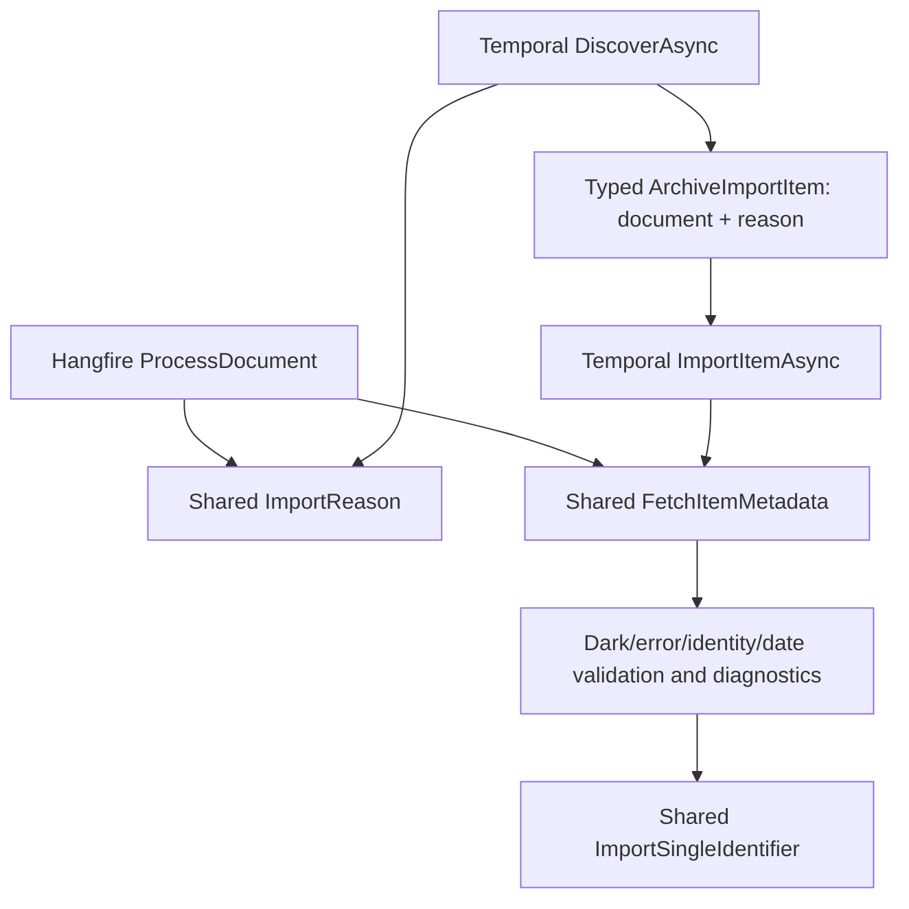

# Provider behavior and logging

Temporal and Hangfire share catalog parsers and writes. They have different execution and failure handling. The tests compare all seven providers against the legacy catalog output; they do not prove every upstream response has equivalent behavior.

## Where Archive's `processDoc` went

The old Hangfire lambda combined selection, HTTP, metadata validation, a transaction, exception handling, and diagnostics. The first Temporal version bypassed it and called `ImportSingleIdentifier` directly. That kept the write logic but duplicated selection/validation and omitted wrapper diagnostics.

The current paths share the domain decisions:

[ArchiveOrgImporter.Item.cs](../../RelistenApi/Services/Importers/ArchiveOrgImporter.Item.cs) owns selection reasons, metadata validation, date repair diagnostics, and deletion-guard reporting. Hangfire's `ProcessDocument` calls those helpers inside its loop. Temporal stores the selected document and reason, then calls the same metadata helper and catalog writer inside an item activity. Its write runs through the receipt transaction.

Both engines also call `VerifyDeletionCandidatesAsync`. Missing listing entries require direct metadata evidence. The five-candidate guard, Present/Deleted/Unknown policy, no-MP3 eligibility rule, and existing operator alert remain separate from Temporal execution success.

## Shared provider operations

| Provider | Typed item | Shared processing and write methods |
|---|---|---|
| Archive | `ArchiveImportItem` (`SearchDoc` plus reason) | `ImportReason`, `FetchItemMetadata`, `ImportSingleIdentifier`, `VerifyDeletionCandidatesAsync` |
| Phish.in | `PhishinShow` | `ProcessEras`, `ProcessTours`, `ProcessSongs`, `ProcessVenues`, `ProcessOneShow` |
| Phish.net | `SourceInput` (source ID plus matching API show) | `ProcessSource`, supplied with fetched ratings/reviews |
| Setlist.fm | `Setlist` | `ProcessSetlist`; retain committed tour bounds between activities |
| Phantasy Tour | `PhantasyTourShowListing` | `ApplyShowBody`; repair listed local dates and derive tour bounds after complete discovery |
| Jerry mirror | `FileMetaObject` | `ProcessPage` or `ApplyVenueBackfill`; shared venue cleanup service |
| Local | `LocalShow[]` for one date | `ProcessVenues`, `ProcessOneDay`, supplied with directory metadata |

The workflow's artist, provider, page, item, and reconciliation sequence is in [the architecture guide](architecture.md). The provider partial files show the concrete types and domain operations; the generic base owns snapshot paging and typed item loading.

## Diagnostics

Shared importer messages go to `ILogger` and to the Hangfire console when a `PerformContext` is present. Temporal no longer loses those messages merely because it passes a null Hangfire context. Archive selection reasons, dark/missing-date skips, date repairs, deletion checks, and guard alerts are available from both engines.

Temporal activity logs include request ID, artist, provider, item identifier, workflow ID, activity ID, and attempt. Lifecycle messages report discovered counts, reused receipts, item results, reconciliation, and final rebuild counts. The worker console includes scopes. HTTP diagnostics report the upstream path and status; query parameters are excluded because some APIs put credentials there. The Temporal UI supplies activity state, retries, cancellation, and failed workflow details. It does not reproduce Hangfire's console progress bars.

The existing Sentry calls in shared parser code remain. The standalone worker does not initialize a Sentry integration; standard worker logs and Temporal failures are the available error-reporting channels unless that integration is configured separately. The API/Hangfire host already has its own Sentry setup.

## Intentional execution differences

- Temporal retries a failed item activity, then counts an exhausted item and continues. The legacy importers have provider-specific catch/retry behavior. Cancellation propagates instead of becoming a skipped item.
- Preparation or discovery failure stops the Temporal workflow before reconciliation. Archive still needs positive deletion evidence after a complete listing, and Jerry orphan cleanup requires a successful backfill.
- Temporal uses immutable discovery selections and transactional receipts. Related GET responses remain in memory and may be refetched on retry.
- A targeted Archive Temporal import does not reconcile other sources. Other providers retain their existing targeted-import no-op behavior.
- Temporal rebuilds artist aggregates at the end even when no item changed, so it can repair aggregates left by an interrupted import. Rebuild retains its own transactions and is safe to repeat.
- Temporal uses the documented seven-day execution deadline and ten-way provider concurrency. Hangfire's progress display and execution lifetime are different.

## Verification

Local fixtures compare sources, tracks, shows, setlists, songs, tours, and reviews, including stable IDs where those objects exist. Additional tests exercise shared Archive skip diagnostics, corrected dates, selection reasons, correlated Temporal logs, and guard alerts captured by a fake notification sink. No test sends an operator notification externally. Existing tests cover retry receipts, rollback, cancellation, history rollover/replay, worker replacement, targeted imports, and Phantasy Tour date repair.
