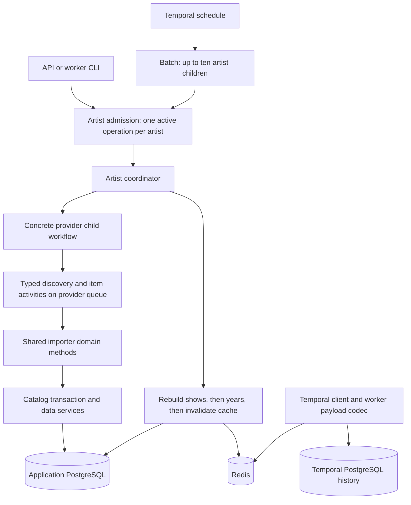

# Implement typed provider workflows and receipt-free retries

Status: implemented and verified locally, including the October 15 concurrency update. Prepared October 12, 2026 against baseline `529deba` on `codex/temporal-ingestion-plan`. The steps retain their original rationale; the progress record below describes implementation evidence and departures.

## Outcome and reading order

An engineer should be able to open a provider's workflow file and see what it fetches, what one item means, what it writes, and when it repairs derived catalog data. Callers request a named operation. Provider data stays typed from discovery through import. Temporal stores the execution record; a Redis payload codec moves large values out of that record transparently. Safe repeated catalog writes replace application commit receipts.

Readers are Alec, Switz, and implementers or reviewers who know Relisten as an app but may not know its technical stack. Alec controls rollout. No infrastructure creation or production deployment is part of implementing this plan.

Read this file for scope, rationale, steps, verification, and handoff. Read [the contract reference](provider-workflow-contracts.md) before implementing client methods, provider workflows, or persistence. It defines the behavior that the steps below must produce. The [prior proposal](api-proposal.md) explains the alternatives; this plan supersedes its snapshot, receipt, item-child, and Local-result recommendations. [Current provider behavior](provider-behavior.md) and [current architecture](architecture.md) describe the implemented code and link its entrypoints.

## Enough system context to begin

Relisten groups recordings by artist and date. A **source** is one playable recording; it has sets and tracks. Several sources can belong to one derived **show**. A **setlist show** contains setlist information and can exist without audio. **Years** and several count/rating tables are derived from the catalog. Importing a source does not necessarily create its derived show immediately.

The ASP.NET API serves listeners and accepts administrative import requests. Hangfire is the existing background-job engine. The undeployed branch adds `RelistenIngestionWorker`, a separate .NET process that shares parsers and catalog data services with the API. PostgreSQL owns the catalog. Redis already supplies caching and Hangfire storage through StackExchange.Redis.

Temporal separates **workflows** from **activities**. A workflow records the order and results of durable operations. It must not perform HTTP, SQL, or Redis I/O directly. An activity performs that I/O and can run again after a timeout or lost acknowledgement. A child workflow is a separate execution started by a parent. **ContinueAsNew** closes one workflow run and starts another with an explicit checkpoint; it limits history growth. A **payload codec** transforms serialized arguments/results at the client/worker transport boundary. It does not change the provider's C# method signature.

Temporal history remains in Temporal's PostgreSQL databases. Redis holds only oversized serialized payload bytes referenced by that history. Neither the codec nor Temporal makes a PostgreSQL catalog commit exactly once. The item transaction and repeated-write behavior must supply that guarantee of catalog convergence.



The codec participates in all activity/workflow argument and result transport. It does not sit between importers and catalog services. Provider activities may perform several related GETs before one database transaction. Routine items use shared activity composition, not item child workflows. An explicit Archive item request has its own artist-level coordinator and calls that same item operation.

## Decisions and scope

| Decision | Reason and consequence |
|---|---|
| Separate provider workflows; explicit typed commands | Providers have different preparation, pagination, item identities, and cleanup. Their sequence must be visible without tracing a universal importer base. |
| Shared activity composition for routine items | Confirmed October 12. Keep a clear place to add later durable processing without adding an independently managed workflow for every recording now. |
| Explicit conflict for an overlapping manual operation | Confirmed October 12. A running full refresh must not be reported as successful admission of a requested item import or rebuild. Include its workflow ID in the conflict. |
| Redis codec through existing StackExchange.Redis | Small values remain inline. Missing Redis bytes can require a fresh import; Alec accepted that availability tradeoff. No separate artifact service or custom snapshot table. |
| Idempotent catalog activities without receipts | A retry may refetch. Stable IDs, atomic item writes, and current-state reads must converge. Results count items, not exact first-attempt SQL mutations. |
| One worker host, ten item activities per provider workflow, ten active artists per batch | Each provider worker also defaults to ten executing activities across its workflows. Keep native queue controls; optional rate settings count activities, not individual GETs. |
| Preserve external catalog behavior and seven active providers | Archive, Phish.in, Phish.net, Setlist.fm, Phantasy Tour, Jerry mirror, and Local remain supported. PanicStream has no worker registration. |
| No compatibility machinery for the undeployed branch | Replace its workflow payloads and local ingestion schema directly. Preserve listener API shapes, catalog identities, and the existing Hangfire fallback. |

No new targeted-import capability beyond Archive, normalization model, embedding store, search index, new scheduling cadence, distributed ownership service, or generic processing registry is in scope. Future processing can consume typed source/setlist identities from the item operation. Do not add unused model/prompt/version fields now.

## Assumptions checked against evidence

The previous chat, [Explore Temporal ingestion architecture](codex://threads/01a111d4-31b3-7599-804e-cc87135d9035?hostId=durable), was read through all available turns. The latest decisions supersede older proposals. The [planning template](https://chatgpt.com/space/page_c2d80e22b8288191b4e8dbbe10ba26af) was also read directly.

| Observation | Consequence for this plan |
|---|---|
| `IngestionStore.CommitAsync` owns an ambient transaction, current catalog reads, cancellation checks, and receipts. | Removing the store requires a replacement transaction runner, not just deleting receipt calls. |
| `eras` has no artist/name uniqueness constraint, but Phish.in prepares eras before importing items. | Keep prerequisite preparation ordered. This does not justify serializing all show writes. |
| Read-only local and production schema inspection confirmed existing unique source, track, set, setlist, tour, venue, song, review, and link identities. | Preserve UUID formulas and conflict keys. Resolve venue/tour insert conflicts by reusing the existing row. No new constraint migration is needed. |
| Local's `ProcessOneDay` combines all date directories into one source. | Return one source reference, correcting the prior proposal's multiple-source claim. |
| Six non-Archive targeted methods return success with zero work. | Expose only Archive targeted admission and reject unsupported requests before starting a workflow. |
| The current batch snapshots artist membership; provider snapshots also preserve pages across rollover. | Carry fixed selections in workflow state. Paged providers finish their current page before ContinueAsNew and carry the next cursor; replay uses the page already recorded in that run. |
| Archive reconciliation currently determines candidates, verifies, and deletes in one receipted activity. | Split read-only verification from applying its fixed deletion list. An apply retry must not discover another group of candidates. |
| `CatalogRebuildService.RebuildYears` also invalidates cache. Both rebuild methods own SQL transactions. | Extract cache invalidation; reuse three ordered activities. Do not wrap rebuild SQL in an item transaction. |
| Installed Temporal .NET SDK is 1.20.0 and supports asynchronous `IPayloadCodec`, client converter configuration, and a separate replay converter. | A custom Redis codec fits the installed SDK. Configure every client and replay worker consistently. |
| Development Redis uses the main local stack and its existing data directory. | Keep Redis data while manual workflow histories matter. Tests own uniquely scoped payload keys; deleting Redis data can still make retained histories unreadable. |

Current source map: [transaction runner](../../RelistenApi/Services/Data/CatalogImportTransaction.cs), [database routing](../../RelistenApi/Services/DbService.cs), [data services](../../RelistenApi/Services/Data/), [provider adapters](../../RelistenApi/Services/Importers/), [batch workflow](../../RelistenApi/Services/Ingestion/Workflows/RefreshBatchWorkflow.cs), [worker registration](../../RelistenApi/Services/Ingestion/TemporalIngestionRegistration.cs), [local stack](../../local-dev/docker-compose.yml). The official [Temporal .NET data-handling guide](https://docs.temporal.io/develop/dotnet/best-practices/data-handling) explains the converter/codec boundary.

## Implementation steps

Each step ends with a working, reviewable result. Commit logical changes with a title and body explaining behavior and rationale. Do not preserve transitional interfaces in the final design. Temporary adapters are acceptable within the refactor if they allow focused verification.

### 1. Define admission and typed operations

Change `IngestionContracts.cs`, `TemporalIngestionClient.cs`, the import/admin controllers, and worker CLI. Add shared contracts under `Services/Ingestion/Contracts/` and provider contracts under `Services/Ingestion/Providers/<Provider>/`. Follow the exact commands, results, serialized variants, and adapter behavior in the contract reference.

Keep all artist operations on `ingest/artist/{uuid}`. Return a handle only after Temporal admits the operation. Explicitly handle active-workflow conflicts, unsupported operations, missing artists/mappings, and invalid input. Configure conflict/reuse policy deliberately; never terminate a running import to admit a new one. Bind returned handles to the admitted execution chain so an old handle cannot cancel a later operation using the same workflow ID.

Outcome: callers no longer construct request IDs, checkpoints, snapshot names, or unrelated provider flags. Tests through the client and HTTP routes prove existing success bodies/authentication and the defined conflict/rejection behavior. Test the actual SDK converter, not just ordinary JSON, for representative commands, keys, dates, provider values, and union variants.

Dependency: none. Retain current import behavior behind temporary translation until provider conversion.

### 2. Add transparent payload offloading

Add `RedisPayloadCodec` under `Services/Ingestion/Transport/`. Update shared Temporal client registration, worker/CLI setup, and replay-test setup. Reuse `RedisService` and its connection. Implement the codec contract, threshold, size limit, expiry, and failure behavior in the reference. Do not add Redis access to workflows or importers.

Outcome: a real Temporal activity can return a value above the threshold, another activity receives the same typed value, and replay works after worker restart while Redis bytes exist. Inline payload bytes and metadata remain unchanged. Tests cover boundary sizes, reuse/TTL refresh, Redis write failure, missing bytes, corruption, and the recovery limitation. The codec must be in place before typed selections replace PostgreSQL snapshots.

Dependency: step 1's transport types. No production Redis configuration change is required by this step.

### 3. Make catalog writes safely repeatable

Add a small `CatalogImportTransaction` data service. Move transaction ownership out of `ProviderContext`/`IngestionStore` as described in the reference. Check `SetlistShowService.Upsert`, era preparation, Phish.net state loading, Local/Phish.in nested scopes, reviews, and catalog indexing. Keep HTTP outside the transaction. Ensure retries return existing catalog identities when timestamp checks avoid another update.

Fix setlist insert conflicts with an upsert that returns the existing row ID and updates the intended fields before reconciling performances. Keep existing identity formulas. Use ordinary ReadCommitted transactions with fresh catalog reads and cancellation/deadline checks before commit. Let Temporal retry database conflicts with a fresh importer. Lock only the Phish.net source row before replacing its reviews. Remove or align nested item transaction scopes so they participate in the runner's isolation level.

Outcome: repeating each provider's real apply operation after a successful commit with a lost acknowledgement preserves numeric IDs, UUIDs, relationships, and content. Prerequisite preparation completes before show activities start. Concurrent items preserve shared tour, venue, and song identities; atomic tour date updates retain the full imported range. An injected failure or cancellation before commit leaves no partial item. A changed upstream response on retry can update the catalog; the result does not pretend to reproduce the first attempt's mutation counts.

Dependency: step 1's outcomes. Keep receipts for unconverted adapters until each provider passes its convergence tests.

### 4. Convert Archive and shared catalog operations

Add `Providers/Archive/ArchiveWorkflows.cs`, `ArchiveActivities.cs`, and its contracts. Adapt `ArchiveOrgImporter.Ingestion.cs` and shared Archive domain helpers; retain selection, logging, validation, date repair, and direct deletion verification. Expose a typed metadata decision instead of returning null for several different skip reasons.

The workflow visibly discovers a complete selection, processes its selected items, then verifies and applies allowed deletions. The targeted coordinator resolves one requested identifier, invokes the same item activity, and rebuilds without artist-wide reconciliation. Replace snapshot references with typed discovery input and checkpoint state. Retain the entire original observed-identifier set for reconciliation.

Add `CatalogActivities` and `CatalogSteps.RebuildArtist`. Extract `InvalidateArtistCache` from the data service and preserve Hangfire callers by having their rebuild entrypoint call all three operations in order. Rebuild runs after a completed full/provider/targeted import, including partial item results and zero selected items. Cancellation or discovery/preparation failure leaves recovery to a fresh import or standalone rebuild.

Outcome: Archive full, year-filtered, and targeted imports retain existing source identities and deletion rules. A fixed-list deletion retry cannot remove additional sources. A failed years activity retries without repeating the completed shows activity; independent cache invalidation eventually makes the updated catalog visible.

Dependency: steps 1–3. Archive is the first complete example for the remaining providers.

### 5. Convert the other providers and batch orchestration

Convert Phish.in and Phish.net together, preserving preparation and enrichment order. Then convert Setlist.fm, Phantasy Tour, Jerry, and Local. Each provider directory contains its contracts, visible workflow sequence, and activities. Keep domain parsing and SQL in their existing appropriate components. The reference specifies each provider's inputs, cursors, output identity, filtering, and cleanup.

Replace the universal `IProviderIngestion` lifecycle and `IngestionImporter` snapshot machinery with ordinary shared importer functionality plus concrete provider methods. Share typed page iteration and item error handling only where they remove actual duplication. Do not require empty prepare/reconcile methods. Keep scoped mutable importer instances local to an activity.

Update batch/discovery workflows and schedules to named requests. Select batch membership once, retain it as a typed result, and continue with at most ten active artist children. Admit up to ten concurrent items per provider workflow. Checkpoint fixed selections after fully draining each segment of at most 100 items, and paged providers after fully draining each page. Carry the next cursor, preparation result, bounded summary, and provider-specific evidence as needed; omit completed pages and per-page item indexes. Batch rollover drains children. The artist coordinator waits for one provider child before starting the next.

Outcome: all seven provider comparison tests pass, including Local's one-source grouping, Phantasy Tour's date repair, and Jerry venue repair. Workflow tests prove empty pages with a next cursor, fixed selection across restart/rollover, page-boundary continuation, deadline propagation, provider order, cancellation, conflict reporting, and ten-child batch concurrency.

Dependency: step 4 establishes shared operations; independent provider conversions can be separate commits. Do not run two engines against one catalog during tests or rollout.

### 6. Remove superseded storage and finish the handoff

Delete `IngestionStore`, `IngestionCleanupService`, receipt/snapshot DTOs, generic no-op capabilities, and their registrations after all callers move. Remove undeployed migration `13_AddIngestionStorage.cs` and the CLI's hard-coded migration-13 target. Make the local baseline/migration command run through the latest remaining migration (currently 12). Do not create a production down migration or drop production tables as part of this refactor.

Reset only the dedicated disposable local Temporal stack if it already has migration 13 or incompatible histories. Never apply the local baseline flag to a real catalog. Update local setup, operator recovery commands, README, architecture, provider behavior, and goal to describe implemented code. Preserve older design/capacity documents as clearly labeled history.

Outcome: no application snapshot/receipt storage is required. API and worker publish, formatting and contract verification pass, and a new reader can follow one provider from request through final rebuild without looking up an undocumented key protocol.

Dependency: all providers and codec/retry tests passed. A fresh reviewer checks feasibility, missing decisions, needless abstraction, and observable verification before completion.

## Verification and evidence to retain

Run from the repository root. Use `./test-local.sh` from [local setup](../../local-dev/README.md). It reuses development PostgreSQL and Redis while tests own their catalog databases, Temporal servers, and synthetic upstream responses. This plan does not require live upstream requests or production writes. Do not route test traffic through production configuration switches.

First run the affected contract tests after each step. Build the API/worker after public types change. Once the integrated refactor is ready:

```sh
dotnet tool restore
dotnet csharpier check .
dotnet build RelistenApi.sln
RELISTEN_LOCAL_INGESTION_TESTS=1 dotnet test RelistenApiTests/RelistenApiTests.csproj --nologo
dotnet publish RelistenIngestionWorker/RelistenIngestionWorker.csproj -c Release
git diff --check
```

Use `dotnet csharpier format .` and review its diff if the check fails. Run the check again before each commit or push. The current opt-in fixtures require Docker, .NET 10, the dedicated database/Redis/Temporal endpoints, and the local schema setup. After removing migration 13, change those setup instructions and the test bootstrap together. Do not rerun a failed test without understanding and changing its cause.

| Contract to prove | Observable test and expected evidence |
|---|---|
| Admission and existing HTTP contracts | Real client starts through Temporal; route tests preserve auth/success bodies; overlapping item/rebuild returns 409 and active workflow ID; no second operation executes. An old handle cannot cancel a new run. |
| Typed transport | Actual Temporal converter + codec round trips commands, provider DTOs, keys, cursors, skip variants, and checkpoint data. Unknown discriminators/provider values fail explicitly. |
| Redis transport and recovery | Large result flows between two activities; restart/replay reads identical bytes. Repeated rollover reuses the immutable selection's Redis key while progress changes. Loss/corruption never invokes the importer with substituted input. Demonstrate stop/terminate/fresh-import recovery. |
| Transaction and retry | Commit then lose acknowledgement for each provider; retry/refetch and compare canonical catalog values, IDs and relationships. Test concurrent commits for different shows of one artist; same-show identity and dependent-row replacement; shared venue/tour creation and date extension; actual PostgreSQL `40001`/`40P01` failures through Temporal retries; rollback, cancellation, primary connection reuse, collection indexing/slug allocation, and nested transaction participation. |
| Archive deletion | Complete listing required; direct evidence distinguishes Present/Deleted/Unknown; dark/404/empty do not prove deletion; six candidates guard; year/targeted imports never remove unrelated sources; apply retry only touches its fixed set. |
| Provider semantics | Paired current Hangfire/Temporal fixture comparisons for all seven providers, plus explicit skip diagnostics, Phish.in→Phish.net ordering, setlist tour bounds, Jerry repairs, Local grouping, and Phantasy Tour complete/incomplete enumeration. |
| Progress and bounded work | Fixed-selection rollover and paged-provider rollover after a completed page; no lost/repeated counted item and no refetch of completed pages. Replay uses recorded inputs. Empty page with continuation progresses. Ten artist children and ten active items per provider workflow remain their separate maxima. A single artist fills item capacity; cancellation and fatal failures drain admitted items before returning. Finalization waits for the complete page or selection. |
| Rebuild and visibility | Query source/show/year/count data and the artist response through its public read service/controller before/after invalidation; fail years and cache steps separately; retries converge. Verify the Hangfire rebuild still invalidates cache. |
| Operating model | Paused schedules stay paused; UTC cadence and skip overlap are preserved; API-only host starts no workers; worker starts no HTTP/Hangfire server; cancellation stops new work and leaves committed data recoverable. |

The [implementation verification record](evidence/provider-workflow-verification.md) retains test totals, skipped-fixture reasons, SDK/server versions, reproducible history generation, and the synthetic failure/recovery sequence. Do not commit credentials, full real-provider payloads, or logs containing secret query parameters. Existing test counts in older documents are historical, not proof for this refactor.

## Migration, rollout, and rollback

Implementation changes only the undeployed branch and isolated local state. It needs no catalog schema addition. The supplied local fixture may have migration 13 from earlier drafts; reset that disposable database/history together instead of inventing an upgrade path for a never-deployed contract. Check the actual target's migration version before eventual rollout. If migration 13 or these workflows are unexpectedly deployed, stop and revise this assumption rather than deleting state.

For a later rollout, preserve the simple [Hangfire handoff](operations.md): stop manual admission; disable/delete the three Hangfire ingestion schedules; drain active imports; switch the API engine to Temporal; start one worker; then explicitly register Temporal schedules. Other Hangfire jobs remain. Verify the namespace retains completed histories for at most seven days and every execution chain is bounded by seven days before relying on the 15-day Redis TTL. Run the manual smoke import and resulting catalog reads chosen by the operator. Production Temporal installation, networking, backup configuration, and credentials remain separate operator work.

Schedules have small inline arguments and must not reference expiring Redis data. Registering a schedule leaves an existing paused schedule unchanged. For local draft schedules with old workflow types, delete/recreate them explicitly in the disposable namespace before testing the new contracts.

Rollback stops admission and pauses Temporal schedules, then cancels/drains workflows and stops the worker before switching the API back to Hangfire. Do not run both engines concurrently. Check the old Hangfire queue before consuming stale jobs. Committed catalog data and identities remain usable; do not reverse imported rows. Keep Redis payloads until TTL expiry if histories are still needed. Reverting refactor commits is safe only after incompatible workflows are drained or discarded in the undeployed local environment.

After Redis loss, decoding can prevent a workflow task from running, including cancellation handling. Stop/drain active catalog writes; if cancellation cannot finish, stop pollers and terminate that execution administratively before starting a fresh import. Do not reset old history against new upstream input or substitute bytes at the old Redis key. A fresh import/rebuild repairs derived data left by previously committed items.

## Remaining assumptions and change triggers

No product decision is intentionally left to the implementer. Thresholds, TTL, admission, item composition, output meaning, provider scope, and cleanup policy are specified in the contract reference. Local helper names and file splits can change if the reader can still find each responsibility.

The target namespace's actual retention and the target catalog's schema remain rollout checks. Full-catalog payload sizes and Temporal resource usage have not been measured for this design; the codec's explicit size failure and representative synthetic test are required. If real selections exceed 64 MiB or histories grow too quickly, measure and revisit page sizing/selection transport before adding another storage layer. Existing [capacity estimates](capacity-and-evidence.md) describe older designs and cannot establish this codec's daily storage cost.

Archive's current reconciliation considers all artist sources, and catalog source identity is artist plus upstream identifier rather than provider plus identifier. Preserve that behavior here. Changing source ownership or deletion policy is separate work. Redis availability loss and non-exact mutation counts are accepted consequences; if those requirements change, revisit persistence rather than hiding receipts behind another name.

## Progress, discoveries, and review

- [x] Recovered the earlier decisions and read the current planning template.
- [x] Confirmed audience, activity composition, and explicit conflict behavior with Alec.
- [x] Checked code, installed SDK contracts, and local catalog uniqueness constraints.
- [x] Corrected Local result ownership and retained transaction responsibility without receipts.
- [x] Specified the plan and linked contract reference.
- [x] Fresh feasibility/decision/complexity/verification review completed and findings resolved.
- [x] Implementation steps 1–6, including replacement of undeployed storage/interfaces.
- [x] Final integrated verification, evidence, and implementation review fixes: 245 passing tests, zero failures, 24 unrelated opt-in skips; build, both publishes, formatting, and documentation links passed.

Review record, October 12: a fresh reviewer checked the documents against the code and installed SDK. Two findings were resolved. The transaction contract now retains the existing ambient scope and sequential Npgsql connection reuse instead of assuming data services share an explicitly held connection. The handle contract now distinguishes SDK result and cancellation identities and follows explicit continuation links for status. The reference also makes collection-indexing serialization and vendor JSON conversion explicit. No additional design blocker was established. Runtime transaction behavior, converter/codec tests, and target rollout assumptions remain implementation verification, not claims made by this planning task.


### Implementation decisions, October 12

The implementation retains the intended ownership and operation boundaries. Small file-layout changes keep shared contracts beside their callers under `Services/Ingestion/`, with provider-specific contracts in each provider directory. `ImportHandle<TResult>` makes each operation's result type explicit: artist operations return `ArtistImportResult`, batches return `ImportBatchResult`, and collection discovery returns its processed count.

The transaction runner passes cancellation to lock acquisition and checks cancellation/deadline before committing. Existing catalog data services do not accept a cancellation token on every SQL call. Rather than expanding this refactor through every data service, the runner also sets a transaction-local statement timeout bounded by the remaining deadline and five-minute transaction limit. Cancellation may wait for a bounded SQL statement; it cannot commit after the cancellation check fails.

The final reviewer identified two lifecycle defects, both corrected: batch cancellation now waits for all already-started children, and logical deadlines use Temporal's server admission time so queue delay consumes the seven-day budget. Tests exercise these boundaries. Archive collection discovery also rejects an exhausted or non-advancing cursor before its declared total; incomplete discovery can no longer be mistaken for a complete page sequence.

The initial verification used an actual 180-item provider continuation, a partially processed 122-item page, a 251-artist batch continuation, and a 3 MiB payload transported through Redis across worker restart and three runs. These prove the state and transport boundaries without claiming an 18,386-item throughput or resource measurement. Full-catalog performance remains a rollout measurement, not an implementation correctness claim.

Final evidence: [provider workflow verification](evidence/provider-workflow-verification.md). Production rollout remains separate operator work. The existing OpenTelemetry package vulnerability warning remains unchanged.

### Cache-oriented simplification, October 12

Treat imported metadata as a rebuildable cache. Occasional stale or missed upstream data can wait for another sync. Stable catalog identities, compound writes, conservative deletion checks, and usable Temporal replay remain required. This clarification changes the following implementation choices:

- Phish.in, Setlist.fm, and Phantasy Tour continue between complete pages. They no longer carry a partially consumed page, item index, or stage into another run. The activity-count threshold can overshoot by one page; worker restart within a page still replays the recorded result.
- Phantasy Tour uses the last observed date when an upstream show appears more than once. A changed date does not fail the whole import. Date/tour repair still waits for complete enumeration.
- The codec stores canonical payload bytes and their TTL with Redis SET. Re-encoding repairs a damaged content key. A separate SHA-256 collision-protection protocol is unnecessary for this cache.
- One admission client accepts typed refresh commands and named maintenance operations directly. Forwarding provider-client classes have been removed. HTTP and CLI behavior stays the same.

Keep separate show/year/cache rebuild activities: their responsibilities are clear, and a failed cache invalidation need not repeat expensive SQL. That pass retained artist transactions and locks. The October 15 audit below supersedes the artist-lock decision while preserving atomic writes and stable identities. No popularity-based schedule has been added; choosing that cadence needs a popularity signal. Existing full and recently-active schedules remain in effect.

Verification: solution build passed. The full local-stack suite passed 256 tests with zero failures and 24 unrelated opt-in tour skips (`RELISTEN_LOCAL_INGESTION_TESTS=1 dotnet test RelistenApiTests/RelistenApiTests.csproj --no-build --nologo`). New cases cover page-boundary continuation/replay, partial failure, mid-page cancellation, retained Phish.in catalogs, Phantasy Tour dates across runs, and Redis repair. CSharpier checked 364 files; whitespace and local documentation links passed. A fresh reviewer traced correctness and source readability separately and found no actionable issue. The existing OpenTelemetry package vulnerability warning remains. No production verification or deployment occurred.

### Concurrent show imports, October 15

The shared-write audit confirmed that the catalog already has the identity constraints needed for concurrent shows. The existing Phish.net Hangfire importer already supports ten concurrent item operations. The artist-wide transaction lock was unnecessary: era preparation happens before show imports, and PostgreSQL can coordinate shared rows directly.

- Each provider workflow admits up to ten items. Fixed selections drain segments of at most 100 items before checkpointing; paged providers drain each page. Provider order, deletion verification, repair, and final rebuild still wait for their prerequisites.
- Item writes use ordinary ReadCommitted transactions. Venue and tour creation uses `ON CONFLICT DO NOTHING`, then reads the existing row in a second statement. This handles both UUID and natural-key conflicts; concurrent tests exposed failures when an upsert targeted only one constraint. Setlist.fm and Jerry expand shared tour dates atomically. Phish.net locks its source row before replacing reviews. The global Archive collection lock remains because artist creation allocates slugs across artists.
- Deadlocks and serialization failures use the existing Temporal activity retry policy. A retry recreates the importer and transaction; no nested retry loop or new migration is required.

Verification: the full local-stack suite passed 261 tests with zero failures and 24 unrelated opt-in tour skips. The solution build, CSharpier check of 364 files, whitespace check, and local documentation links passed. Tests cover overlapping different-show commits, same-show identity and dependent rows, shared venue/tour creation, PostgreSQL conflict retries, bounded workflow concurrency, cancellation and expiry draining, and continuation/replay. The shared-create regression test passed five additional runs after correcting alternate-index conflicts. A fresh correctness and readability review has no unresolved findings. Workflow fixtures record concurrent results safely and verify cancellation for each active activity. Existing dependency advisories remain unchanged. Production schema inspection was read-only; no deployment or production writes occurred.
